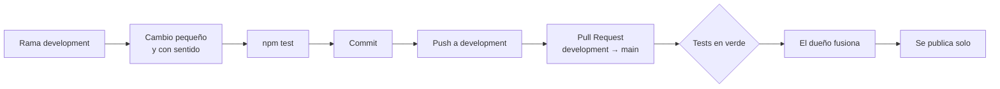

# Cómo hacer cambios en marquesina

Normas para cualquier persona (o asistente de IA) que vaya a cambiar el proyecto. Si es tu primera vez, lee antes la [guía paso a paso](docs/GUIA.md).

## Flujo de trabajo



1. **Nunca se trabaja en `main`.** Todo va a `development` y llega a `main` con una Pull Request que fusiona el dueño del repo.
2. **Un cambio, un propósito.** Mejor varias PR pequeñas que una enorme.
3. **Antes de cada commit:** `npm test` en verde (Node 22, sin instalar nada).
4. **Autoría:** los commits van firmados como `Sergio Santiago Bendaña Quesada <serbenda@gmail.com>`, sin coautores.

## Mensajes de commit

En español, en presente y diciendo **qué cambia para quien usa la web**:

| ✅ Bien | ❌ Mal |
|---|---|
| `Carga rápida: la posición de los buses no retrasa los tiempos` | `fix` |
| `Busca también en la API de EMT: aparecen las paradas de El Pardo` | `cambios varios` |

## Lista de comprobación antes de abrir una PR

- [ ] `npm test` pasa.
- [ ] Si cambia `logic.js`: hay un test nuevo o actualizado en `tests/logic.test.js`.
- [ ] Si cambia `worker.js`: hay un test en `tests/worker.test.js` y la ruta funciona (`/push/key`, `/crtm/stop/06756`, `/emt/arrives/69`).
- [ ] Si cambia `logic.js`, `push.js` o los iconos: se ha subido `VERSION` en `sw.js`.
- [ ] Si cambia una ruta, un límite, un secreto o un paso de configuración: la documentación está al día ([REFERENCIA](docs/REFERENCIA.md), [GUIA](docs/GUIA.md), [MANTENIMIENTO](docs/MANTENIMIENTO.md)).
- [ ] Hay una línea nueva en [CHANGELOG.md](CHANGELOG.md).
- [ ] No hay contraseñas, claves ni tokens en ningún archivo.
- [ ] Probado en el móvil (o con el modo móvil del navegador).

## Estilo del código

- **Sin dependencias ni compilación.** La web es HTML + JavaScript que se publica tal cual. Si algo se puede hacer con lo que trae el navegador, no se añade una librería.
- **La lógica pura va en `logic.js`:** nada de pantalla, red ni hora del sistema dentro. Así se puede probar.
- **Comentarios en español** que expliquen el *porqué*, no el *qué*. Cada función exportada lleva un bloque `/** … */` con qué recibe, qué devuelve y un ejemplo.
- **Todo texto que venga de fuera** y se pinte con `innerHTML` pasa por `esc()`.
- **Nunca confiar en lo que manda el navegador:** el worker valida y recorta todo (`cleanAlerts`).
- **Los fallos no deben dejar la pantalla vacía:** mejor datos de hace un rato, marcados como antiguos, que un error.
- Formato: 2 espacios, UTF-8 y final de línea LF (ver [`.editorconfig`](.editorconfig)).

## Tests

```bash
npm test                                    # todos
node --test tests/logic.test.js             # solo la lógica
node --test --test-name-pattern="leave"     # los que contengan "leave"
```

Los tests usan **respuestas reales** guardadas en `tests/fixtures/`. Si EMT o el Consorcio cambian el formato de sus respuestas, guarda una nueva con el mismo nombre y ajusta lo que falle.

## Documentación

| Si cambias… | Actualiza… |
|---|---|
| Algo que ve la persona usuaria | `README.md` |
| Cómo funciona algo por dentro | `docs/REFERENCIA.md` |
| Un paso de configuración o una cuenta | `docs/GUIA.md` y `docs/MANTENIMIENTO.md` |
| Una decisión de diseño | `docs/ARQUITECTURA.md` |
| El dominio o el DNS | `docs/DOMINIO.md` |
| El repetidor | `docs/RESPALDO.md` |
| Algo que afecte a la operación (límites, vigilancia, recuperación) | `docs/OPERACIONES.md` |
| Algo que afecte a la seguridad (rutas, validaciones, secretos, dependencias) | `docs/SEGURIDAD.md` |
| Un hito o una decisión importante | `docs/HISTORIA.md` |

Los diagramas son [Mermaid](https://mermaid.js.org) y GitHub los dibuja solos. Para comprobar uno antes de subirlo, pégalo en <https://mermaid.live>.
