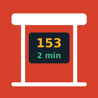
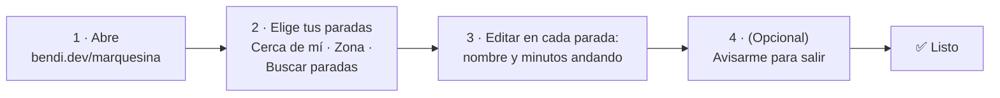
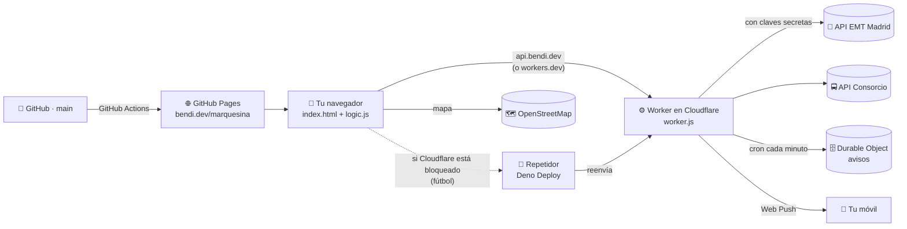
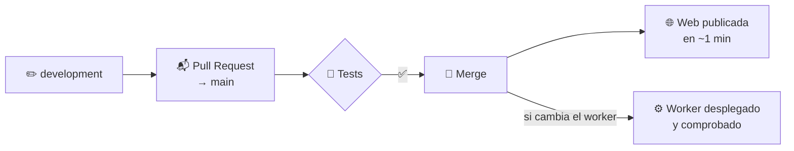

<div align="center">



# marquesina

**Tus autobuses, Metro y trenes de Madrid en el mapa, en tiempo real.<br/>Y un aviso en el móvil cuando toca salir de casa.**

### 👉 [bendi.dev/marquesina](https://bendi.dev/marquesina/)

[](https://github.com/serbenda/marquesina/actions/workflows/tests.yml)
[](https://github.com/serbenda/marquesina/actions/workflows/pages.yml)
[](https://github.com/serbenda/marquesina/actions/workflows/worker.yml)
[](https://github.com/serbenda/marquesina/actions/workflows/healthcheck.yml)

Gratis · Sin registro · Sin anuncios · Sin cookies · Se instala como una app

</div>

---

## Índice

- [En 30 segundos](#en-30-segundos)
- [Qué puedes hacer](#qué-puedes-hacer)
- [Cómo se usa](#cómo-se-usa)
- [Cómo funciona](#cómo-funciona)
- [Qué hay en este repositorio](#qué-hay-en-este-repositorio)
- [Para quien vaya a cambiar el código](#para-quien-vaya-a-cambiar-el-código)
- [Documentación](#documentación)
- [Preguntas frecuentes](#preguntas-frecuentes)
- [Limitaciones conocidas](#limitaciones-conocidas)
- [Datos y créditos](#datos-y-créditos)

---

## En 30 segundos

marquesina es **la pantalla luminosa de una parada de autobús, pero en tu móvil y para las paradas que tú elijas**. Te dice cuánto le falta a tu autobús, dónde está ahora mismo y si te da tiempo a llegar andando. Si se lo pides, te manda una notificación cuando tienes que salir de casa.

Funciona en **Madrid y toda la Comunidad**:

| Red | Ejemplos |
|---|---|
| 🚌 **EMT Madrid** | Todas las líneas, también El Pardo |
| 🚍 **Interurbanos** | 151, 153, 158, 827, 72x… |
| 🏘️ **Urbanos de otros municipios** | Alcobendas, Sanse, Colmenar Viejo, Tres Cantos, Getafe… |
| 🚇 **Metro** | Próximos trenes de cada estación |

---

## Qué puedes hacer

- 🔔 **Recibir un aviso para salir.** En cada parada eliges días y horas (por ejemplo, de lunes a viernes de 8:00 a 8:45) y te llega una notificación, *"¡Sal ya! 153 · Cole"*, aunque la app esté cerrada.
- ⏱️ **Saber cuándo salir.** Dices cuántos minutos tardas andando a cada parada y marquesina te dice *"Sal en 4 min"*, *"¡Sal ya!"* o *"No llegas"*, y a qué bus te da tiempo. Arriba del todo aparece siempre lo más urgente.
- 📋 **Ver tus paradas en vivo.** Una fila por línea con el próximo bus y los siguientes (*"luego 14′ · 26′"*). Se actualiza sola cada 15 s (o 10 s, 30 s, 1 min), con los buses deslizándose por el mapa. Se pausa cuando no estás mirando y se pone al día al volver.
- 🏷️ **Ponerles nombre.** "Casa", "Cole", "Trabajo"… y marcar tus favoritas para que salgan siempre arriba.
- 🗺️ **Seguir los buses en el mapa** con su posición GPS real, en un recuadro del color de su línea y con un rastro de por dónde vienen. Si varios coinciden, se abren en abanico. Al tocar una llegada, el mapa se centra en ese bus.
- 🚇 **Ver el Metro** con los colores oficiales de cada línea.
- 📡 **Saber si el dato es fiable.** En el Consorcio, cada tiempo indica si es *En directo (GPS)* o *Según horario*.
- 🔎 **Encontrar paradas sin saber el código:**
  - **Cerca de mí**: usa tu ubicación. La primera vez carga las 3 paradas más cercanas; después te enseña las de alrededor.
  - **Zona**: eliges un municipio y el mapa va allí.
  - **Buscar paradas**: muestra todas las paradas de la zona que ves en el mapa (autobús, Metro y Cercanías) mientras lo mueves.
- 📶 **No quedarte en blanco si falla la conexión.** Se mantienen los últimos datos, hasta 15 minutos, indicando de cuándo son.
- 📲 **Instalarla como una app**, con icono, pantalla completa y tema claro u oscuro.

---

## Cómo se usa



1. Abre **[bendi.dev/marquesina](https://bendi.dev/marquesina/)**. La primera vez te pregunta dónde coges el transporte (tu ubicación o un municipio) y cuánto tardas andando.
2. Añade más paradas con **Cerca de mí**, **Zona** o **Buscar paradas**.
3. Pulsa **Editar** junto a cada parada para ponerle nombre, los minutos andando, marcarla como favorita y activar el **aviso para salir**.
4. En **Ajustes** cambias cada cuánto se actualiza o escribes códigos a mano:

| Red | Código | Ejemplo |
|---|---|---|
| EMT Madrid | El número que aparece en la marquesina | `69`, `72` |
| Consorcio (interurbanos, Alcobendas, Sanse…) | 5 cifras | `06756` |
| Metro | `4_` + número de estación | `4_278` |

### Instalarla en el móvil

| Dispositivo | Cómo |
|---|---|
| **Android (Chrome)** | Botón **Instalar** de marquesina, o menú ⋮ → *Instalar aplicación* |
| **iPhone (Safari)** | **Compartir** → *Añadir a pantalla de inicio*. Los avisos solo funcionan con la app instalada (iOS 16.4 o posterior) |
| **Ordenador (Chrome, Edge)** | Botón **Instalar** o el icono de instalar de la barra de direcciones |

### Qué datos hay en cada red

| | EMT Madrid | Consorcio (autobuses) | Metro |
|---|---|---|---|
| Tiempos de llegada | ✅ | ✅ | ✅ |
| Posición GPS en el mapa | ✅ | ✅ | ❌ |
| Distancia hasta la parada | ✅ | ❌ | ❌ |
| Indica si es GPS u horario | Siempre GPS | ✅ | — |
| Avisos para salir | ✅ | ✅ | ✅ |

Metro Ligero no devuelve tiempos en la API del Consorcio. Cercanías aparece en las búsquedas, pero sus estaciones devuelven sobre todo los trenes de Metro que paran en ellas.

---

## Cómo funciona



| Pieza | Qué hace | Archivo |
|---|---|---|
| **Web** | Pantalla, mapa y lista. HTML y JavaScript sin compilación | `index.html` |
| **Lógica** | Leer las APIs, agrupar, calcular cuándo salir. La comparten la web y el worker | `logic.js` |
| **App instalable** | Abre al instante y recibe notificaciones | `sw.js`, `manifest.webmanifest` |
| **Worker** | Intermediario con EMT y el Consorcio, cachés, avisos y cron | `worker.js`, `wrangler.toml` |
| **Avisos** | Firma y cifra cada notificación, sin librerías | `push.js` |
| **Repetidor** | Camino de respaldo fuera de Cloudflare para los bloqueos de LaLiga | `relay/` |

**Tres caminos al mismo worker:** `api.bendi.dev`, `marquesina.serbenda.workers.dev` y un repetidor fuera de Cloudflare (Deno Deploy). Durante los partidos de LaLiga varias operadoras bloquean IP de Cloudflare; la web prueba los tres a la vez y se queda con el que conteste ([docs/RESPALDO.md](docs/RESPALDO.md)).

¿Por qué un intermediario? El Consorcio **no permite** que otras webs le pidan datos desde el navegador, y EMT pide **usuario y contraseña**, que no pueden estar en la web. El worker resuelve las dos cosas y, de paso, junta peticiones y guarda respuestas unos segundos para ir más rápido.

**Privacidad:** tus paradas se guardan solo en tu navegador. En Cloudflare se guardan únicamente los avisos que actives (parada, horario y la dirección de entrega de notificaciones), sin nombre, correo ni ubicación. Detalle en [SECURITY.md](SECURITY.md).

👉 Explicación completa, con más de 30 diagramas, en [docs/REFERENCIA.md](docs/REFERENCIA.md).

---

## Qué hay en este repositorio

```
marquesina/
├── index.html               🌐 La web: estilos, pantalla y comportamiento
├── logic.js                 🧮 Cálculos puros (web + worker + tests)
├── push.js                  🔐 Notificaciones: firma VAPID y cifrado
├── sw.js                    📲 Service worker: app instalable y avisos
├── manifest.webmanifest     📲 Nombre, iconos y colores de la app
├── worker.js                ⚙️ Worker de Cloudflare: proxy, cachés, avisos y cron
├── wrangler.toml            ⚙️ Configuración del worker (dominio, Durable Object, cron)
├── relay/                   🛟 Repetidor de respaldo en Deno Deploy (bloqueos de LaLiga)
├── assets/                  🖼️ Iconos
├── tests/                   🧪 Tests con respuestas reales (fixtures/)
├── docs/                    📚 Documentación (ver abajo)
├── .github/
│   ├── workflows/           🤖 Tests, publicación, despliegue y chequeo horario
│   ├── ISSUE_TEMPLATE/      📝 Plantillas para avisar de fallos o proponer ideas
│   ├── pull_request_template.md
│   └── dependabot.yml       🔄 Avisa de versiones nuevas de las acciones
├── README.md                📄 Este archivo
├── CONTRIBUTING.md          🤝 Cómo hacer cambios
├── AGENTS.md                🤖 Lo imprescindible para asistentes de IA
├── SECURITY.md              🔒 Datos, secretos y cómo avisar de un fallo
├── CHANGELOG.md             🗓️ Historial de cambios
├── package.json             Solo para `npm test` (sin dependencias)
├── .editorconfig            Formato común para cualquier editor
└── .nojekyll                Publica los archivos tal cual en GitHub Pages
```

---

## Para quien vaya a cambiar el código

**No hace falta instalar nada** salvo Node 22 para los tests.

```bash
git clone https://github.com/serbenda/marquesina.git
cd marquesina
git switch development     # nunca se trabaja en main
npm test                   # 30 tests, ~10 s
npm run check              # sintaxis de los cuatro archivos JavaScript
```

### Cómo llega un cambio a la web



### Los robots (GitHub Actions)

| Robot | Cuándo | Qué hace |
|---|---|---|
| **Tests** | Cada PR y cada push | Sintaxis y `npm test` |
| **Publicar en GitHub Pages** | Al fusionar en `main` | Publica la web |
| **Desplegar worker en Cloudflare** | Al fusionar cambios del worker en `main` | Lo publica y comprueba que responde |
| **Chequeo de marquesina** | Cada hora | Comprueba web, Consorcio, EMT, avisos y las tres direcciones; si falla, llega un email |

Antes de abrir una PR, lee [CONTRIBUTING.md](CONTRIBUTING.md). Lo más importante:

- Trabajar en `development` y llevar los cambios a `main` con una PR.
- Commits firmados como `Sergio Santiago Bendaña Quesada <serbenda@gmail.com>`.
- Ningún secreto en el código.
- Si cambias `logic.js`, `push.js` o los iconos, sube `VERSION` en `sw.js`.
- La documentación se actualiza en la misma PR.

**Ver la web en local:** `python3 -m http.server 8000` y abrir <http://localhost:8000>. La pantalla y el mapa funcionan, pero el worker solo responde a `bendi.dev`, así que desde `localhost` las paradas darán error de conexión. Para la lógica, usa los tests.

---

## Documentación

| Documento | Para quién | Qué tiene |
|---|---|---|
| **[docs/GUIA.md](docs/GUIA.md)** | **Empieza aquí** si no sabes nada | Qué es cada pieza con un símil, diccionario, diagramas, montaje desde cero en 9 fases, día a día y árbol de problemas |
| [docs/REFERENCIA.md](docs/REFERENCIA.md) | Quien toca el código | Cómo funciona cada parte por dentro, con más de 30 diagramas, límites y mensajes de error |
| [docs/ARQUITECTURA.md](docs/ARQUITECTURA.md) | Quien quiere entender las decisiones | Piezas, fuentes de datos, por qué así, seguridad |
| [docs/MANTENIMIENTO.md](docs/MANTENIMIENTO.md) | Quien mantiene el servicio | Mobility Labs, Cloudflare, GitHub, comprobaciones y errores |
| [docs/DOMINIO.md](docs/DOMINIO.md) | Quien toca el DNS | `api.bendi.dev`: por qué, pasos, estado y vuelta atrás |
| [docs/HISTORIA.md](docs/HISTORIA.md) | Todos | Cómo se construyó paso a paso: fechas, decisiones y lecciones |
| [docs/OPERACIONES.md](docs/OPERACIONES.md) | SRE / DevOps | Vigilancia, incidentes, recuperación, límites y postmortems |
| [docs/SEGURIDAD.md](docs/SEGURIDAD.md) | Seguridad | Amenazas, controles, secretos y riesgos |
| [docs/RESPALDO.md](docs/RESPALDO.md) | Quien mantiene el servicio | Repetidor fuera de Cloudflare para los bloqueos de LaLiga |
| [CONTRIBUTING.md](CONTRIBUTING.md) · [AGENTS.md](AGENTS.md) | Quien va a hacer cambios (personas o IA) | Normas, lista de comprobación y cosas que confunden |
| [SECURITY.md](SECURITY.md) · [CHANGELOG.md](CHANGELOG.md) | Todos | Datos y secretos · historial |

Además, **cada archivo de código empieza con una explicación** de qué hace, quién lo usa y sus secciones, y cada función tiene su descripción con un ejemplo.

---

## Preguntas frecuentes

<details>
<summary><b>¿Cuesta algo?</b></summary>

No. Usa los planes gratuitos de GitHub y Cloudflare. Lo único que se paga es la renovación anual del dominio `bendi.dev`.
</details>

<details>
<summary><b>Pone "No se pudo conectar…" en mi casa pero con datos móviles funciona</b></summary>

Lo más habitual es el **bloqueo de LaLiga**: durante los partidos, Movistar, MasOrange, Vodafone y DIGI cortan IP de Cloudflare. marquesina prueba sola tres caminos, uno de ellos fuera de Cloudflare ([docs/RESPALDO.md](docs/RESPALDO.md)). Otra causa posible es un filtro de tu red (Pi-hole, AdGuard, router…) que bloquee `*.workers.dev` ([docs/DOMINIO.md](docs/DOMINIO.md)).
</details>

<details>
<summary><b>No me llegan los avisos</b></summary>

1. Comprueba que has puesto los **minutos andando** de la parada: sin ellos no se puede calcular cuándo salir.
2. Permite las notificaciones en el navegador.
3. En iPhone, instala la app (**Compartir → Añadir a pantalla de inicio**) y activa el aviso desde ella.
4. Pulsa **Enviar aviso de prueba** en *Editar* parada.

Más casos en [docs/MANTENIMIENTO.md §7](docs/MANTENIMIENTO.md).
</details>

<details>
<summary><b>¿Por qué un bus sale como "+20"?</b></summary>

EMT no da el tiempo exacto cuando el bus está a más de 20 minutos.
</details>

<details>
<summary><b>He cambiado algo y la web sigue igual</b></summary>

Recarga forzando (**Ctrl + Shift + R** o **Cmd + Shift + R**). Si cambiaste `logic.js`, `push.js` o los iconos, comprueba que subiste `VERSION` en `sw.js`.
</details>

<details>
<summary><b>¿Se puede usar el worker para otro proyecto?</b></summary>

Solo responde a `bendi.dev` y `serbenda.github.io`. Para otro proyecto lo mejor es otro worker con su propio subdominio (por ejemplo `luz.bendi.dev`); ver [docs/DOMINIO.md §7](docs/DOMINIO.md).
</details>

---

## Limitaciones conocidas

- La API del Consorcio no es pública ni está documentada oficialmente: puede cambiar sin aviso.
- Los avisos se revisan cada minuto: pueden llegar hasta un minuto tarde.
- En el Consorcio, tiempos y posiciones vienen por separado: al tocar una llegada, el mapa se centra en el bus de esa línea más cercano a la parada, que suele ser el que llega, pero no siempre.
- *En directo / Según horario* se deduce del formato de los datos; no es una indicación oficial.
- **Cerca de mí** necesita permiso de ubicación.
- Los minutos andando los indicas tú: marquesina no calcula rutas.

---

## Datos y créditos

- Autobuses: [EMT Madrid · Mobility Labs](https://mobilitylabs.emtmadrid.es/) y [Consorcio Regional de Transportes de Madrid](https://www.crtm.es/).
- Mapa: © colaboradores de [OpenStreetMap](https://www.openstreetmap.org/copyright), con [Leaflet](https://leafletjs.com/).

<div align="center">

Proyecto personal de **[Sergio Santiago Bendaña Quesada](https://github.com/serbenda)** · [bendi.dev](https://bendi.dev)

</div>
