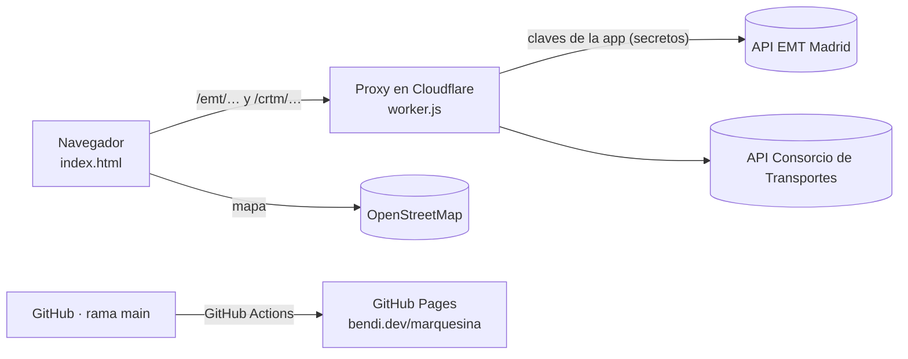

# marquesina

**Tus autobuses de Madrid en el mapa, en tiempo real.**

marquesina muestra los autobuses que van a llegar a tus paradas: dónde están, cuánto les falta y si te da tiempo a salir. Es como la pantalla luminosa de una marquesina, pero en el móvil y para las paradas que tú elijas, aunque no tengan pantalla.

👉 **https://bendi.dev/marquesina/**

Funciona con los autobuses urbanos de **EMT Madrid** y con los del **Consorcio de Transportes**: interurbanos (151, 153, 158, 827…) y urbanos de otros municipios como **Alcobendas** y **San Sebastián de los Reyes**. No hace falta registrarse ni instalar nada.

---

## Qué puedes hacer

- **Saber cuándo salir de casa.** Indica cuántos minutos tardas andando a cada parada y marquesina te dice *"Sal en 4 min"*, *"¡Sal ya!"* o *"No llegas"*, y a qué bus te da tiempo. Arriba del todo aparece siempre lo más urgente.
- **Ver tus paradas en vivo.** Una fila por línea con el próximo bus y los siguientes (*"luego 14′ · 26′"*). Se actualiza sola cada 30 s, 1 min o 2 min, y al volver a abrir la app.
- **Ponerles nombre.** "Casa", "Cole", "Trabajo"… y marcar tus favoritas para que salgan siempre arriba.
- **Seguir los buses en el mapa.** Los de EMT y los del Consorcio (interurbanos, Alcobendas, Sanse…) aparecen con su posición GPS real en un recuadro del color de su línea y dejan un rastro para ver por dónde vienen. Si tocas una llegada en la lista, el mapa se centra en ese bus.
- **Saber si el dato es fiable.** En el Consorcio, cada tiempo indica si es *En directo (GPS)* o *Según horario*.
- **Encontrar paradas sin saber el código:**
  - **Cerca de mí**: usa tu ubicación y carga las 3 paradas más cercanas.
  - **Buscar paradas**: tocas el mapa y te muestra las paradas de alrededor con sus líneas, para añadirlas.
- **Guardar tus paradas.** Se quedan en tu navegador y la próxima vez la web se abre con ellas.
- **Instalarla como una app.** Icono en la pantalla de inicio, pantalla completa y arranque instantáneo.
- **Usarla de día o de noche.** Tiene tema claro y oscuro según tu dispositivo, y está pensada primero para el móvil.

## Cómo se usa

1. Abre **https://bendi.dev/marquesina/**. Arranca en vivo con dos paradas de ejemplo en Alcobendas.
2. Pulsa **Cerca de mí**, o **Buscar paradas** y toca el mapa donde está tu parada.
3. Pulsa **Editar** junto a cada parada para ponerle nombre, los minutos que tardas andando y marcarla como favorita.
4. Listo. Para cambiar el intervalo de actualización o escribir códigos a mano, entra en **Ajustes**.

En **Ajustes** también puedes escribir los códigos a mano:

| Red | Código | Ejemplo |
|---|---|---|
| EMT Madrid | El número que aparece en la marquesina | `69`, `72` |
| Consorcio (interurbanos, Alcobendas, Sanse…) | 5 cifras | `06756` |

### Instalarla en el móvil

- **Android (Chrome):** pulsa **Instalar** en la barra de marquesina, o menú ⋮ → *Instalar aplicación*.
- **iPhone (Safari):** botón **Compartir** → *Añadir a pantalla de inicio*.
- **Ordenador (Chrome, Edge):** botón **Instalar** o el icono de instalar de la barra de direcciones.

### Qué datos hay en cada zona

| | EMT Madrid | Consorcio |
|---|---|---|
| Tiempos de llegada | ✅ | ✅ |
| Posición GPS del bus en el mapa | ✅ | ✅ |
| Distancia hasta la parada en la lista | ✅ | ❌ |
| Indica si el dato es GPS u horario | Siempre GPS | ✅ |

## Cómo funciona



- **Web estática** (`index.html`): un solo archivo con HTML, CSS y JavaScript, sin compilación. El mapa usa [Leaflet](https://leafletjs.com/) y [OpenStreetMap](https://www.openstreetmap.org/).
- **App instalable (PWA):** `manifest.webmanifest` y `sw.js`. El service worker guarda la página y las librerías para que abra al instante; los datos de autobuses siempre se piden en vivo.
- **Proxy** (`worker.js`) en Cloudflare Workers, plan gratuito. Hace falta por dos motivos:
  - La API del Consorcio no permite llamadas desde otras webs (CORS).
  - Los datos de EMT requieren iniciar sesión. El proxy lo hace con las claves de la aplicación marquesina, guardadas como secretos, para que nadie tenga que registrarse.
- **Sin servidor ni base de datos propios.** Las paradas de cada persona se guardan en su navegador (`localStorage`). No hay analítica ni cookies.

Más detalle en [docs/ARQUITECTURA.md](docs/ARQUITECTURA.md).

## Estructura del repositorio

```
marquesina/
├── index.html                  Web completa (HTML + CSS + JS)
├── manifest.webmanifest        Datos de la app instalable (nombre, iconos, colores)
├── sw.js                       Service worker: arranque rápido y uso como app
├── worker.js                   Proxy para Cloudflare Workers
├── wrangler.toml               Configuración para desplegar el worker con wrangler
├── assets/
│   ├── icono.png               Icono original (registrado en Mobility Labs)
│   ├── icono-192.png, icono-512.png, icono-maskable-512.png
│   └── apple-touch-icon.png    Iconos de la app
├── docs/
│   ├── ARQUITECTURA.md         Diseño, fuentes de datos y funcionamiento interno
│   └── MANTENIMIENTO.md        Puesta en marcha y mantenimiento paso a paso
├── .github/workflows/
│   ├── pages.yml               Publica la web en GitHub Pages (push a main)
│   ├── worker.yml              Despliega el worker en Cloudflare (cambios en worker.js)
│   └── healthcheck.yml         Comprueba cada hora que todo responde y avisa si falla
└── .nojekyll                   Sirve los archivos tal cual, sin Jekyll
```

## Desarrollo

### Probar en local
No hay dependencias ni compilación. Sirve la carpeta con cualquier servidor estático, por ejemplo:

```bash
python3 -m http.server 8000
# abre http://localhost:8000
```

Para que las llamadas al proxy funcionen desde `localhost`, añade ese origen temporalmente a `ALLOWED_ORIGINS` en el worker, o prueba directamente en la web publicada.

### Flujo de trabajo
1. Trabajar siempre en la rama **`development`**. Nunca hacer commits directos a `main`.
2. Abrir una **pull request** `development → main`.
3. Al fusionarla, GitHub Actions publica la web automáticamente en 30–60 s.
4. Si el cambio toca `worker.js`, el workflow **Desplegar worker en Cloudflare** lo publica solo y comprueba que responde.
5. Cada hora, **Chequeo de marquesina** comprueba la web, el Consorcio y EMT. Si algo falla, GitHub te avisa por email.
6. Si cambias `sw.js` o los archivos que guarda, sube `VERSION` en `sw.js` para que los móviles renueven la caché.

Los pasos detallados (Cloudflare, secretos, Mobility Labs, comprobaciones) están en [docs/MANTENIMIENTO.md](docs/MANTENIMIENTO.md).

## Documentación

| Documento | Para qué |
|---|---|
| [docs/ARQUITECTURA.md](docs/ARQUITECTURA.md) | Cómo está montado: piezas, APIs, datos guardados, proxy, seguridad |
| [docs/MANTENIMIENTO.md](docs/MANTENIMIENTO.md) | Cómo ponerlo en marcha y mantenerlo: Mobility Labs, Cloudflare, GitHub Pages, comprobaciones y errores |

## Limitaciones conocidas

- La API del Consorcio no es pública ni está documentada oficialmente: puede cambiar sin aviso.
- En el Consorcio, los tiempos de llegada y las posiciones vienen por separado: al tocar una llegada, el mapa se centra en el bus de esa línea más cercano a la parada, que suele ser el que llega pero no siempre.
- La etiqueta *En directo / Según horario* se deduce del formato de los datos. No es una indicación oficial.
- **Cerca de mí** necesita permiso de ubicación del navegador.
- Los minutos andando los indicas tú: marquesina no calcula rutas.

## Datos y créditos

- Datos de autobuses: [EMT Madrid · Mobility Labs](https://mobilitylabs.emtmadrid.es/) y [Consorcio Regional de Transportes de Madrid](https://www.crtm.es/).
- Mapa: © colaboradores de [OpenStreetMap](https://www.openstreetmap.org/copyright).
- Mapa interactivo: [Leaflet](https://leafletjs.com/).

Proyecto personal de [Sergio Santiago Bendaña Quesada](https://github.com/serbenda) · [bendi.dev](https://bendi.dev)
