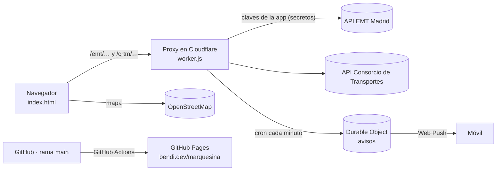

# marquesina

**Tus autobuses, Metro y trenes de Madrid en el mapa, en tiempo real.**

marquesina muestra el transporte que va a llegar a tus paradas: dónde está, cuánto le falta y si te da tiempo a salir. Y te avisa en el móvil cuando toca salir de casa. Es como la pantalla luminosa de una marquesina, pero en el móvil y para las paradas que tú elijas, aunque no tengan pantalla.

👉 **https://bendi.dev/marquesina/**

Funciona en **Madrid y toda la Comunidad**: autobuses de **EMT Madrid**, interurbanos (151, 153, 158, 827, 72x…), urbanos de otros municipios (Alcobendas, Sanse, Colmenar Viejo…) y **Metro**. No hace falta registrarse ni instalar nada.

---

## Qué puedes hacer

- **Recibir un aviso para salir.** En cada parada eliges días y franja horaria (por ejemplo, de lunes a viernes de 8:00 a 8:45) y te llega una notificación al móvil, *"¡Sal ya! 153 · Cole"*, aunque la app esté cerrada.
- **Saber cuándo salir de casa.** Indica cuántos minutos tardas andando a cada parada y marquesina te dice *"Sal en 4 min"*, *"¡Sal ya!"* o *"No llegas"*, y a qué bus te da tiempo. Arriba del todo aparece siempre lo más urgente.
- **Ver tus paradas en vivo.** Una fila por línea con el próximo bus y los siguientes (*"luego 14′ · 26′"*). Se actualiza sola cada 15 s (o 10 s, 30 s, 1 min), con los buses deslizándose por el mapa hasta su nueva posición. Se pausa cuando la app no está a la vista y se pone al día nada más volver.
- **Ponerles nombre.** "Casa", "Cole", "Trabajo"… y marcar tus favoritas para que salgan siempre arriba.
- **Seguir los buses en el mapa.** Los de EMT y los del Consorcio (interurbanos, Alcobendas, Sanse…) aparecen con su posición GPS real en un recuadro del color de su línea y dejan un rastro para ver por dónde vienen. Si varios coinciden, se abren en abanico para que se lean todos. Si tocas una llegada en la lista, el mapa se centra en ese bus.
- **Ver el Metro.** Próximos trenes de cada estación, con los colores oficiales de cada línea.
- **Saber si el dato es fiable.** En el Consorcio, cada tiempo indica si es *En directo (GPS)* o *Según horario*.
- **Encontrar paradas sin saber el código:**
  - **Cerca de mí**: usa tu ubicación. La primera vez carga las 3 paradas más cercanas; después te enseña las de alrededor para añadirlas.
  - **Zona**: eliges un municipio (Alcobendas, Colmenar Viejo, Tres Cantos, Getafe…) y el mapa va allí.
  - **Buscar paradas**: muestra todas las paradas de la zona que ves en el mapa (autobús, Metro y Cercanías) mientras lo mueves. Tocas una y la añades.
- **No perder la información si falla la conexión.** Se mantienen los últimos datos, hasta 15 minutos, y se indica su antigüedad (*"Sin conexión · datos hace 3 min"*).
- **Guardar tus paradas.** Se quedan en tu navegador y la próxima vez la web se abre con ellas.
- **Instalarla como una app.** Icono en la pantalla de inicio, pantalla completa y arranque instantáneo.
- **Usarla de día o de noche.** Tiene tema claro y oscuro según tu dispositivo, y está pensada primero para el móvil.

## Cómo se usa

1. Abre **https://bendi.dev/marquesina/**. La primera vez te pregunta dónde coges el transporte (tu ubicación o un municipio) y cuánto tardas andando.
2. Añade más paradas con **Cerca de mí**, **Zona** o **Buscar paradas**.
3. Pulsa **Editar** junto a cada parada para ponerle nombre, los minutos andando, marcarla como favorita y activar el **aviso para salir**.
4. Listo. Para cambiar el intervalo de actualización o escribir códigos a mano, entra en **Ajustes**.

En **Ajustes** también puedes escribir los códigos a mano:

| Red | Código | Ejemplo |
|---|---|---|
| EMT Madrid | El número que aparece en la marquesina | `69`, `72` |
| Consorcio (interurbanos, Alcobendas, Sanse…) | 5 cifras | `06756` |
| Metro | `4_` + número de estación | `4_278` (La Granja) |

### Instalarla en el móvil

- **Android (Chrome):** pulsa **Instalar** en la barra de marquesina, o menú ⋮ → *Instalar aplicación*.
- **iPhone (Safari):** botón **Compartir** → *Añadir a pantalla de inicio*. En iPhone los avisos solo funcionan con la app instalada (iOS 16.4 o posterior).
- **Ordenador (Chrome, Edge):** botón **Instalar** o el icono de instalar de la barra de direcciones.

### Qué datos hay en cada zona

| | EMT Madrid | Consorcio (autobuses) | Metro |
|---|---|---|---|
| Tiempos de llegada | ✅ | ✅ | ✅ |
| Posición GPS en el mapa | ✅ | ✅ | ❌ |
| Distancia hasta la parada en la lista | ✅ | ❌ | ❌ |
| Indica si el dato es GPS u horario | Siempre GPS | ✅ | — |
| Avisos para salir | ✅ | ✅ | ✅ |

Metro Ligero no devuelve tiempos en la API del Consorcio; Cercanías aparece en las búsquedas, pero sus estaciones devuelven sobre todo los trenes de Metro que paran en ellas.

## Cómo funciona



- **Web estática** (`index.html` + `logic.js`): HTML, CSS y JavaScript sin compilación. `logic.js` tiene la lógica pura (lectura de las APIs, agrupación, cuándo salir) y la comparten la web, el worker y los tests. El mapa usa [Leaflet](https://leafletjs.com/) y [OpenStreetMap](https://www.openstreetmap.org/).
- **App instalable (PWA):** `manifest.webmanifest` y `sw.js`. El service worker guarda la página y las librerías para que abra al instante; los datos de autobuses siempre se piden en vivo.
- **Proxy** (`worker.js`) en Cloudflare Workers, plan gratuito. Hace falta por dos motivos:
  - La API del Consorcio no permite llamadas desde otras webs (CORS).
  - Los datos de EMT requieren iniciar sesión. El proxy lo hace con las claves de la aplicación marquesina, guardadas como secretos, para que nadie tenga que registrarse.
- **Avisos** (`push.js` + Durable Object `PushHub`): el navegador se suscribe con Web Push; el worker guarda la suscripción y tus avisos, y cada minuto comprueba los activos. Cuando toca salir, envía la notificación cifrada al servicio de push del móvil (Google, Apple, Mozilla).
- **Sin servidor propio.** Las paradas de cada persona se guardan en su navegador (`localStorage`). Solo los avisos (paradas, horario y la dirección de push del navegador, sin datos personales) se guardan en Cloudflare para poder enviarlos. No hay analítica ni cookies.

Más detalle en [docs/ARQUITECTURA.md](docs/ARQUITECTURA.md).

## Estructura del repositorio

```
marquesina/
├── index.html                  Web (HTML + CSS + interfaz)
├── logic.js                    Lógica pura compartida: APIs, agrupación, cuándo salir, avisos
├── push.js                     Web Push sin dependencias: claves VAPID y cifrado de avisos
├── manifest.webmanifest        Datos de la app instalable (nombre, iconos, colores)
├── sw.js                       Service worker: arranque rápido, uso como app y avisos
├── worker.js                   Proxy y avisos en Cloudflare Workers (Durable Object + cron)
├── wrangler.toml               Configuración para desplegar el worker con wrangler
├── assets/
│   ├── icono.png               Icono original (registrado en Mobility Labs)
│   ├── icono-192.png, icono-512.png, icono-maskable-512.png
│   └── apple-touch-icon.png    Iconos de la app
├── tests/
│   ├── logic.test.js           Tests de la lógica con respuestas reales de las APIs
│   ├── worker.test.js          Tests del worker y de los avisos (sin Cloudflare)
│   └── fixtures/               Respuestas reales de EMT y del Consorcio
├── package.json                Solo para "npm test" (sin dependencias)
├── docs/
│   ├── ARQUITECTURA.md         Diseño, fuentes de datos y funcionamiento interno
│   └── MANTENIMIENTO.md        Puesta en marcha y mantenimiento paso a paso
├── .github/workflows/
│   ├── pages.yml               Publica la web en GitHub Pages (push a main)
│   ├── tests.yml               Ejecuta los tests en cada PR y push
│   ├── worker.yml              Despliega el worker en Cloudflare (cambios en worker.js, logic.js, push.js)
│   └── healthcheck.yml         Comprueba cada hora que todo responde y avisa si falla
└── .nojekyll                   Sirve los archivos tal cual, sin Jekyll
```

## Desarrollo

### Probar en local
No hay dependencias ni compilación. Sirve la carpeta con cualquier servidor estático, por ejemplo:

```bash
python3 -m http.server 8000
# abre http://localhost:8000
```

Para que las llamadas al proxy funcionen desde `localhost`, añade ese origen temporalmente a `ALLOWED_ORIGINS` en el worker, o prueba directamente en la web publicada.

### Tests
Solo hace falta Node 22, sin instalar nada:

```bash
npm test
```

Prueban la lectura de las APIs con respuestas reales guardadas (`tests/fixtures`), la agrupación, el cálculo de cuándo salir, los horarios de los avisos y el ciclo completo de una notificación en el worker: suscripción, cifrado, envío, no repetir y borrar suscripciones caducadas. Se ejecutan solos en cada PR.

### Flujo de trabajo
1. Trabajar siempre en la rama **`development`**. Nunca hacer commits directos a `main`.
2. Abrir una **pull request** `development → main`.
3. Al fusionarla, GitHub Actions publica la web automáticamente en 30–60 s.
4. Si el cambio toca el worker (`worker.js`, `logic.js`, `push.js` o `wrangler.toml`), el workflow **Desplegar worker en Cloudflare** lo publica solo y comprueba que responde.
5. Cada hora, **Chequeo de marquesina** comprueba la web, el Consorcio y EMT. Si algo falla, GitHub te avisa por email.
6. Si cambias `sw.js` o los archivos que guarda, sube `VERSION` en `sw.js` para que los móviles renueven la caché.

Los pasos detallados (Cloudflare, secretos, Mobility Labs, comprobaciones) están en [docs/MANTENIMIENTO.md](docs/MANTENIMIENTO.md).

## Documentación

| Documento | Para qué |
|---|---|
| [docs/ARQUITECTURA.md](docs/ARQUITECTURA.md) | Cómo está montado: piezas, APIs, datos guardados, proxy, seguridad |
| [docs/MANTENIMIENTO.md](docs/MANTENIMIENTO.md) | Cómo ponerlo en marcha y mantenerlo: Mobility Labs, Cloudflare, GitHub Pages, comprobaciones y errores |

## Limitaciones conocidas

- La API del Consorcio no es pública ni está documentada oficialmente: puede cambiar sin aviso.
- Los avisos se revisan cada minuto: pueden llegar hasta un minuto más tarde del momento exacto.
- En el Consorcio, los tiempos de llegada y las posiciones vienen por separado: al tocar una llegada, el mapa se centra en el bus de esa línea más cercano a la parada, que suele ser el que llega pero no siempre.
- La etiqueta *En directo / Según horario* se deduce del formato de los datos. No es una indicación oficial.
- **Cerca de mí** necesita permiso de ubicación del navegador.
- Los minutos andando los indicas tú: marquesina no calcula rutas.

## Datos y créditos

- Datos de autobuses: [EMT Madrid · Mobility Labs](https://mobilitylabs.emtmadrid.es/) y [Consorcio Regional de Transportes de Madrid](https://www.crtm.es/).
- Mapa: © colaboradores de [OpenStreetMap](https://www.openstreetmap.org/copyright).
- Mapa interactivo: [Leaflet](https://leafletjs.com/).

Proyecto personal de [Sergio Santiago Bendaña Quesada](https://github.com/serbenda) · [bendi.dev](https://bendi.dev)
