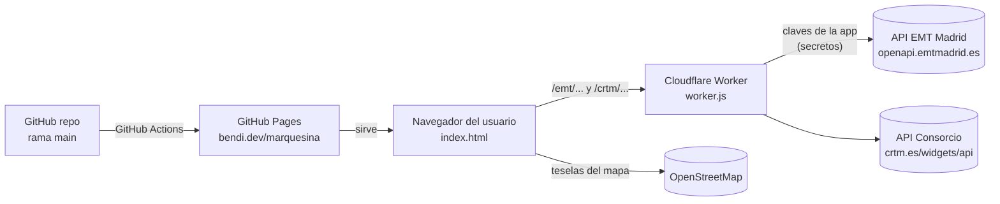

# marquesina: arquitectura y mantenimiento

Este documento explica cómo está montada marquesina, de dónde salen los datos y qué hay que hacer para mantenerla. Es la referencia para cualquier cambio. El [README](../README.md) cubre solo el uso, y los pasos concretos en Mobility Labs, Cloudflare y GitHub están en [MANTENIMIENTO.md](MANTENIMIENTO.md).

## 1. Qué es

Una web estática que muestra en un mapa los autobuses que van a llegar a las paradas que elige el usuario, con los minutos que faltan, y se actualiza sola cada 15 s por defecto (10 s, 30 s o 1 min a elegir).

- **Web:** https://bendi.dev/marquesina/ (GitHub Pages, repo `serbenda/marquesina`).
- **Proxy:** https://marquesina.serbenda.workers.dev (Cloudflare Workers, cuenta de serbenda).
- **No hay servidor propio ni base de datos.** Los ajustes de cada usuario se guardan en su navegador.

## 2. Piezas

| Pieza | Archivo | Dónde se ejecuta | Cómo se publica |
|---|---|---|---|
| Web | `index.html` | Navegador del usuario | Automático: push a `main` → workflow `pages.yml` |
| App instalable | `manifest.webmanifest`, `sw.js`, `assets/` | Navegador del usuario | Igual que la web |
| Lógica compartida | `logic.js` | Navegador, worker y tests | Con la web y con el worker |
| Proxy y avisos | `worker.js`, `push.js`, `wrangler.toml` | Cloudflare Workers + Durable Object `PushHub` + cron cada minuto | Automático: cambios en `main` → workflow `worker.yml` |
| Tests | `tests/`, `package.json` | GitHub Actions en cada PR | Workflow `tests.yml` |
| Vigilancia | `.github/workflows/healthcheck.yml` | GitHub Actions, cada hora | Forma parte del repo |
| Despliegue | `.github/workflows/pages.yml` | GitHub Actions | Forma parte del repo |
| Sin Jekyll | `.nojekyll` | GitHub Pages | Hace que GitHub sirva los archivos tal cual |

`index.html` es un único archivo con HTML, CSS y JS. Lo único externo que carga es Leaflet 1.9.4 (desde cdnjs) y las fuentes de Google Fonts (Barlow Condensed y Figtree).

## 3. Fuentes de datos

### 3.1 EMT Madrid (Mobility Labs)

- **Qué cubre:** autobuses urbanos de la ciudad de Madrid.
- **Qué da:** tiempo de llegada, distancia **y posición GPS** de cada bus. Es lo que permite pintar buses moviéndose en el mapa.
- **Acceso:** la aplicación `marquesina` está registrada en [Mobility Labs](https://mobilitylabs.emtmadrid.es/) con la cuenta de serbenda. Sus claves (**X-ClientId** y **passKey**) están guardadas como secretos del worker (`EMT_CLIENT_ID`, `EMT_PASSKEY`). Como respaldo, el worker también puede entrar con la cuenta de Mobility Labs (`EMT_EMAIL`, `EMT_PASSWORD`): EMT responde código 84 a las claves de una aplicación que aún no ha habilitado. El worker inicia sesión y consulta EMT, así que **los usuarios no necesitan registrarse**.
- **Llamadas:**
  - `GET /v2/mobilitylabs/user/login/`, con cabeceras `X-ClientId` y `passKey` (o `email` y `password` como respaldo). Lo hace solo el worker; la web nunca habla directamente con EMT. Devuelve `accessToken` y `tokenSecExpiration`. El token se reutiliza hasta poco antes de que caduque; si EMT lo rechaza, el worker lo renueva y reintenta una vez.
  - `POST /v2/transport/busemtmad/stops/{parada}/arrives/`, con cabecera `accessToken`. Devuelve la parada (`StopInfo`) y las llegadas (`Arrive[]`: `line`, `destination`, `estimateArrive` en segundos, `DistanceBus` en metros, `geometry.coordinates` como [lon, lat]).

### 3.2 Consorcio Regional de Transportes de Madrid (CRTM)

- **Qué cubre:** interurbanos (151, 153, 158, 827…) y urbanos de otros municipios (Alcobendas, San Sebastián de los Reyes…). Sus paradas tienen código `8_XXXXX`; en la web se escriben solo las 5 cifras.
- **Qué da:** tiempo de llegada por parada y **posición GPS de los autobuses** de cada línea (`GetLineLocation`). En el mapa los buses aparecen como en EMT y la parada lleva además una etiqueta con las 3 próximas llegadas.
- **Acceso:** sin registro, pero **no admite CORS**: el navegador no puede llamarla desde otra web. Por eso pasa por el worker.
- **Llamadas** (siempre vía `https://marquesina.serbenda.workers.dev/crtm/...`):
  - `GetStops.php?codStop=8_06756`: nombre y coordenadas de la parada. Se guarda en caché en memoria mientras la página está abierta.
  - `GetStopsTimes.php?codStop=8_06756&type=1&orderBy=2&stopTimesByIti=3`: próximas llegadas (`stopTimes.times.Time[]`, con `line.shortDescription`, `destination`, `time` en ISO y `codIssue`).
  - `GetNearestStopsByLocation.php?latitude=..&longitude=..&mode=&method=1&precision=350`: paradas cercanas a un punto. Lo usan los botones **Buscar paradas** (punto tocado en el mapa) y **Cerca de mí** (ubicación del navegador; se quedan las 3 más cercanas).
- **Posición de los autobuses** (lo hace el worker en `/crtm/stop/<parada>`, ver §5):
  1. Con las líneas y sentidos que salen en `GetStopsTimes` (solo autobuses: modos 8 y 9), se pide una vez por línea `GetLinesInformation.php?activeItinerary=1&codLine=<línea>`, que da los itinerarios con su sentido y sus paradas. Se guarda en memoria del worker y 1 día en la caché de Cloudflare.
  2. Se elige el itinerario que contiene la parada y tiene ese sentido.
  3. `GetLineLocation.php?mode=<codMode>&codItinerary=<itinerario>&codLine=<línea>&codStop=<parada>&direction=<sentido>` devuelve `vehiclesLocation.VehicleLocation[]` con `codVehicle` (matrícula), `coordinates` y `service`. `mode` es `8` para interurbanos y `9` para urbanos de otros municipios.
  - Las llegadas no indican qué vehículo es, así que la lista y los buses del mapa no se enlazan uno a uno. Al tocar una fila, se centra el bus de esa línea más cercano a la parada.
  - Si falla la posición de una línea, se ignora y siguen valiendo los tiempos.
- **Búsqueda de paradas:** `GetNearestStopsByLocation` también devuelve paradas de EMT con prefijo `6_` (el número que sigue es el código de parada de EMT). La web usa esta llamada para encontrar paradas de las dos redes: `6_` va a la lista de EMT y `8_` a la del Consorcio.
- **Peculiaridades:**
  - Cuando solo hay un elemento, la API devuelve un objeto en vez de una lista. Por eso existe `asArray()`.
  - El tiempo restante se calcula como `time − actualDate`, ambos dados por la API, para no depender del reloj del usuario.
  - **En directo / Según horario:** si `codIssue` empieza por el código de la línea (p. ej. `8__153____3_09:05:00...`), el tiempo es de horario. Si no (p. ej. `VCM20033413`), viene del GPS. **Es una deducción propia, no está documentada por el Consorcio.**
  - Devuelve llegadas de horas vista. La web se queda con las 2 primeras de cada línea en los próximos 90 minutos.
  - Es una API no oficial: la usan los widgets de crtm.es y no tiene contrato ni documentación pública. Puede cambiar sin aviso (ver §7).

### 3.3 Mapa

Teselas de OpenStreetMap (`tile.openstreetmap.org`) con atribución. Para un uso intensivo, la política de OSM pide usar otro proveedor de teselas.

## 4. Cómo funciona la web por dentro (`index.html`)

1. **Arranque:** lee los ajustes de `localStorage` (clave `marquesina`) y los combina con los valores por defecto (`DEF`). Si no hay proxy guardado, usa `PROXY`.
2. **Modo:**
   - *En vivo*, si hay paradas de EMT o del Consorcio. Sin ajustes guardados se usan las paradas de ejemplo `06756, 06758` (Alcobendas, constante `DEF.crtm`), así la web arranca en vivo para cualquiera.
   - *Demo*, solo si el usuario la elige (Ajustes → Usar demo, campo `demo: true`): buses simulados que se acercan a Cibeles.
3. **Ciclo:** `setInterval(tick, 1000)`.
   - Cada segundo se actualizan la cuenta atrás del anillo y los minutos de la lista (restando el tiempo transcurrido desde la última consulta, sin volver a llamar a la API).
   - Cuando llega a cero, `refresh()` consulta todas las paradas en paralelo (`Promise.all`). Si una falla, se muestra su error y las demás siguen funcionando.
4. **Mapa:** cada bus de EMT es un marcador con el número de línea y un rastro (`polyline`) que crece en cada consulta. Los buses que dejan de aparecer se borran. Las paradas del Consorcio llevan una etiqueta permanente con las 3 próximas llegadas.
5. **Colores de línea:** salen de un hash del número de línea sobre una paleta fija (`colorFor`), así cada línea tiene siempre el mismo color.
6. **Tema:** claro u oscuro según el sistema, con variables CSS en `:root`.

### Lista de llegadas y aviso de salida

- **Agrupación:** `groupByLine()` junta las llegadas de cada parada por línea y destino. Cada fila muestra el primer bus y los dos siguientes ("luego 14′ · 26′").
- **Cuándo salir:** `leaveInfo()` busca el primer bus al que da tiempo llegar andando (`eta ≥ walk − 30 s`) y calcula `salir en = eta − walk`. El chip de cada fila muestra *Sal en X min*, *¡Sal ya!* (≤ 1 min) o *No llegas*, y añade *al de N′* si el primer bus ya no da tiempo.
- **Tarjeta principal:** `heroHtml()` elige, entre las paradas con minutos andando, la salida más próxima (las favoritas primero) y la muestra arriba en grande. Se pone roja cuando toca salir ya.
- **Orden:** favoritas primero; el resto, en el orden en que se añadieron.
- **Editar parada:** el botón *Editar* abre un diálogo con nombre, minutos andando, favorita y *Quitar parada*.
- **Volver a la app:** al recuperar el foco (`visibilitychange`), si los datos tienen más de 15 s se refrescan al momento.

### Buscar paradas, zonas y bienvenida
- **Fuentes de la búsqueda:** se combinan dos, en paralelo: `GetNearestStopsByLocation` del Consorcio (autobuses del Consorcio, Metro, Cercanías y parte de EMT) y la API de EMT (`/emt/near`, todas las paradas de EMT). **El Consorcio no tiene todas las paradas de EMT**: en El Pardo devuelve 0 paradas en 1,5 km. `mergeStops()` quita los duplicados. Si una fuente falla, vale la otra.
- **Buscar paradas:** con el mapa a zoom 15 o más, carga las paradas de la zona visible (`GetNearestStopsByLocation` desde el centro, con radio hasta la esquina, máx. 1,5 km) cada vez que se mueve el mapa. Se pintan con el renderizador *canvas* de Leaflet (aguanta cientos de puntos) y con color por red: EMT, Interurbano, Urbano, Metro y Cercanías. `parseNearest()` (`logic.js`) separa EMT (`6_`) del resto.
- **Zona:** lista fija de municipios y barrios con su centro (`ZONES` en `index.html`). La API de municipios del Consorcio (`GetMunicipalities.php`) devuelve error 500, por eso la lista es propia. Al elegir uno, el mapa va allí y activa *Buscar paradas*.
- **Cerca de mí:** sin paradas propias, carga las 3 más cercanas. Con paradas propias, centra el mapa en tu ubicación y enseña las de alrededor sin borrar las tuyas.
- **Bienvenida:** solo la primera vez (sin `localStorage["marquesina"]` ni `marquesina-intro`). Pregunta dónde coges el transporte (ubicación, municipio o ejemplo) y, con tu ubicación, el nombre y los minutos andando de la parada más cercana, que queda como favorita.

### Mapa
- **Movimiento suave:** los recuadros de los buses (`className: bus-marker`) tienen una transición CSS de 1,2 s, así se deslizan hasta la nueva posición en vez de saltar. Durante el zoom se desactiva (`.leaflet-zoom-anim`) para que no se queden atrás. Respeta `prefers-reduced-motion`.
- **Pausa en segundo plano:** con la pestaña oculta o la app minimizada (`document.hidden`) no se consulta nada; al volver se actualiza si los datos tienen más de 5 s.
- **Encuadre:** al cargar, se ajusta a tus paradas y a los buses a menos de 2,5 km de ellas, no a los que están lejos.
- **Recuadros que no se pisan:** `spreadMarkers()` desplaza en abanico los recuadros que caen casi en el mismo punto de la pantalla. Se recalcula al hacer zoom.
- **Metro:** colores oficiales de cada línea (`METRO` en `index.html`). En el resto, color estable por número de línea.

### Datos antiguos
- Si una parada falla al actualizar, se conservan sus últimos datos durante 15 minutos con `stale: true`. Cada parada lleva su propia hora de consulta (`at`), y los minutos se descuentan desde ella.
- Debajo del nombre aparece *Sin conexión · datos hace N min*. Si fallan todas, la etiqueta superior pasa de *En vivo* a *Sin conexión*.
- Solo hay una consulta en marcha a la vez. Las peticiones que llegan mientras tanto (por ejemplo, al añadir una parada) se hacen justo después, no se pierden.

### App instalable (PWA)

- `manifest.webmanifest`: nombre, colores, `display: standalone` e iconos (192, 512 y uno *maskable* para Android).
- `sw.js` (service worker):
  - **La página:** primero red; si no hay conexión, la última guardada.
  - **Librerías, fuentes e iconos:** primero caché.
  - **Datos del worker (`*.workers.dev`) y teselas de OpenStreetMap:** nunca se guardan, siempre en vivo.
  - `VERSION` identifica la caché. Al cambiarla, el service worker nuevo borra la anterior.
- **Instalar:** en Android y escritorio aparece el botón *Instalar* (evento `beforeinstallprompt`). En iPhone se muestra una vez el aviso de *Compartir → Añadir a pantalla de inicio*.

### Ajustes guardados (`localStorage["marquesina"]`)

| Campo | Significado |
|---|---|
| `stops` | Paradas EMT, separadas por comas |
| `crtm` | Paradas del Consorcio (5 cifras) |
| `proxy` | URL del worker. Vacío en el formulario = usar `PROXY` |
| `every` | Segundos entre consultas (10, 15, 30 o 60; por defecto 15) |
| `alerts` | Avisos por parada (clave `emt:<id>` o `crtm:<id>`): `on`, `days` (1–7), `from`, `to`, `line`, `lead` (minutos de antelación) |
| `meta` | Datos propios de cada parada, con clave `emt:<id>` o `crtm:<id>`: `alias` (nombre), `walk` (minutos andando), `fav` (favorita) |
| `demo` | `true` si el usuario eligió el modo demo |

## 5. El proxy (`worker.js`)

- `/crtm/stop/<parada>` → **todo lo de una parada del Consorcio en una sola respuesta**: `stop` (nombre y posición, de `GetStops`, caché 1 día), `stopTimes` (de `GetStopsTimes`) y `vehicles` (posición de los buses de cada línea con `GetLinesInformation` + `GetLineLocation`). La web hace así 1 petición por parada en vez de hasta 8; las consultas al Consorcio desde el worker son subpeticiones y no cuentan en el límite diario.
- `/crtm/<Archivo>.php?...` → `https://www.crtm.es/widgets/api/<Archivo>.php?...`. Solo deja pasar nombres que encajan con `Get*.php`, así no se puede usar como proxy abierto. Lo usa la búsqueda de paradas (`GetNearestStopsByLocation`). Cloudflare cachea 10 s.
- `/emt/near/<lat>/<lon>/<radio>` → paradas de EMT alrededor de un punto (`GET /v2/transport/busemtmad/stops/arroundxy/<lon>/<lat>/<radio>/`, radio 50–1.500 m). Caché de 1 día por punto redondeado a ~100 m, porque las paradas casi no cambian.
- `/emt/arrives/<parada>` → inicia sesión en EMT con los secretos de la aplicación (o los de la cuenta si fallan) y devuelve las llegadas de la parada (mismo JSON que EMT). Guarda la respuesta 10 s en la caché de Cloudflare (`caches.default`), así varios usuarios mirando la misma parada generan una sola consulta.
- **CORS:** responde con `Access-Control-Allow-Origin` solo para los orígenes de `ALLOWED_ORIGINS` (`https://bendi.dev`, `https://serbenda.github.io`).
- **Secretos:** `EMT_CLIENT_ID` y `EMT_PASSKEY` (y de respaldo `EMT_EMAIL` y `EMT_PASSWORD`) se configuran en Cloudflare → Worker `marquesina` → Settings → Variables and Secrets (tipo *Secret*). No están en el repo. Para cambiarlos (por ejemplo, si se regeneran en Mobility Labs), se editan ahí y se pulsa Deploy.
- **No guarda ni registra las credenciales de los usuarios.**
- `/push/key`, `/push/subscribe`, `/push/unsubscribe`, `/push/test` → avisos programados (ver §5.1).
- **Caché de 10 s:** EMT y el Consorcio refrescan las posiciones cada 15–30 s, así que consultar más a menudo no da datos nuevos; con 10 s, varias personas mirando la misma parada generan una sola consulta a la fuente.
- **Límites del plan gratuito de Cloudflare:** 100.000 peticiones al día. Cada persona con la web abierta y a la vista hace 1 petición por parada cada 15 s (240 por parada y hora). Con la app en segundo plano no hace ninguna. El cron de los avisos suma 1.440 al día.

### 5.1 Avisos programados (Web Push)

**Flujo**
1. En *Editar* parada, el usuario activa *Avisarme para salir*: días (L–D), franja (desde–hasta), línea (o cualquiera) y antelación (al salir, 3, 5 o 10 min antes). Requiere los minutos andando.
2. La web pide permiso de notificaciones, obtiene la clave pública (`GET /push/key`) y se suscribe con `pushManager.subscribe()`.
3. Envía la suscripción y **todos** sus avisos a `POST /push/subscribe`. Cada cambio vuelve a enviar la lista completa; si no queda ninguno, `POST /push/unsubscribe`.
4. Un **cron cada minuto** (`[triggers] crons` en `wrangler.toml`) llama a `PushHub.check()`:
   - Selecciona los avisos activos ahora (`alertActive()`, hora de Madrid, con horario de verano).
   - Consulta cada parada una sola vez (EMT con la caché compartida de 10 s; Consorcio con `cacheTtl` de 10 s).
   - Calcula la salida con `bestLeave()` (la misma función que la web) y avisa si `salir en ≤ antelación`.
   - **No repite:** recuerda cada envío por suscripción, aviso, línea y hora prevista del bus (redondeada a 2 min) durante 2 horas.
   - Si el servicio de push responde 404 o 410, la suscripción ha caducado y se borra.
5. El service worker (`sw.js`) recibe el mensaje (evento `push`) y muestra la notificación. Al tocarla, abre o trae al frente la app.

**Almacenamiento:** Durable Object `PushHub`, una sola instancia (`idFromName("hub")`), con almacenamiento SQLite (disponible en el plan gratuito). Claves:
- `vapid`: par de claves VAPID. Se genera la primera vez y no cambia. **Si se borrara, todas las suscripciones dejarían de funcionar** y cada usuario tendría que reactivar sus avisos.
- `sub:<hash del endpoint>`: suscripción (`endpoint`, `keys`) y avisos.
- `sent`: avisos ya enviados (para no repetir).

**Criptografía** (`push.js`, sin dependencias, solo WebCrypto):
- Firma VAPID (RFC 8292): JWT ES256 con `aud` = origen del servicio de push, `exp` = 12 h, `sub` = `https://bendi.dev/marquesina`.
- Cifrado del mensaje (RFC 8291, `aes128gcm`): ECDH P-256 con la clave del navegador, HKDF-SHA-256 y AES-128-GCM.
- Solo se envía a servicios de push conocidos (Google, Mozilla, Apple, Windows): `isPushEndpoint()`. Así el worker no puede usarse para llamar a cualquier URL.

**Límites:** 10 avisos por suscripción y 1.000 suscripciones en total. Los avisos que llegan incompletos (sin días, sin minutos andando…) se descartan.

**Compatibilidad:** Chrome, Edge y Firefox (Android y escritorio). En iPhone solo con la app instalada en la pantalla de inicio (iOS 16.4+).

## 6. Despliegue

### Web
1. Trabajar en la rama `development`. **Nunca hacer commits directos a `main`.**
2. Abrir una PR `development → main`. La fusiona serbenda.
3. Al fusionar, el workflow **Publicar en GitHub Pages** sube el repo entero a Pages. Tarda unos 30–60 s y se puede seguir en la pestaña *Actions*. También se puede lanzar a mano con *Run workflow*.
4. GitHub Pages cachea unos 10 minutos. Para ver el cambio al momento, recarga forzando (Ctrl/Cmd + Shift + R) o abre la URL con `?v=N`.

Configuración necesaria en el repo: **Settings → Pages → Source: GitHub Actions**. El dominio `bendi.dev` viene del repo `serbenda.github.io`: `bendi.dev/marquesina` funciona porque este repo es un "project site".

### Proxy
- **Automático:** el workflow `worker.yml` despliega `worker.js` con `wrangler` (configuración en `wrangler.toml`) cada vez que cambia en `main`. Antes valida la sintaxis y después comprueba que el Consorcio y EMT responden. Usa el secreto del repo `CLOUDFLARE_API_TOKEN`.
- Los secretos de EMT siguen en Cloudflare: wrangler no los toca al desplegar, y `keep_vars = true` conserva además las variables creadas desde el panel.
- **Manual:** el worker ya no es un solo archivo (importa `logic.js` y `push.js`), así que no se puede pegar en el editor de Cloudflare. Si el despliegue automático falla, se relanza desde *Actions → Desplegar worker en Cloudflare → Run workflow* (ver MANTENIMIENTO §2.3).

### Vigilancia
- El workflow `healthcheck.yml` se ejecuta cada hora (minuto 17) y comprueba la web publicada, el Consorcio y EMT a través del worker. Si algo falla, el workflow sale en rojo y GitHub envía un email.
- GitHub desactiva los workflows programados tras 60 días sin actividad en el repo. Si pasa, hay que reactivarlo desde *Actions*.

### Tests
- `npm test` (Node 22, sin dependencias) ejecuta `tests/logic.test.js` y `tests/worker.test.js`.
- `tests/fixtures/` guarda respuestas reales de EMT (parada 69) y del Consorcio (parada 06756 y posición de un 153). Si una API cambia de formato, se actualiza el fixture y se ajusta `logic.js`.
- `worker.test.js` carga `worker.js` sustituyendo `cloudflare:workers` por una clase simulada, con almacenamiento en memoria y `fetch` falso. Comprueba el ciclo completo de un aviso, incluido descifrar la notificación como lo haría el navegador.
- El cifrado se verificó además con una implementación independiente (Python, `cryptography`).

## 7. Mantenimiento: problemas típicos

| Síntoma | Causa probable | Qué hacer |
|---|---|---|
| La web sigue mostrando la versión vieja | Caché de Pages o del navegador | Recarga forzada o `?v=N`; revisar que el workflow terminó en verde |
| El workflow no arranca | Pages no está en "GitHub Actions" o Actions desactivadas | Settings → Pages / Settings → Actions → General |
| "No se pudo conectar con el Consorcio…" | Worker caído, URL mal o origen no permitido | Abrir la URL de prueba del §6; si la web está en un dominio nuevo, añadirlo a `ALLOWED_ORIGINS` y volver a desplegar |
| Paradas del Consorcio sin datos o datos raros | El Consorcio cambió su API | Abrir `GetStopsTimes.php` en el navegador, ver el JSON nuevo y ajustar `crtmArrivals()` |
| Paradas de EMT con "EMT rechazó el inicio de sesión" o "Faltan los secretos…" | Secretos del worker sin poner, mal copiados o claves revocadas | Revisar `EMT_CLIENT_ID` y `EMT_PASSKEY` en Cloudflare y la aplicación en Mobility Labs |
| Worker devuelve 429 o deja de responder | Límite diario del plan gratuito | Ver métricas en Cloudflare; subir `cacheTtl` o el intervalo por defecto |
| Todos los tiempos salen "Según horario" | El Consorcio cambió el formato de `codIssue` | Revisar la regla `live` en `parseCrtmTimes()` (`logic.js`) |
| No llegan los avisos | Permiso de notificaciones denegado, app no instalada en iPhone, cron parado o suscripción caducada | Ver MANTENIMIENTO §7 |

### Revisiones periódicas
- **Cada pocos meses:** comprobar que las tres APIs siguen respondiendo igual (ver las URLs de prueba).
- **Leaflet:** está fijado a 1.9.4. Para actualizarlo, cambiar la versión en las dos etiquetas (`<link>` del CSS y `<script>`) y probar el mapa.
- **Acciones de los workflows:** `checkout@v4`, `configure-pages@v5`, `upload-pages-artifact@v3`, `deploy-pages@v4` y `cloudflare/wrangler-action@v3`. GitHub avisa en *Actions* cuando alguna queda obsoleta.

## 8. Seguridad y privacidad

- Las claves de la aplicación de EMT viven solo como secretos del worker. **Nunca deben aparecer en `index.html` ni en el repo.**
- Todas las consultas de EMT se hacen con la aplicación `marquesina`; los usuarios no ponen ninguna cuenta. Si hubiera abuso, se pueden regenerar las claves en Mobility Labs y actualizar los secretos.
- El worker solo reenvía las consultas de paradas y tiempos del Consorcio y responde a los orígenes permitidos.
- La web no tiene analítica ni cookies propias.

## 9. Ideas pendientes

- Paradas compartibles por enlace.
- Cercanías y Metro en tiempo real; incidencias de EMT; BiciMAD.
- Límite de consultas por usuario en el worker.
