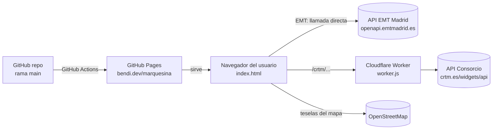

# marquesina: arquitectura y mantenimiento

Este documento explica cómo está montada marquesina, de dónde salen los datos y qué hay que hacer para mantenerla. Es la referencia para cualquier cambio. El [README](../README.md) cubre solo el uso.

## 1. Qué es

Una web estática que muestra en un mapa los autobuses que van a llegar a las paradas que elige el usuario, con los minutos que faltan, y se actualiza sola cada 30 s, 1 min o 2 min.

- **Web:** https://bendi.dev/marquesina/ (GitHub Pages, repo `serbenda/marquesina`).
- **Proxy:** https://marquesina.serbenda.workers.dev (Cloudflare Workers, cuenta de serbenda).
- **No hay servidor propio ni base de datos.** Los ajustes de cada usuario se guardan en su navegador.

## 2. Piezas

| Pieza | Archivo | Dónde se ejecuta | Cómo se publica |
|---|---|---|---|
| Web | `index.html` | Navegador del usuario | Automático: push a `main` → workflow `pages.yml` |
| Proxy | `worker.js` | Cloudflare Workers | **Manual:** se copia el código en el panel de Cloudflare |
| Despliegue | `.github/workflows/pages.yml` | GitHub Actions | Forma parte del repo |
| Sin Jekyll | `.nojekyll` | GitHub Pages | Hace que GitHub sirva los archivos tal cual |

`index.html` es un único archivo con HTML, CSS y JS. Lo único externo que carga es Leaflet 1.9.4 (desde cdnjs) y las fuentes de Google Fonts (Barlow Condensed y Figtree).

## 3. Fuentes de datos

### 3.1 EMT Madrid (Mobility Labs)

- **Qué cubre:** autobuses urbanos de la ciudad de Madrid.
- **Qué da:** tiempo de llegada, distancia **y posición GPS** de cada bus. Es lo que permite pintar buses moviéndose en el mapa.
- **Acceso:** cuenta gratuita en [Mobility Labs](https://mobilitylabs.emtmadrid.es/). Cada usuario pone su email y contraseña en Ajustes, y se guardan en su `localStorage`.
- **Llamadas** (directas desde el navegador; EMT admite CORS):
  - `GET /v2/mobilitylabs/user/login/`, con cabeceras `email` y `password`. Devuelve `accessToken` y `tokenSecExpiration`. El token se reutiliza hasta un minuto antes de que caduque.
  - `POST /v2/transport/busemtmad/stops/{parada}/arrives/`, con cabecera `accessToken`. Devuelve la parada (`StopInfo`) y las llegadas (`Arrive[]`: `line`, `destination`, `estimateArrive` en segundos, `DistanceBus` en metros, `geometry.coordinates` como [lon, lat]).

### 3.2 Consorcio Regional de Transportes de Madrid (CRTM)

- **Qué cubre:** interurbanos (151, 153, 158, 827…) y urbanos de otros municipios (Alcobendas, San Sebastián de los Reyes…). Sus paradas tienen código `8_XXXXX`; en la web se escriben solo las 5 cifras.
- **Qué da:** tiempo de llegada por parada. **No da la posición de los autobuses**, así que en el mapa las llegadas se muestran como etiqueta junto a la parada.
- **Acceso:** sin registro, pero **no admite CORS**: el navegador no puede llamarla desde otra web. Por eso pasa por el worker.
- **Llamadas** (siempre vía `https://marquesina.serbenda.workers.dev/crtm/...`):
  - `GetStops.php?codStop=8_06756`: nombre y coordenadas de la parada. Se guarda en caché en memoria mientras la página está abierta.
  - `GetStopsTimes.php?codStop=8_06756&type=1&orderBy=2&stopTimesByIti=3`: próximas llegadas (`stopTimes.times.Time[]`, con `line.shortDescription`, `destination`, `time` en ISO y `codIssue`).
  - `GetNearestStopsByLocation.php?latitude=..&longitude=..&mode=&method=1&precision=350`: paradas cercanas a un punto. Lo usa el botón **Buscar paradas**.
- **Peculiaridades:**
  - Cuando solo hay un elemento, la API devuelve un objeto en vez de una lista. Por eso existe `asArray()`.
  - El tiempo restante se calcula como `time − actualDate`, ambos dados por la API, para no depender del reloj del usuario.
  - **En directo / Según horario:** si `codIssue` empieza por el código de la línea (p. ej. `8__153____3_09:05:00...`), el tiempo es de horario. Si no (p. ej. `VCM20033413`), viene del GPS. **Es una deducción propia, no está documentada por el Consorcio.**
  - Devuelve llegadas de horas vista. La web se queda con las 2 primeras de cada línea en los próximos 90 minutos.
  - Es una API no oficial: la usan los widgets de crtm.es y no tiene contrato ni documentación pública. Puede cambiar sin aviso (ver §7).

### 3.3 Mapa

Teselas de OpenStreetMap (`tile.openstreetmap.org`) con atribución. Para un uso intensivo, la política de OSM pide usar otro proveedor de teselas.

## 4. Cómo funciona la web por dentro (`index.html`)

1. **Arranque:** lee los ajustes de `localStorage` (clave `marquesina`) y los combina con los valores por defecto (`DEF`). Si no hay proxy guardado, usa `PROXY`.
2. **Modo:**
   - *En vivo*, si hay credenciales de EMT o paradas del Consorcio.
   - *Demo*, si no hay nada: buses simulados que se acercan a Cibeles, para enseñar cómo funciona.
3. **Ciclo:** `setInterval(tick, 1000)`.
   - Cada segundo se actualizan la cuenta atrás del anillo y los minutos de la lista (restando el tiempo transcurrido desde la última consulta, sin volver a llamar a la API).
   - Cuando llega a cero, `refresh()` consulta todas las paradas en paralelo (`Promise.all`). Si una falla, se muestra su error y las demás siguen funcionando.
4. **Mapa:** cada bus de EMT es un marcador con el número de línea y un rastro (`polyline`) que crece en cada consulta. Los buses que dejan de aparecer se borran. Las paradas del Consorcio llevan una etiqueta permanente con las 3 próximas llegadas.
5. **Colores de línea:** salen de un hash del número de línea sobre una paleta fija (`colorFor`), así cada línea tiene siempre el mismo color.
6. **Tema:** claro u oscuro según el sistema, con variables CSS en `:root`.

### Ajustes guardados (`localStorage["marquesina"]`)

| Campo | Significado |
|---|---|
| `stops` | Paradas EMT, separadas por comas |
| `email`, `pass` | Credenciales de Mobility Labs (solo en ese navegador) |
| `crtm` | Paradas del Consorcio (5 cifras) |
| `proxy` | URL del worker. Vacío en el formulario = usar `PROXY` |
| `base` | URL de la API de EMT |
| `every` | Segundos entre consultas (30, 60 o 120) |

## 5. El proxy (`worker.js`)

- `/crtm/<Archivo>.php?...` → `https://www.crtm.es/widgets/api/<Archivo>.php?...`. Solo deja pasar nombres que encajan con `Get*.php`, así no se puede usar como proxy abierto. Cloudflare cachea 20 s, de modo que varios usuarios mirando la misma parada generan una sola llamada al Consorcio.
- `/v2/...` → API de EMT. Hoy no hace falta porque EMT admite CORS, pero se deja por si eso cambia.
- **CORS:** responde con `Access-Control-Allow-Origin` solo para los orígenes de `ALLOWED_ORIGINS` (`https://bendi.dev`, `https://serbenda.github.io`).
- **No guarda ni registra credenciales.**
- **Límites del plan gratuito de Cloudflare:** 100.000 peticiones al día. Cada usuario con la web abierta hace unas 2 peticiones por parada y minuto (tiempos más, la primera vez, datos de la parada).

## 6. Despliegue

### Web
1. Trabajar en la rama `development`. **Nunca hacer commits directos a `main`.**
2. Abrir una PR `development → main`. La fusiona serbenda.
3. Al fusionar, el workflow **Publicar en GitHub Pages** sube el repo entero a Pages. Tarda unos 30–60 s y se puede seguir en la pestaña *Actions*. También se puede lanzar a mano con *Run workflow*.
4. GitHub Pages cachea unos 10 minutos. Para ver el cambio al momento, recarga forzando (Ctrl/Cmd + Shift + R) o abre la URL con `?v=N`.

Configuración necesaria en el repo: **Settings → Pages → Source: GitHub Actions**. El dominio `bendi.dev` viene del repo `serbenda.github.io`: `bendi.dev/marquesina` funciona porque este repo es un "project site".

### Proxy
Los cambios en `worker.js` **no se despliegan solos**:
1. Cloudflare → Compute (Workers) → `marquesina` → **Edit code**.
2. Pegar el contenido de `worker.js` (copiarlo desde la vista *raw* de GitHub) → **Deploy**.
3. Comprobar en `https://marquesina.serbenda.workers.dev/crtm/GetStops.php?codStop=8_06756`: debe devolver JSON con "MARQUÉS VALDAVIA".

Mejora posible: desplegarlo desde GitHub Actions con `wrangler` y un token de Cloudflare guardado como secreto del repo.

## 7. Mantenimiento: problemas típicos

| Síntoma | Causa probable | Qué hacer |
|---|---|---|
| La web sigue mostrando la versión vieja | Caché de Pages o del navegador | Recarga forzada o `?v=N`; revisar que el workflow terminó en verde |
| El workflow no arranca | Pages no está en "GitHub Actions" o Actions desactivadas | Settings → Pages / Settings → Actions → General |
| "No se pudo conectar con el Consorcio…" | Worker caído, URL mal o origen no permitido | Abrir la URL de prueba del §6; si la web está en un dominio nuevo, añadirlo a `ALLOWED_ORIGINS` y volver a desplegar |
| Paradas del Consorcio sin datos o datos raros | El Consorcio cambió su API | Abrir `GetStopsTimes.php` en el navegador, ver el JSON nuevo y ajustar `crtmArrivals()` |
| "No se pudo iniciar sesión en Mobility Labs" | Credenciales mal o cuenta sin activar | Revisar en mobilitylabs.emtmadrid.es |
| Error de conexión con EMT | EMT ha quitado CORS | Poner en Ajustes → URL de la API de EMT la URL del worker (ya tiene la ruta `/v2/`) |
| Worker devuelve 429 o deja de responder | Límite diario del plan gratuito | Ver métricas en Cloudflare; subir `cacheTtl` o el intervalo por defecto |
| Todos los tiempos salen "Según horario" | El Consorcio cambió el formato de `codIssue` | Revisar la regla `live` en `crtmArrivals()` |

### Revisiones periódicas
- **Cada pocos meses:** comprobar que las tres APIs siguen respondiendo igual (ver las URLs de prueba).
- **Leaflet:** está fijado a 1.9.4. Para actualizarlo, cambiar la versión en las dos etiquetas (`<link>` del CSS y `<script>`) y probar el mapa.
- **Acciones del workflow:** `checkout@v4`, `configure-pages@v5`, `upload-pages-artifact@v3`, `deploy-pages@v4`. GitHub avisa en *Actions* cuando alguna queda obsoleta.

## 8. Seguridad y privacidad

- Las credenciales de EMT se quedan en el navegador de cada usuario y solo viajan a EMT (o al worker, si se configura como API de EMT). **No se suben al repo.**
- El worker solo reenvía las consultas de paradas y tiempos del Consorcio y responde a los orígenes permitidos.
- La web no tiene analítica ni cookies propias.
- Si alguna vez se quiere que los autobuses de EMT funcionen sin que cada usuario se registre, las credenciales tendrían que vivir como **secreto del worker** (`wrangler secret put`), nunca en `index.html`.

## 9. Ideas pendientes

- Aviso de "sal ya" según el tiempo que se tarda andando a la parada.
- Convertir la web en PWA (instalable y con icono).
- Paradas por defecto o compartibles por enlace.
- Despliegue automático del worker desde GitHub Actions.
- Credenciales de EMT en el worker para que funcione sin registro.
