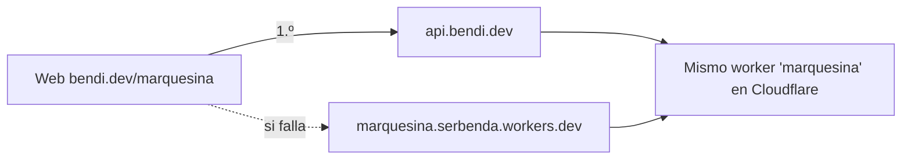

# marquesina: dominio propio `api.bendi.dev`

Por qué el worker tiene una dirección propia, cómo se configuró y qué hacer si algo falla. La arquitectura general está en [ARQUITECTURA.md](ARQUITECTURA.md) y el mantenimiento diario en [MANTENIMIENTO.md](MANTENIMIENTO.md).

> ¿Empiezas de cero? Lee primero la [guía paso a paso con diagramas](GUIA.md). Cómo funciona cada parte por dentro, con diagramas: [REFERENCIA.md](REFERENCIA.md).

## 1. El problema

El 1 de noviembre de 2026 la web dejó de funcionar desde la red de casa: *"No se pudo conectar con el Consorcio"*. El diagnóstico fue el siguiente:

| Prueba | Resultado |
|---|---|
| Worker desde GitHub Actions (EE. UU.) | ✅ Todo responde en 1–4 s |
| Worker desde el navegador de casa | ❌ Todas las rutas se quedan colgadas, incluida `/push/key`, que no usa el Consorcio |
| Otro `*.workers.dev` cualquiera (`example.workers.dev`) desde casa | ❌ Bloqueado |
| GitHub, OpenStreetMap y cloudflare.com desde casa | ✅ Cargan |

**Conclusión:** la red bloquea **todo el dominio `workers.dev`**. Es habitual en Pi-hole, AdGuard, algunos routers, antivirus y redes de empresa, porque esos dominios se usan mucho en phishing. Cualquier usuario con un filtro así tendría el mismo problema.

**Solución:** servir el mismo worker también desde un subdominio propio, `api.bendi.dev`, que esos filtros no tienen motivo para bloquear.

## 2. Cómo queda



- **Las dos direcciones apuntan al mismo worker**, con el mismo código, los mismos secretos y los mismos avisos.
- **La web** (`index.html`) usa `PROXIES = ["https://api.bendi.dev", "https://marquesina.serbenda.workers.dev"]`. Si una petición a una dirección falla por red o por tiempo de espera, `getJson()` prueba la otra y se queda con la que funcione. Así no hay corte durante el cambio, y la web funciona aunque una de las dos esté bloqueada.
- **El worker** (`wrangler.toml`) declara las dos: `workers_dev = true` y `routes = [{ pattern = "api.bendi.dev", custom_domain = true }]`. Al desplegar, wrangler crea en Cloudflare el registro DNS y el certificado de `api.bendi.dev`.
- **Los chequeos** (`healthcheck.yml` cada hora y `worker.yml` al desplegar) comprueban `api.bendi.dev` y también `workers.dev`.
- **El service worker** (`sw.js`) no guarda nunca respuestas de ninguna de las dos direcciones.

## 3. DNS de bendi.dev

Cloudflare solo permite poner un dominio propio a un worker si **gestiona el DNS de ese dominio**. El dominio sigue **registrado y pagado en Porkbun**; lo único que cambia es quién responde a las consultas de DNS.

### Registros de bendi.dev (inventario del 1/11/2026, antes del cambio)

| Nombre | Tipo | Valor | Para qué |
|---|---|---|---|
| `bendi.dev` | A | 185.199.108.153 · 185.199.109.153 · 185.199.110.153 · 185.199.111.153 | GitHub Pages |
| `bendi.dev` | AAAA | 2606:50c0:8000::153 · 8001::153 · 8002::153 · 8003::153 | GitHub Pages (IPv6) |
| `www.bendi.dev` | CNAME | `serbenda.github.io` | GitHub Pages |
| `_github-pages-challenge-serbenda.bendi.dev` | TXT | `893263541f409edd80b575fb2892c9` | Verificación del dominio en GitHub |
| — | MX, SPF, DMARC | *(ninguno)* | No hay correo en bendi.dev |
| `api.bendi.dev` | — | *(lo crea wrangler al desplegar)* | Worker |

Todos los registros de GitHub Pages deben ir en **DNS only** (nube gris), no *Proxied*. Así GitHub sigue sirviendo y renovando el certificado HTTPS de bendi.dev, y la web funciona exactamente igual que antes.

### Nameservers

| Antes (Porkbun) | Después (Cloudflare) |
|---|---|
| curitiba.ns.porkbun.com · fortaleza.ns.porkbun.com · maceio.ns.porkbun.com · salvador.ns.porkbun.com | **hassan.ns.cloudflare.com** · **magali.ns.cloudflare.com** |

## 4. Pasos y estado

| # | Paso | Dónde | Estado |
|---|---|---|---|
| 1 | Añadir `bendi.dev` a Cloudflare, plan Free, importando registros | Cloudflare → *Add a domain* | ✅ Hecho |
| 2 | Pasar a **DNS only** los 9 registros importados (4 A, 4 AAAA, 1 CNAME) | Cloudflare → bendi.dev → **DNS → Records** → seleccionar los registros → **Edit** (edición en bloque) → *Proxy status* apagado → *Save* | ✅ Hecho (9 de 9) |
| 3 | Añadir el TXT de verificación de GitHub: nombre `_github-pages-challenge-serbenda`, valor `893263541f409edd80b575fb2892c9` | Cloudflare → DNS → Records → *Add record* | ✅ Hecho (10 registros en total, todos DNS only) |
| 4 | Cambiar los nameservers a `hassan.ns.cloudflare.com` y `magali.ns.cloudflare.com` | Porkbun → *Domain Management* → bendi.dev → **Authoritative Nameservers** → *Edit* (borrar los 4 de Porkbun, poner los 2 de Cloudflare) → *Save Nameservers* | ✅ Hecho (1/11/2026, 18:50) |
| 5 | Esperar a que Cloudflare marque bendi.dev como **Active** (minutos a unas horas; llega un email) | Cloudflare → bendi.dev → Overview (se puede forzar con *Check nameservers now*) | ⏳ Esperando |
| 6 | Comprobar que `https://bendi.dev` y `https://bendi.dev/marquesina/` siguen cargando con candado | Navegador | ⏳ Pendiente |
| 7 | **Fusionar la PR de `api.bendi.dev`** (mejor con la zona *Active*: antes, wrangler publica el worker pero la comprobación final falla porque el nombre aún no existe en Internet) | GitHub | ✅ Fusionada (#16), antes de que la zona estuviera *Active*: el despliegue publicó el worker, pero la comprobación falló con `Could not resolve host: api.bendi.dev` |
| 8 | Comprobar que el workflow *Desplegar worker* termina en verde y que `https://api.bendi.dev/push/key` responde | GitHub Actions → *Desplegar worker en Cloudflare* → **Run workflow** / navegador | ⏳ Pendiente (relanzar cuando el paso 5 esté hecho) |

> Los pasos 2 y 3 se pueden hacer antes o después del 4, pero conviene hacerlos **antes**. Si se cambian los nameservers con los registros en *Proxied*, la web seguirá funcionando a través de Cloudflare, pero GitHub puede avisar de que el dominio no está bien configurado y fallar al renovar el certificado.

## 5. Comprobaciones

```text
https://api.bendi.dev/push/key                         → JSON con "publicKey"
https://api.bendi.dev/crtm/stop/06756                  → JSON con "stopTimes"
https://marquesina.serbenda.workers.dev/push/key       → igual (dirección alternativa)
https://dns.google/resolve?name=bendi.dev&type=NS      → hassan / magali .ns.cloudflare.com
https://dns.google/resolve?name=bendi.dev&type=A       → las 4 IP 185.199.x.153 de GitHub (no IP de Cloudflare)
```

En GitHub: repo `serbenda.github.io` → **Settings → Pages** debe seguir mostrando *"DNS check successful"* para `bendi.dev`.

## 6. Problemas y vuelta atrás

| Síntoma | Causa probable | Qué hacer |
|---|---|---|
| bendi.dev no carga o da error de certificado tras el cambio | Algún registro en *Proxied* o falta alguno | Revisar el §3: registros en **DNS only** y que estén todos |
| GitHub Pages dice *"Domain's DNS record could not be retrieved"* | Propagación en curso o registros en *Proxied* | Esperar unas horas; revisar que estén en DNS only |
| El paso *Comprobar que responde* falla con `Could not resolve host: api.bendi.dev` | La zona aún no está *Active* (los nameservers no se han cambiado o no se han propagado) | Esperar a *Active* y relanzar *Desplegar worker* (**Run workflow**). No hay nada roto: la web usa `workers.dev` mientras tanto |
| El despliegue del worker falla con un error de dominio o zona | La zona aún no está *Active*, o el token no tiene permiso | Esperar a *Active* y relanzar; si persiste, crear un token nuevo con la plantilla *Edit Cloudflare Workers* y **All zones** (MANTENIMIENTO §2.7) |
| `api.bendi.dev` no responde, pero `workers.dev` sí | Certificado aún emitiéndose (primeros minutos) | La web usa `workers.dev` sola mientras tanto; esperar |
| Hay que deshacerlo todo | — | En Porkbun, volver a poner los 4 nameservers de Porkbun (§3). Los registros siguen allí, no se han borrado. La web seguirá funcionando con `workers.dev` |

## 7. Más usos

`api.bendi.dev` puede servir a otros proyectos (`bolsillo`, `hucha`…) con rutas propias en el mismo worker o en otro worker con su propio subdominio (`luz.bendi.dev`, etc.), sin depender de `workers.dev`.
