# Guía de marquesina para quien empieza de cero

Esta guía explica **qué es cada pieza de marquesina, cómo encajan y cómo montarlo todo desde cero, paso a paso**, para alguien que no ha usado nunca GitHub, Cloudflare ni un DNS. No hace falta saber programar.

Si ya conoces el proyecto y buscas un detalle técnico, ve a [ARQUITECTURA.md](ARQUITECTURA.md) (cómo funciona por dentro), [MANTENIMIENTO.md](MANTENIMIENTO.md) (tareas y errores) o [DOMINIO.md](DOMINIO.md) (`api.bendi.dev` y el DNS).

---

## Índice

1. [Cómo leer esta guía](#1-cómo-leer-esta-guía)
2. [Qué es marquesina, en una frase](#2-qué-es-marquesina-en-una-frase)
3. [Las piezas, explicadas con un ejemplo de la vida real](#3-las-piezas-explicadas-con-un-ejemplo-de-la-vida-real)
4. [Diccionario: las palabras raras](#4-diccionario-las-palabras-raras)
5. [Diagramas de arquitectura](#5-diagramas-de-arquitectura)
6. [Cuentas y servicios que se usan](#6-cuentas-y-servicios-que-se-usan)
7. [Montarlo todo desde cero, paso a paso](#7-montarlo-todo-desde-cero-paso-a-paso)
8. [Hacer un cambio en la web (el día a día)](#8-hacer-un-cambio-en-la-web-el-día-a-día)
9. [Qué hacer si algo no funciona](#9-qué-hacer-si-algo-no-funciona)
10. [Dónde está cada cosa en el código](#10-dónde-está-cada-cosa-en-el-código)
11. [Revisión de cada pocos meses](#11-revisión-de-cada-pocos-meses)
12. [Datos de referencia](#12-datos-de-referencia)

---

## 1. Cómo leer esta guía

Cada paso usa estos símbolos:

| Símbolo | Qué significa |
|---|---|
| 🖱️ | Haz clic en lo que pone en **negrita** |
| ⌨️ | Escribe exactamente lo que pone en `este formato` |
| 📋 | Copia un valor para pegarlo después |
| ✅ | Cómo saber que el paso ha ido bien |
| ⚠️ | Cuidado: aquí es fácil equivocarse |
| 🔒 | Dato secreto: no lo pegues nunca en un chat, un correo, un *issue* ni en el código |

Los nombres de botones y menús aparecen en el idioma en que los muestran las webs (muchas veces en inglés). Las webs cambian de diseño de vez en cuando: si un botón no está exactamente donde dice la guía, busca uno con el mismo nombre.

---

## 2. Qué es marquesina, en una frase

> **Es la pantalla luminosa de una parada de autobús, pero en tu móvil y para las paradas que tú elijas: te dice cuánto le falta a tu autobús, dónde está y cuándo tienes que salir de casa.**

Web: **https://bendi.dev/marquesina/**

Funciona con los autobuses de **EMT Madrid**, los **interurbanos** y urbanos de otros municipios (Alcobendas, Sanse, Colmenar Viejo…) y el **Metro**.

---

## 3. Las piezas, explicadas con un ejemplo de la vida real

Imagina que marquesina es **una tienda de información sobre autobuses**:

| Pieza real | En la tienda sería… | Qué hace de verdad |
|---|---|---|
| **La web** (`index.html`) | El **mostrador** donde el cliente mira | Lo que ves en el móvil: el mapa, la lista de paradas y los minutos |
| **El worker** (Cloudflare) | El **dependiente** que va al almacén a por la información | Un pequeño programa en Internet que pide los datos a EMT y al Consorcio y se los da a la web |
| **EMT y el Consorcio** | Los **proveedores** | Las empresas públicas que saben dónde está cada autobús |
| **GitHub** | El **archivo** donde se guardan los planos de la tienda | Donde está guardado todo el código y su historial |
| **GitHub Pages** | El **local** donde está abierta la tienda | El servicio gratuito que publica la web en Internet |
| **GitHub Actions** | Los **robots** que montan la tienda y la revisan | Programas automáticos que publican cada cambio y comprueban cada hora que todo va bien |
| **El dominio `bendi.dev`** | La **dirección postal** de la tienda | El nombre que se escribe en el navegador |
| **El DNS** | La **guía telefónica** | Traduce `bendi.dev` a la dirección numérica del servidor |
| **Cloudflare** | La **empresa de mensajería** y la **centralita** | Aloja el worker y, desde el cambio de noviembre de 2026, también la guía telefónica (DNS) de bendi.dev |
| **Porkbun** | El **registro de la propiedad** | La empresa donde está comprado y renovado el dominio `bendi.dev` |
| **Mobility Labs** | El **carné de cliente** de EMT | Donde se dio de alta marquesina para que EMT le deje pedir datos |

¿Por qué hace falta el "dependiente" (el worker) y la web no va directamente a los proveedores? Por dos motivos:

1. **El Consorcio no deja que otras webs le pidan datos directamente** (es una protección de los navegadores que se llama CORS). El worker sí puede, porque no es un navegador.
2. **EMT pide usuario y contraseña.** Si estuvieran en la web, cualquiera podría verlos. En el worker están guardados como **secretos** 🔒 que nadie puede leer.

---

## 4. Diccionario: las palabras raras

| Palabra | Explicación sencilla |
|---|---|
| **API** | Una "ventanilla" de una empresa por la que un programa pide datos y recibe respuestas, normalmente en formato JSON |
| **JSON** | Un formato de texto para datos, con llaves `{ }` y comillas. Ejemplo: `{"linea": "153", "minutos": 4}` |
| **Repositorio (repo)** | La carpeta de un proyecto en GitHub, con todo su historial de cambios |
| **Rama (branch)** | Una copia paralela del proyecto. Aquí hay dos: **`main`** (la que se publica) y **`development`** (donde se trabaja) |
| **Commit** | Un "guardado" de cambios en el repo, con un mensaje que dice qué se hizo |
| **Pull Request (PR)** | Una petición para llevar los cambios de `development` a `main`. Cuando la **fusionas** (*merge*), los cambios se publican |
| **Workflow / GitHub Actions** | Un robot de GitHub que hace algo solo: publicar la web, probar el código, revisar cada hora que todo responde |
| **Worker** | Un programa pequeño que vive en los servidores de Cloudflare y responde a peticiones de Internet |
| **Proxy** | Un intermediario que pide algo en tu nombre. El worker hace de proxy entre la web y EMT o el Consorcio |
| **Dominio** | Un nombre de Internet que compras, como `bendi.dev` |
| **Subdominio** | Un nombre "dentro" de tu dominio, como `api.bendi.dev` o `www.bendi.dev`. No hay que comprarlo aparte |
| **DNS** | El sistema que traduce nombres (`bendi.dev`) a direcciones numéricas (`185.199.108.153`) |
| **Registro DNS** | Cada línea de esa traducción. Tipos: **A** (dirección IPv4), **AAAA** (IPv6), **CNAME** (alias de otro nombre), **TXT** (texto, por ejemplo para verificar que el dominio es tuyo) |
| **Nameservers** | Los servidores que "responden por" tu dominio: son quienes tienen tu guía telefónica. Cambiarlos es decir "a partir de ahora, quien manda en mi DNS es otra empresa" |
| **Proxied / DNS only** | En Cloudflare, *Proxied* (nube naranja) hace que el tráfico pase por Cloudflare; *DNS only* (nube gris) solo traduce el nombre. Para GitHub Pages se usa **DNS only** |
| **CORS** | Una regla de los navegadores: una web solo puede pedir datos a otra si esa otra lo permite expresamente |
| **Secreto** 🔒 | Un dato privado (contraseña, clave) guardado de forma que ni siquiera se puede volver a leer, solo usar o sobrescribir |
| **Token** 🔒 | Una "llave" que da permiso a un programa para hacer algo en tu nombre, por ejemplo a GitHub para publicar el worker en Cloudflare |
| **Caché** | Una copia guardada un rato para no tener que pedir lo mismo una y otra vez |
| **PWA** | Una web que se puede instalar como si fuera una app, con su icono en la pantalla de inicio |
| **Service worker** | Un programa que el navegador guarda junto a la web para que abra al instante y para recibir notificaciones |
| **Web Push** | El sistema estándar de notificaciones de las webs, el que permite el aviso *"¡Sal ya!"* |
| **VAPID** | La "firma" que identifica al worker ante Google, Apple o Mozilla cuando envía una notificación |
| **Cron** | Una tarea programada que se repite (aquí, revisar los avisos cada minuto) |
| **Durable Object** | Una pequeña base de datos dentro de Cloudflare donde el worker guarda los avisos de cada persona |
| **Despliegue (deploy)** | Publicar una versión nueva del código para que la use la gente |

---

## 5. Diagramas de arquitectura

### 5.1 La foto completa

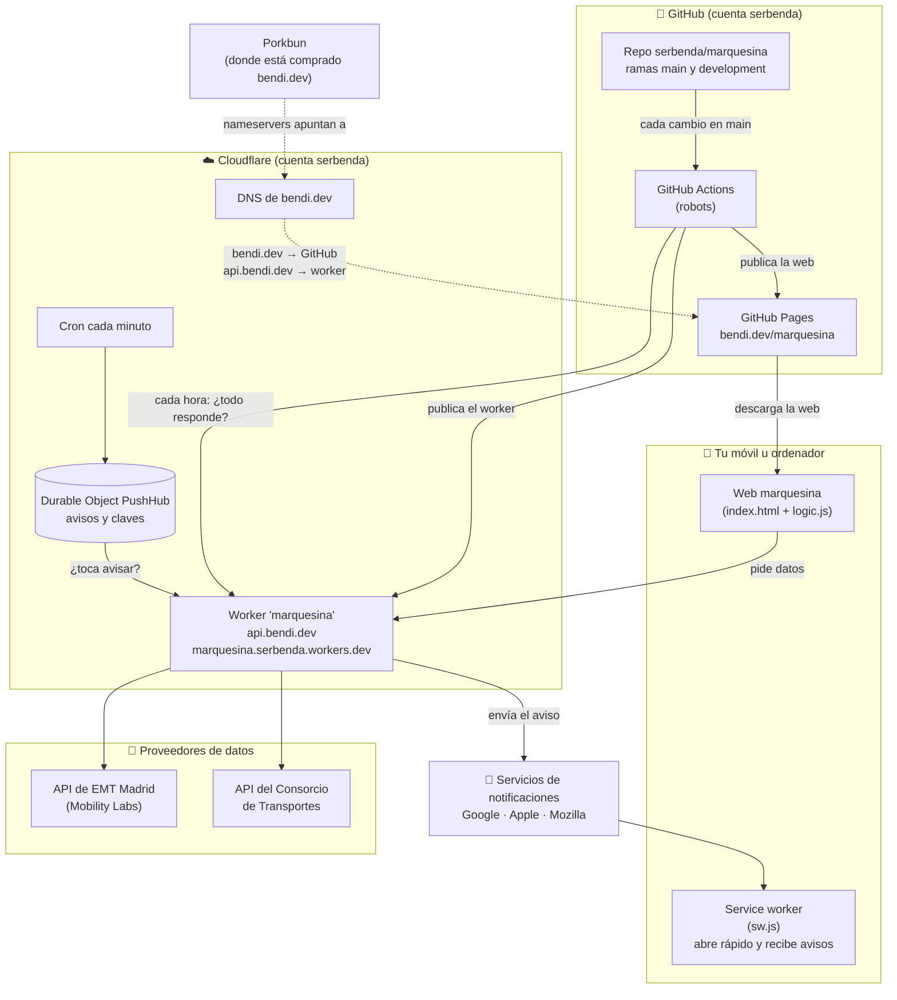

### 5.2 Qué pasa cuando abres la web

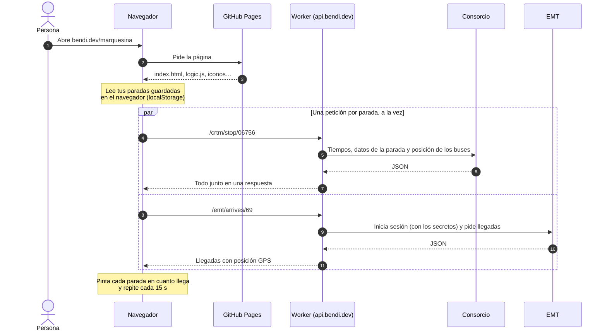

### 5.3 Cómo funciona el aviso "¡Sal ya!"

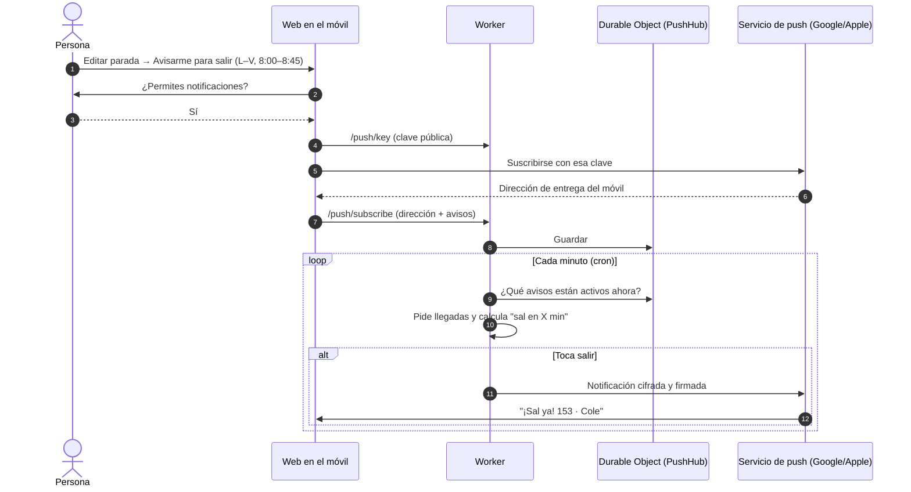

### 5.4 Cómo se publica un cambio

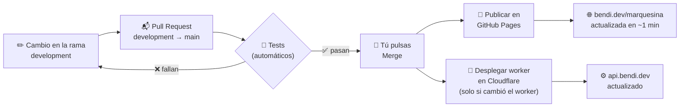

### 5.5 Cómo se resuelve `bendi.dev` y `api.bendi.dev`

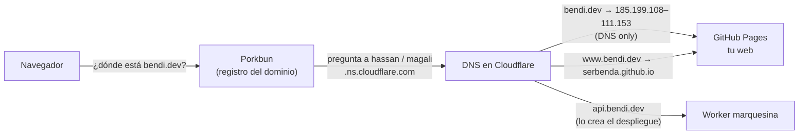

### 5.6 Dos direcciones para el mismo worker

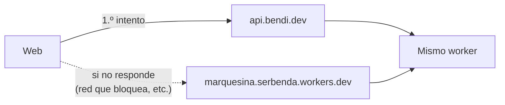

Algunas redes (Pi-hole, AdGuard, routers, empresas) bloquean todo lo que termina en `workers.dev`. Por eso existe `api.bendi.dev`. La web prueba primero una y, si falla, la otra, sin que la persona note nada.

---

## 6. Cuentas y servicios que se usan

| Servicio | Para qué | Dirección | Cuenta | Coste |
|---|---|---|---|---|
| **GitHub** | Guardar el código, publicar la web, robots automáticos | https://github.com/serbenda/marquesina | serbenda | Gratis |
| **Cloudflare** | Worker, avisos, DNS de bendi.dev | https://dash.cloudflare.com | serbenda@gmail.com | Gratis (plan Free) |
| **Porkbun** | Compra y renovación del dominio bendi.dev | https://porkbun.com | serbenda | Renovación anual del dominio |
| **Mobility Labs (EMT)** | Permiso para pedir datos de EMT | https://mobilitylabs.emtmadrid.es | serbenda | Gratis |
| **Consorcio de Transportes** | Datos de interurbanos, urbanos y Metro | https://www.crtm.es | No necesita cuenta | Gratis |
| **OpenStreetMap** | El mapa | https://www.openstreetmap.org | No necesita cuenta | Gratis |

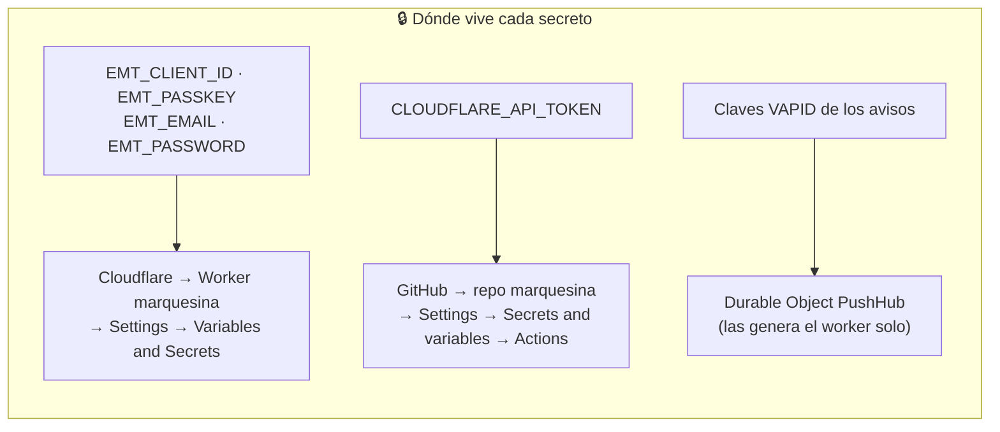

⚠️ **Ningún secreto está en el código ni en el repo.** Si alguna vez ves una contraseña o una clave en un archivo, es un error: cámbiala enseguida en su servicio.

---

## 7. Montarlo todo desde cero, paso a paso

Así sería montar marquesina en otra cuenta o volver a montarla si se perdiera todo. El orden importa:

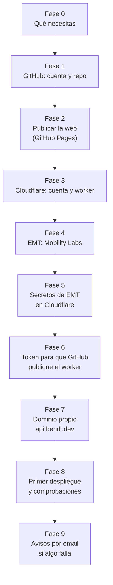

### Fase 0 · Qué necesitas

- Un ordenador con un navegador moderno (Chrome, Edge, Firefox o Safari).
- Un correo electrónico.
- El dominio `bendi.dev` (o el tuyo), comprado en un registrador como Porkbun.
- Unos **90 minutos** la primera vez. Después, casi todo es automático.

---

### Fase 1 · GitHub: cuenta y repositorio (15 min)

**Objetivo:** tener el código guardado en GitHub con las dos ramas, `main` y `development`.

1. 🖱️ Entra en https://github.com y pulsa **Sign up** si no tienes cuenta. Sigue los pasos (correo, contraseña, usuario).
2. 🖱️ Arriba a la derecha, pulsa **+** → **New repository**.
3. ⌨️ En **Repository name** escribe `marquesina`.
4. 🖱️ Marca **Public** (GitHub Pages gratis necesita repos públicos).
5. 🖱️ Marca **Add a README file** y pulsa **Create repository**.
6. Sube los archivos del proyecto: 🖱️ **Add file** → **Upload files**, arrastra todo el contenido de la carpeta del proyecto y pulsa **Commit changes**.
7. Crea la rama de trabajo: 🖱️ pulsa el selector de ramas (pone `main`) → ⌨️ escribe `development` → 🖱️ **Create branch: development from main**.

✅ **Bien si:** en la página del repo ves `index.html`, `worker.js`, `docs/`… y el selector de ramas tiene `main` y `development`.

⚠️ **Regla de oro:** nunca se cambia nada directamente en `main`. Siempre en `development` y luego una Pull Request (ver §8).

---

### Fase 2 · Publicar la web con GitHub Pages (10 min)

**Objetivo:** que la web se vea en `https://bendi.dev/marquesina/`.

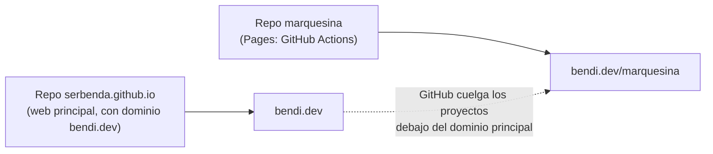

1. 🖱️ En el repo `marquesina`: **Settings** → **Pages** (menú de la izquierda).
2. 🖱️ En **Build and deployment → Source**, elige **GitHub Actions**.
3. 🖱️ **Settings** → **Actions** → **General**: en *Actions permissions* debe estar marcado **Allow all actions and reusable workflows**. Si no, márcalo y pulsa **Save**.
4. El robot `.github/workflows/pages.yml` publica la web cada vez que cambia `main`. Para lanzarlo la primera vez: 🖱️ pestaña **Actions** → **Publicar en GitHub Pages** → **Run workflow** → **Run workflow**.

✅ **Bien si:** en **Actions** aparece la ejecución con un ✔️ verde y `https://bendi.dev/marquesina/` carga la web.

ℹ️ El dominio `bendi.dev` está configurado en el repo de la web principal, `serbenda.github.io` (**Settings → Pages → Custom domain**). Por eso el proyecto aparece solo en `bendi.dev/marquesina`.

---

### Fase 3 · Cloudflare: cuenta y worker (10 min)

**Objetivo:** crear el "dependiente" que irá a por los datos.

1. 🖱️ Entra en https://dash.cloudflare.com y regístrate con tu correo (plan **Free**). Si te pide añadir un dominio, sáltatelo de momento.
2. 🖱️ Menú de la izquierda: **Compute (Workers)**. En algunas cuentas se llama **Workers & Pages**.
3. 🖱️ **Create** → **Create Worker** (o *Start with Hello World!*).
4. ⌨️ **Worker name:** `marquesina`.
5. ⚠️ Si aparece **Protect with Cloudflare Access**, déjalo **apagado**. Si lo activas, el worker pedirá iniciar sesión y la web no podrá usarlo.
6. 🖱️ **Deploy**.
7. La primera vez te pide un subdominio de `workers.dev`: ⌨️ `serbenda`. La dirección queda `https://marquesina.serbenda.workers.dev`.

✅ **Bien si:** al abrir esa dirección sale un *"Hello World!"*. Es normal: el código de verdad lo sube GitHub en la fase 8.

---

### Fase 4 · EMT: darse de alta en Mobility Labs (15 min)

**Objetivo:** tener permiso para pedir los datos de EMT.

1. 🖱️ Entra en https://mobilitylabs.emtmadrid.es y regístrate.
2. 📧 Abre el correo de confirmación y pulsa el enlace para **activar la cuenta**. Sin esto no funciona nada.
3. 🖱️ Busca la sección de tus aplicaciones y crea una nueva con estos datos:

| Campo | Qué poner |
|---|---|
| Nombre | `marquesina` |
| Categoría | **Transporte Público** |
| Descarga | Solo **Web App**: `https://bendi.dev/marquesina/` |
| Descripción | `Mapa en tiempo real de los autobuses que llegan a tus paradas: dónde están, cuánto les falta y si te da tiempo a salir. Web gratuita y sin anuncios.` |
| Firebase Api_Key | Vacío |
| Idioma | Español |
| Icono | `assets/icono.png` del repo (obligatorio) |

4. 📋 Al abrir la aplicación creada verás **X-ClientId** y **passKey** 🔒. Los usarás en la fase 5.

⚠️ **Código 84:** las aplicaciones recién creadas pueden no estar habilitadas todavía. Por eso el worker puede entrar también con el email y la contraseña de la cuenta (fase 5). Detalles en [MANTENIMIENTO.md §1.4](MANTENIMIENTO.md).

---

### Fase 5 · Guardar los secretos de EMT en Cloudflare (5 min)

**Objetivo:** que el worker pueda entrar en EMT sin que nadie vea las claves.

1. 🖱️ Cloudflare → **Compute (Workers)** → **marquesina** → **Settings** → **Variables and Secrets** → **Add**.
2. Añade estas 4 variables. En cada una, 🖱️ marca el tipo **Secret** y ⌨️ escribe el nombre exacto:

| Nombre (exacto) | Valor 🔒 |
|---|---|
| `EMT_CLIENT_ID` | El **X-ClientId** de la fase 4 |
| `EMT_PASSKEY` | El **passKey** de la fase 4 |
| `EMT_EMAIL` | El email de tu cuenta de Mobility Labs |
| `EMT_PASSWORD` | La contraseña de tu cuenta de Mobility Labs |

3. 🖱️ **Deploy** (o *Add variables and deploy*).

✅ **Bien si:** en *Variables and Secrets* aparecen los 4 nombres con el valor oculto.

⚠️ Pega los valores sin espacios ni saltos de línea al principio o al final. Cloudflare no te deja volver a ver un secreto, solo sobrescribirlo.

---

### Fase 6 · Token para que GitHub publique el worker (10 min)

**Objetivo:** que, cada vez que cambie el código del worker, GitHub lo suba solo a Cloudflare.

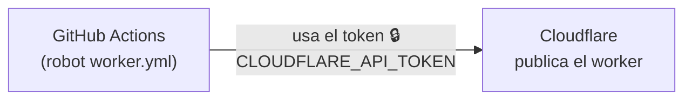

**En Cloudflare, crear el token:**
1. 🖱️ Icono de tu perfil (arriba a la derecha) → **My Profile** → **API Tokens** → **Create Token**.
2. 🖱️ Plantilla **Edit Cloudflare Workers** → **Use template**.
3. Rellena:
   - ⌨️ **Token name:** `marquesina-github`
   - **Permissions:** déjalos como vienen.
   - **Account Resources:** **Include** → tu cuenta.
   - **Zone Resources:** **Include** → **All zones**. Hace falta para `api.bendi.dev`.
   - **Client IP Address Filtering:** vacío (GitHub cambia de IP).
   - **TTL:** vacío (sin caducidad) o una fecha dentro de un año, pero entonces apúntate renovarlo.
4. 🖱️ **Continue to summary** → **Create Token**.
5. 📋 Copia el token 🔒. **Solo se muestra una vez.**

**En GitHub, guardarlo:**
6. 🖱️ Repo `marquesina` → **Settings** → **Secrets and variables** → **Actions** → **New repository secret**.
7. ⌨️ **Name:** `CLOUDFLARE_API_TOKEN` · **Secret:** el token copiado → 🖱️ **Add secret**.

✅ **Bien si:** en *Actions secrets* aparece `CLOUDFLARE_API_TOKEN`.

---

### Fase 7 · Dominio propio `api.bendi.dev` (20 min + espera)

**Objetivo:** que el worker tenga una dirección propia que ningún filtro bloquee. El motivo y el diagnóstico están en [DOMINIO.md](DOMINIO.md).

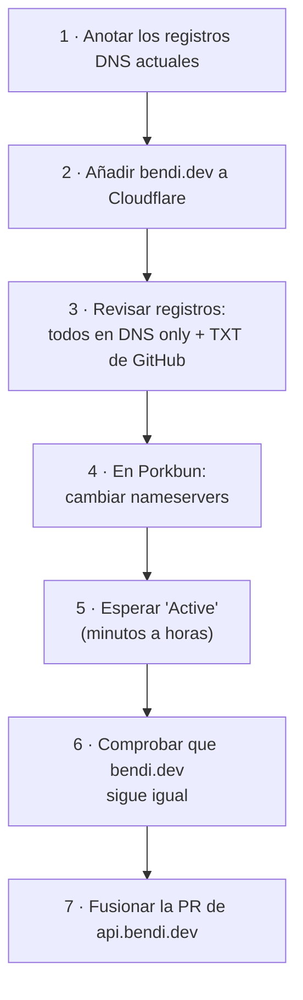

**1. Anotar los registros actuales** (para comprobar que no se pierde ninguno):

| Nombre | Tipo | Valor |
|---|---|---|
| `bendi.dev` | A | `185.199.108.153`, `185.199.109.153`, `185.199.110.153`, `185.199.111.153` |
| `bendi.dev` | AAAA | `2606:50c0:8000::153`, `2606:50c0:8001::153`, `2606:50c0:8002::153`, `2606:50c0:8003::153` |
| `www` | CNAME | `serbenda.github.io` |
| `_github-pages-challenge-serbenda` | TXT | `893263541f409edd80b575fb2892c9` |

Para verlos tú mismo, abre `https://dns.google/resolve?name=bendi.dev&type=A` (cambia `A` por `AAAA`, `TXT`…).

**2. Añadir bendi.dev a Cloudflare**
1. 🖱️ Cloudflare → **Domains** → **Connect a domain** (o *Add a domain*).
2. ⌨️ `bendi.dev`. Deja **Import DNS records: Automatic**.
3. 🖱️ **Continue** → plan **Free** → **Select plan**.

**3. Revisar los registros**
1. 🖱️ Cloudflare → bendi.dev → **DNS** → **Records**.
2. Comprueba que están los de la tabla del paso 1.
3. ⚠️ Todos deben estar en **DNS only** (nube gris). Si alguno pone **Proxied** (nube naranja): 🖱️ marca su casilla (o la de todos) → **Edit** → apaga **Proxy status** → **Save**.
4. Si falta el TXT: 🖱️ **Add record** → Type **TXT** → ⌨️ Name `_github-pages-challenge-serbenda` → Content `893263541f409edd80b575fb2892c9` → **Save**.

✅ **Bien si:** hay 10 registros (4 A, 4 AAAA, 1 CNAME y 1 TXT), todos en *DNS only*.

**4. Cambiar los nameservers en Porkbun**
1. 🖱️ https://porkbun.com → inicia sesión → **Domain Management**.
2. 🖱️ En la fila de `bendi.dev`, el botón **NS** (*edit name servers*).
3. Borra las 4 líneas de Porkbun y ⌨️ escribe, una por línea:
   ```
   hassan.ns.cloudflare.com
   magali.ns.cloudflare.com
   ```
4. 🖱️ **Save Nameservers**.

⚠️ Los nameservers de Cloudflare pueden ser otros si se vuelve a añadir el dominio. Usa siempre los que muestre Cloudflare en **bendi.dev → Overview**.

**5. Esperar**
- Cloudflare comprueba el cambio solo. Suele tardar **de minutos a unas horas** (como mucho 48 h).
- Te llegará un email y en **bendi.dev → Overview** pondrá **Active**.

✅ **Comprobar:** `https://dns.google/resolve?name=bendi.dev&type=NS` debe mostrar `hassan` y `magali.ns.cloudflare.com`.

**6. Comprobar que la web sigue igual**
- `https://bendi.dev` y `https://bendi.dev/marquesina/` cargan con el candado 🔒 del navegador.
- GitHub → repo `serbenda.github.io` → **Settings → Pages**: debe seguir poniendo *DNS check successful*.

**7. Fusionar la PR de `api.bendi.dev`** (solo con *Active*). Al fusionarla, el robot crea `api.bendi.dev` en Cloudflare y espera hasta 5 min a que tenga certificado.

✅ **Bien si:** `https://api.bendi.dev/push/key` muestra un texto que empieza por `{"publicKey":`.

**Si algo va mal:** en Porkbun, vuelve a poner los 4 nameservers de Porkbun (`curitiba`, `fortaleza`, `maceio` y `salvador`.ns.porkbun.com). La web sigue funcionando con `workers.dev` mientras tanto.

---

### Fase 8 · Primer despliegue y comprobaciones (10 min)

1. 🖱️ GitHub → repo `marquesina` → **Actions** → **Desplegar worker en Cloudflare** → **Run workflow** → rama `main` → **Run workflow**.
2. Espera a que salga ✔️ verde (1–5 min). El robot:
   - comprueba que el código no tiene errores,
   - lo publica en Cloudflare (worker, base de datos de avisos y cron),
   - comprueba que `api.bendi.dev` y `workers.dev` responden.
3. Abre estas direcciones:

| Dirección | Debe salir |
|---|---|
| `https://api.bendi.dev/push/key` | `{"publicKey":"…"}` |
| `https://api.bendi.dev/crtm/stop/06756` | Un texto largo con `"stopTimes"` y `MARQUÉS VALDAVIA` |
| `https://api.bendi.dev/emt/arrives/69` | Un texto con `"code":"00"` |
| `https://bendi.dev/marquesina/` | La web, con la etiqueta **En vivo** |

4. **Prueba de avisos:** en el móvil, abre la web → **Editar** en una parada → pon los minutos andando → activa **Avisarme para salir** → **Enviar aviso de prueba**. Te debe llegar *"Marquesina: avisos activados"*. En iPhone, antes hay que instalar la app (**Compartir → Añadir a pantalla de inicio**) y abrirla desde el icono.

---

### Fase 9 · Que GitHub te avise por email si algo falla (2 min)

El robot **Chequeo de marquesina** revisa cada hora que la web, EMT, el Consorcio y los avisos responden.

1. 🖱️ GitHub → tu foto (arriba a la derecha) → **Settings** → **Notifications**.
2. En **System → Actions**, activa **Email** y elige **Only notify for failed workflows**.

✅ **Bien si:** el día que algo falle te llega un correo de GitHub con el nombre del paso que falló.

⚠️ GitHub apaga los robots programados si el repo pasa **60 días sin cambios**. Si te llega un aviso de eso: **Actions** → *Chequeo de marquesina* → **Enable workflow**.

---

## 8. Hacer un cambio en la web (el día a día)

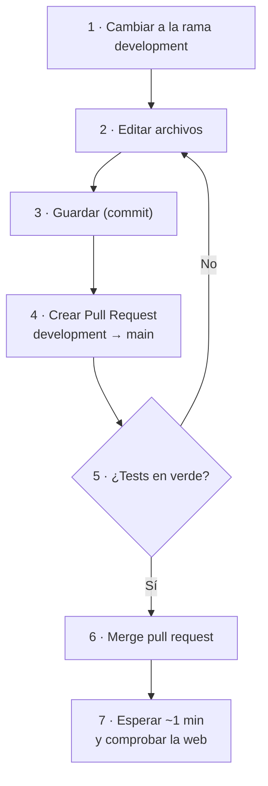

**Desde la web de GitHub (sin instalar nada):**
1. 🖱️ En el repo, selector de ramas → **development**.
2. 🖱️ Abre el archivo → icono del lápiz ✏️ (*Edit this file*).
3. Haz el cambio → 🖱️ **Commit changes…** → ⌨️ escribe qué has cambiado → marca **Commit directly to the development branch** → **Commit changes**.
4. 🖱️ Aparecerá un aviso amarillo, *"development had recent pushes"* → **Compare & pull request**. Si no aparece: pestaña **Pull requests** → **New pull request** → base `main` ← compare `development`.
5. ⌨️ Pon un título que explique el cambio → 🖱️ **Create pull request**.
6. Espera a que la comprobación **Tests** salga en ✔️ verde.
7. 🖱️ **Merge pull request** → **Confirm merge**.
8. En 1 minuto la web está actualizada. Si no ves el cambio, recarga forzando: **Ctrl + Shift + R** (Windows) o **Cmd + Shift + R** (Mac), o añade `?v=2` al final de la dirección.

**Desde tu ordenador (para quien programa):**
```bash
git switch development
# …editar…
npm test                       # comprobar que todo va bien (Node 22, sin instalar nada)
git commit -am "Qué he cambiado"
git push
# y crear la Pull Request en GitHub
```

⚠️ **Autoría:** los commits van firmados como `Sergio Santiago Bendaña Quesada <serbenda@gmail.com>`.

---

## 9. Qué hacer si algo no funciona

### 9.1 Árbol de decisión

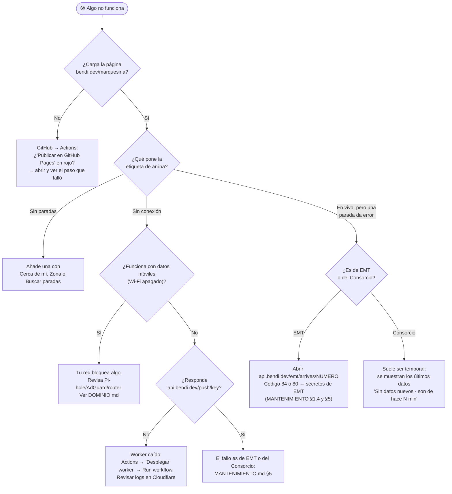

### 9.2 Problemas frecuentes

| Lo que ves | Qué pasa | Qué hacer |
|---|---|---|
| La web sigue igual después de un cambio | El navegador guarda la versión anterior | **Ctrl/Cmd + Shift + R** o añadir `?v=N` |
| *"No se pudo conectar…"* solo en casa | Tu red bloquea `workers.dev` | Debería arreglarse solo con `api.bendi.dev`; si no, revisa tu filtro de red |
| *"Sin datos nuevos · son de hace 3 min"* | El Consorcio no respondió en ese momento | Nada: se actualiza solo en la siguiente vuelta |
| *"EMT rechazó el inicio de sesión (84…)"* | La aplicación de EMT no está habilitada | Comprobar que existen `EMT_EMAIL` y `EMT_PASSWORD` (fase 5) |
| No llega el aviso de prueba | Permiso de notificaciones denegado, o iPhone sin la app instalada | Permitir notificaciones; en iPhone, instalar la app primero |
| Llega un email *"Chequeo de marquesina failed"* | Algo dejó de responder | Abrir el enlace del email, ver qué paso falló y seguir el árbol de arriba |
| *"Desplegar worker"* en rojo | Token caducado o error en el código | Abrir el paso que falló; si habla de autenticación, repetir la fase 6 |

Más casos, con su explicación, en [MANTENIMIENTO.md](MANTENIMIENTO.md) §5–§7.

---

## 10. Dónde está cada cosa en el código

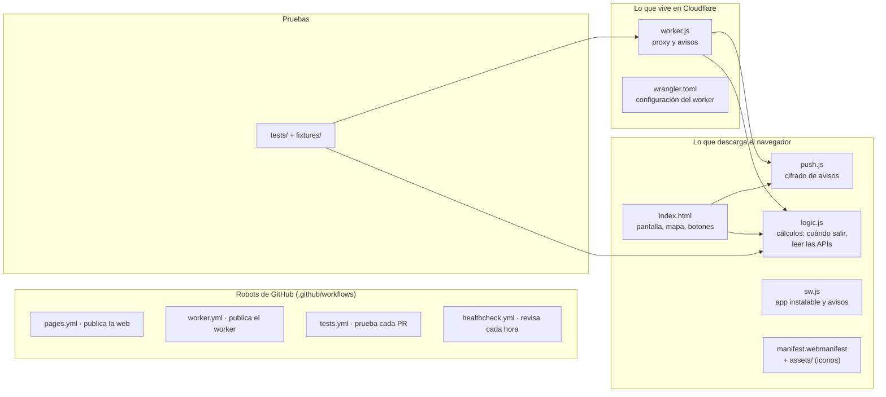

| Si quieres cambiar… | Toca… |
|---|---|
| Textos, colores, botones o el diseño | `index.html` |
| Cómo se calcula "Sal en X min" | `logic.js` (y su test en `tests/logic.test.js`) |
| Qué pide el worker a EMT o al Consorcio | `worker.js` |
| Los municipios del botón **Zona** | `ZONES` en `index.html` |
| Colores del Metro | `METRO` en `index.html` |
| Cada cuánto se actualiza | Opciones de `fEvery` y `DEF.every` en `index.html` |
| Cada cuánto revisa los avisos | `crons` en `wrangler.toml` |
| Nombre, colores o iconos de la app instalada | `manifest.webmanifest` y `assets/` |

---

## 11. Revisión de cada pocos meses

- [ ] La web carga y pone **En vivo**.
- [ ] El aviso de prueba llega al móvil.
- [ ] GitHub → **Actions**: los 4 robots en verde.
- [ ] Cloudflare → worker `marquesina` → **Metrics**: lejos del límite de 100.000 peticiones al día.
- [ ] Cloudflare → **API Tokens**: `marquesina-github` sigue activo.
- [ ] Mobility Labs: la aplicación `marquesina` sigue activa (si la habilitan, el código 84 desaparece).
- [ ] Porkbun: `bendi.dev` con **renovación automática** activada y la tarjeta al día.
- [ ] `https://dns.google/resolve?name=bendi.dev&type=NS` sigue apuntando a Cloudflare.

---

## 12. Datos de referencia

| Qué | Valor |
|---|---|
| Web | https://bendi.dev/marquesina/ |
| Repo | https://github.com/serbenda/marquesina |
| Worker | `marquesina` · https://api.bendi.dev · https://marquesina.serbenda.workers.dev |
| Cuenta de Cloudflare (ID) | `81707420145ed400a786dcb658bedb6e` |
| Nameservers de bendi.dev | `hassan.ns.cloudflare.com` · `magali.ns.cloudflare.com` |
| Secretos del worker (nombres) | `EMT_CLIENT_ID` · `EMT_PASSKEY` · `EMT_EMAIL` · `EMT_PASSWORD` |
| Secreto de GitHub (nombre) | `CLOUDFLARE_API_TOKEN` |
| Robots | `pages.yml` · `worker.yml` · `tests.yml` · `healthcheck.yml` |
| Base de datos de avisos | Durable Object `PushHub` |
| Cron | `* * * * *` (cada minuto) |
| Paradas de ejemplo | Consorcio `06756` y `06758` (Alcobendas) |

Los **valores** de los secretos 🔒 no están en ningún documento. Solo están en Cloudflare, en GitHub y en Mobility Labs.
