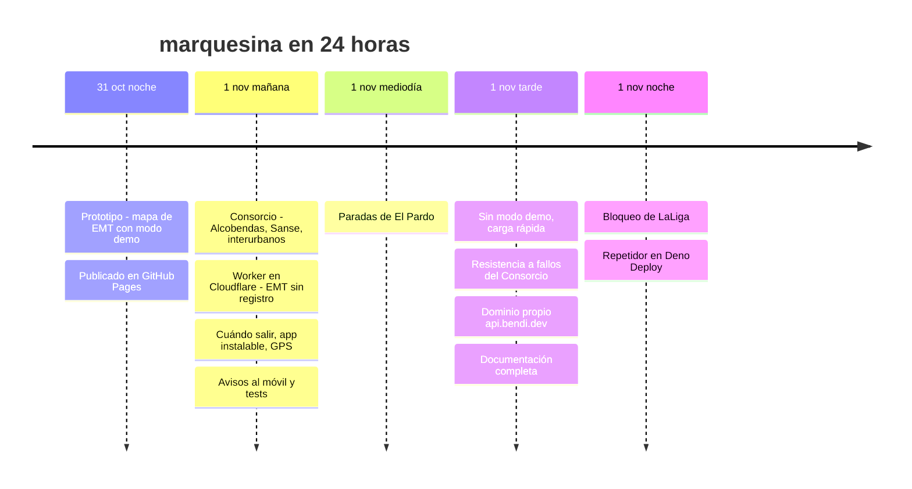
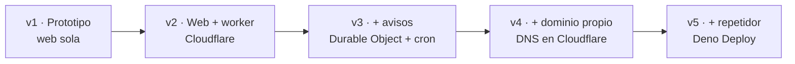
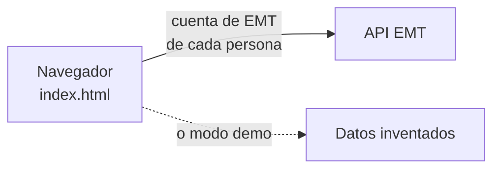
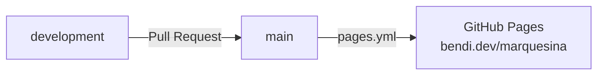
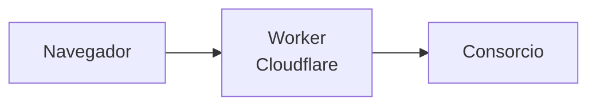
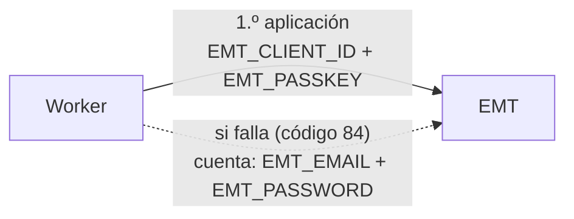
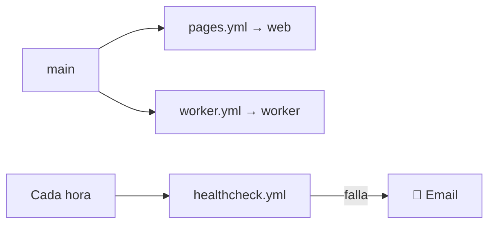
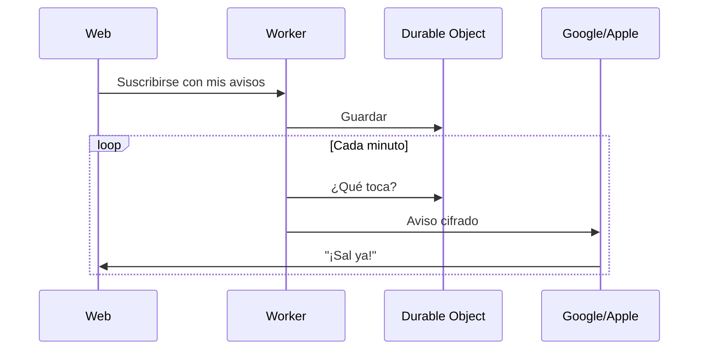
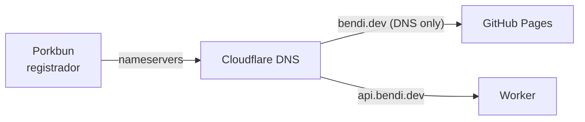
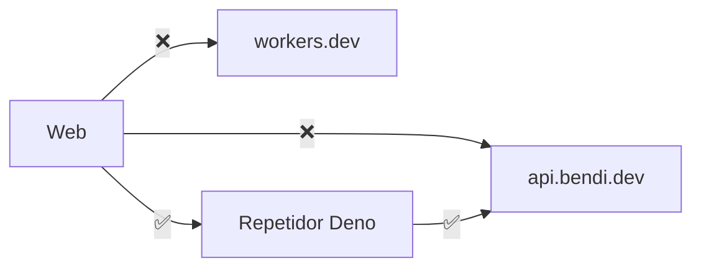

# marquesina: cómo se construyó, paso a paso

Bitácora completa del proyecto: **qué se hizo, en qué orden, por qué y qué se aprendió**. Sirve para tres cosas:

1. Que no se pierda nada: si mañana hubiera que rehacerlo, aquí está el camino entero.
2. Entender por qué el proyecto es como es: cada pieza existe porque resolvió un problema concreto.
3. Aprender: cada fase termina con lo que enseña, contado para quien empieza.

Las horas son de Madrid. Cada paso enlaza a su Pull Request (PR) en GitHub, donde está el detalle del código.

> ¿Palabras raras? Están todas en el [diccionario de la guía](GUIA.md#4-diccionario-las-palabras-raras).

---

## Índice

- [Resumen en un dibujo](#resumen-en-un-dibujo)
- [Fase 1 · La idea y el primer prototipo](#fase-1--la-idea-y-el-primer-prototipo-31-oct-2120)
- [Fase 2 · Publicarlo en Internet](#fase-2--publicarlo-en-internet-31-oct--1-nov-0858)
- [Fase 3 · Toda la Comunidad de Madrid](#fase-3--toda-la-comunidad-de-madrid-1-nov-0907)
- [Fase 4 · Un intermediario propio en Cloudflare](#fase-4--un-intermediario-propio-en-cloudflare-1-nov-0923)
- [Fase 5 · EMT sin registrarse](#fase-5--emt-sin-registrarse-1-nov-0940)
- [Fase 6 · Que sea útil de verdad](#fase-6--que-sea-útil-de-verdad-1-nov-1001)
- [Fase 7 · Avisos al móvil y pruebas automáticas](#fase-7--avisos-al-móvil-y-pruebas-automáticas-1-nov-1032)
- [Fase 8 · Problemas reales de uso](#fase-8--problemas-reales-de-uso-1-nov-1052--1801)
- [Fase 9 · "No se puede conectar": el dominio propio](#fase-9--no-se-puede-conectar-el-dominio-propio-1-nov-1823)
- [Fase 10 · Documentación y buenas prácticas](#fase-10--documentación-y-buenas-prácticas-1-nov-1836--1906)
- [Fase 11 · El bloqueo del fútbol y el repetidor](#fase-11--el-bloqueo-del-fútbol-y-el-repetidor-1-nov-1931--2009)
- [Registro de decisiones](#registro-de-decisiones)
- [Lo que se configuró fuera del código](#lo-que-se-configuró-fuera-del-código)
- [Lecciones aprendidas](#lecciones-aprendidas)
- [Pendiente](#pendiente)

---

## Resumen en un dibujo

---

## Fase 1 · La idea y el primer prototipo (31 oct, 21:20)

**Qué se quería:** ver en el móvil, en un mapa, los autobuses que van a llegar a tu parada y cuánto les falta, como la pantalla de una marquesina, pero para cualquier parada.

**Qué se hizo** ([PR #1](https://github.com/serbenda/marquesina/pull/1)):
- Una sola página (`index.html`) con un mapa de **Leaflet** y **OpenStreetMap**.
- Datos de **EMT Madrid** (API de Mobility Labs).
- Un **modo demo** con autobuses inventados, para que se viera algo sin cuenta de EMT.
- Un **proxy opcional** configurable, porque el navegador no puede llamar directamente a algunas APIs.

**Lo que enseña:** empezar por lo mínimo que funcione y se pueda enseñar. Todo lo demás se añadió encima.

---

## Fase 2 · Publicarlo en Internet (31 oct – 1 nov, 08:58)

**Qué se hizo** ([PR #2](https://github.com/serbenda/marquesina/pull/2), [PR #3](https://github.com/serbenda/marquesina/pull/3)):
1. Se añadió `.nojekyll` para que GitHub Pages sirva los archivos tal cual.
2. Se creó el robot **Publicar en GitHub Pages** (`pages.yml`): cada cambio en `main` se publica solo.
3. Al estar en la cuenta `serbenda`, que ya tenía `bendi.dev` como dominio, la web quedó en **https://bendi.dev/marquesina/**.

**Norma que se fijó aquí:** nunca se toca `main` directamente. Todo va por `development` y una PR que fusiona el dueño.

**Lo que enseña (DevOps):** automatizar el despliegue desde el primer día. Así publicar deja de ser un trabajo manual y nunca se publica algo que no esté en `main`.

---

## Fase 3 · Toda la Comunidad de Madrid (1 nov, 09:07)

**Qué se quería:** no solo EMT. También Alcobendas, San Sebastián de los Reyes, Colmenar Viejo y los interurbanos.

**Qué se hizo** ([PR #4](https://github.com/serbenda/marquesina/pull/4)):
- Se integró la API del **Consorcio Regional de Transportes de Madrid** (CRTM): `GetStopsTimes` para los tiempos y, más tarde, `GetLineLocation` para la posición GPS.

**Problema encontrado:** el Consorcio **no permite** que otras webs le pidan datos desde el navegador (**CORS**). Hacía falta un intermediario sí o sí.

**Lo que enseña:** las APIs públicas no siempre están pensadas para usarse desde una web. Hay que comprobarlo pronto, porque cambia la arquitectura.

---

## Fase 4 · Un intermediario propio en Cloudflare (1 nov, 09:23)

**Qué se hizo** ([PR #5](https://github.com/serbenda/marquesina/pull/5), [PR #6](https://github.com/serbenda/marquesina/pull/6)):
1. Se creó la cuenta de **Cloudflare** (plan gratuito).
2. Se creó el **worker** `marquesina` en `marquesina.serbenda.workers.dev`.
3. El worker reenvía las peticiones al Consorcio y añade las cabeceras **CORS** solo para `bendi.dev` y `serbenda.github.io`.
4. La web lo usa **por defecto**, sin que nadie tenga que configurar nada.
5. La web arranca **en vivo** con dos paradas de ejemplo de Alcobendas y gana el botón **Cerca de mí**.

**Lo que enseña (arquitectura):** un intermediario (patrón *backend for frontend*) resuelve CORS y además permite cachear, juntar peticiones y esconder credenciales. Es la pieza que más se reutilizó después.

---

## Fase 5 · EMT sin registrarse (1 nov, 09:40)

**Problema:** para EMT cada persona tenía que poner su cuenta de Mobility Labs. Nadie lo iba a hacer, y además las contraseñas quedarían en el navegador.

**Qué se hizo** ([PR #7](https://github.com/serbenda/marquesina/pull/7), [PR #8](https://github.com/serbenda/marquesina/pull/8)):
1. Se registró la aplicación **marquesina** en Mobility Labs, con su icono (`assets/icono.png`).
2. Sus claves (**X-ClientId** y **passKey**) se guardaron como **secretos** del worker en Cloudflare: `EMT_CLIENT_ID` y `EMT_PASSKEY`. Las escribió el dueño en el panel; nunca pasaron por el código ni por un chat.
3. El worker inicia sesión en EMT y la web ya no pide cuentas.
4. Se quitó de la web la opción de cuenta propia.

**Incidente:** EMT respondía **código 84** porque la aplicación recién creada aún no estaba habilitada.
**Solución:** respaldo con la **cuenta** de Mobility Labs (`EMT_EMAIL` y `EMT_PASSWORD`, también como secretos). El worker prueba primero la aplicación y, si falla, la cuenta.

**Lo que enseña (seguridad):** las credenciales viven en el servidor, nunca en el cliente. Y tener un plan B de autenticación evita que un trámite ajeno (la habilitación de EMT) te deje sin servicio.

---

## Fase 6 · Que sea útil de verdad (1 nov, 10:01)

**Qué se hizo** ([PR #9](https://github.com/serbenda/marquesina/pull/9), [PR #10](https://github.com/serbenda/marquesina/pull/10)):
- **Paradas con nombre** ("Casa", "Cole") y **favoritas**.
- **Cuándo salir:** minutos andando por parada → *"Sal en 4 min"*.
- **Agrupación por línea** con los siguientes pasos.
- **App instalable** (PWA): `manifest.webmanifest`, iconos y `sw.js`.
- **Despliegue automático del worker** (`worker.yml` + `wrangler.toml`) con el token `CLOUDFLARE_API_TOKEN` guardado como secreto de GitHub.
- **Chequeo cada hora** (`healthcheck.yml`): si algo deja de responder, GitHub avisa por email.
- **Posición GPS real** de los autobuses del Consorcio en el mapa.
- **Consultas que no se solapan:** si una respuesta tarda, no se lanza otra encima.

**Lo que enseña (SRE):** desde que hay usuarios hay que **vigilar** (monitorización) y **avisar** (alertas). Un chequeo sintético cada hora es lo mínimo y no cuesta nada.

---

## Fase 7 · Avisos al móvil y pruebas automáticas (1 nov, 10:32)

**Qué se hizo** ([PR #11](https://github.com/serbenda/marquesina/pull/11)):
- **Avisos programados** (Web Push): *"¡Sal ya! 153 · Cole"* aunque la app esté cerrada.
  - `push.js`: firma VAPID y cifrado aes128gcm, **sin librerías**.
  - **Durable Object** `PushHub`: guarda suscripciones y avisos.
  - **Cron** cada minuto: revisa qué avisos tocan.
- **Zonas** (municipios), **Metro** y **Cercanías**, mapa más limpio, **bienvenida** y **datos antiguos** marcados si falla la conexión.
- **Tests automáticos** (`tests/`) con **respuestas reales** guardadas (*fixtures*), y robot **Tests** en cada PR.
- La lógica pura se separó en `logic.js`, compartida por la web, el worker y los tests.

**Lo que enseña:** separar la lógica pura del resto permite probarla sin red ni navegador. Los *fixtures* reales protegen de cambios de formato de las APIs.

---

## Fase 8 · Problemas reales de uso (1 nov, 10:52 – 18:01)

Al usarlo de verdad aparecieron fallos que ningún test había previsto:

| Hora | Síntoma | Causa | Solución | PR |
|---|---|---|---|---|
| 10:52 | Refresco lento y a saltos | Muchas peticiones por parada | Una sola petición por parada (`/crtm/stop/…`), cada 15 s, pausa en segundo plano | [#11](https://github.com/serbenda/marquesina/pull/11) |
| 12:54 | *"Estoy en El Pardo y no reconoció nada"* | El Consorcio no tiene todas las paradas de EMT | Buscar también en EMT (`/emt/near`) y unir resultados | [#12](https://github.com/serbenda/marquesina/pull/12) |
| 17:39 | Opciones que confundían | Modo demo y proxy configurable ya no tenían sentido | Quitarlos; Ajustes conserva nombres y avisos | [#13](https://github.com/serbenda/marquesina/pull/13) |
| 17:52 | *"Tarda en cargar"* (~12,5 s) | Se esperaba a la posición de todos los buses | Posiciones como mucho 2,5 s, cada parada se pinta al llegar, límite de 10 s | [#14](https://github.com/serbenda/marquesina/pull/14) |
| 18:01 | Errores 502 intermitentes | El Consorcio falla con muchas peticiones a la vez | Reintento, 3 a la vez como mucho, últimos datos buenos 15 min | [#15](https://github.com/serbenda/marquesina/pull/15) |
| 18:01 | *"luego 16666′"* | EMT manda 999999 para "más de 20 min" | Mostrar **+20** | [#15](https://github.com/serbenda/marquesina/pull/15) |

**Lo que enseña (SRE):**
- Las dependencias externas **fallan**. Hay que diseñar para eso: reintentos, límites de concurrencia, tiempos máximos y datos antiguos marcados antes que una pantalla vacía (*degradación elegante*).
- La latencia también es un fallo: si tarda 12 s, para el usuario "no funciona".

---

## Fase 9 · "No se puede conectar": el dominio propio (1 nov, 18:23)

**Síntoma:** en casa, *"No se pudo conectar con el Consorcio"*. Desde GitHub Actions, todo funcionaba.

**Diagnóstico:**

| Prueba | Resultado |
|---|---|
| Worker desde GitHub (EE. UU.) | ✅ |
| Worker desde casa | ❌ todo colgado, incluso `/push/key` |
| Cualquier otro `*.workers.dev` desde casa | ❌ |
| GitHub, OpenStreetMap, cloudflare.com desde casa | ✅ |

**Conclusión entonces:** la red bloqueaba `*.workers.dev`, algo habitual en filtros como Pi-hole o AdGuard.

**Qué se hizo** ([PR #16](https://github.com/serbenda/marquesina/pull/16), [DOMINIO.md](DOMINIO.md)):
1. Se anotaron los 10 registros DNS de `bendi.dev`.
2. Se añadió `bendi.dev` a Cloudflare (plan Free) importando los registros.
3. Se pusieron todos en **DNS only** (nube gris) para que GitHub Pages siguiera sirviendo la web y su certificado.
4. Se añadió el TXT de verificación de GitHub Pages.
5. El dueño cambió en **Porkbun** los nameservers a `hassan` y `magali.ns.cloudflare.com`.
6. Cloudflare marcó la zona **Active**.
7. `wrangler.toml` declaró `api.bendi.dev` como dominio propio del worker y el despliegue lo creó.
8. La web pasó a probar `api.bendi.dev` y, si falla, `workers.dev`.

**Incidente menor:** la PR se fusionó antes de que la zona estuviera *Active*. El worker se publicó bien, pero la comprobación final falló con `Could not resolve host`. Al activarse la zona se relanzó el despliegue y salió en verde. No hubo corte de servicio.

**Lo que enseña (sistemas):** antes de cambiar el DNS, **inventario** de registros y **plan de vuelta atrás** (volver a poner los nameservers de Porkbun). Y los cambios de DNS tardan en propagarse: no hay que depender de ellos en el mismo minuto.

---

## Fase 10 · Documentación y buenas prácticas (1 nov, 18:36 – 19:06)

**Qué se hizo** ([PR #17](https://github.com/serbenda/marquesina/pull/17), [PR #18](https://github.com/serbenda/marquesina/pull/18)):
- [GUIA.md](GUIA.md) para quien empieza de cero, [REFERENCIA.md](REFERENCIA.md) con el funcionamiento interno y más de 30 diagramas.
- Código comentado archivo por archivo, con ejemplos comprobados.
- `CONTRIBUTING.md`, `SECURITY.md`, `CHANGELOG.md`, `AGENTS.md`, plantillas de issues y PR, `.editorconfig` y **Dependabot**.
- Comprobación automática de los 55 diagramas y de todos los enlaces internos.

**Lo que enseña:** la documentación es parte del producto. Si solo una persona sabe cómo funciona algo, ese algo es frágil (*bus factor* = 1).

---

## Fase 11 · El bloqueo del fútbol y el repetidor (1 nov, 19:31 – 20:09)

**Síntoma:** con `api.bendi.dev` funcionando en el resto de Internet, en casa **seguía sin ir**.

**Diagnóstico** (desde el ordenador de casa, consultando el DNS por HTTPS):

| Nombre | IP |
|---|---|
| `api.bendi.dev` | `188.114.96.5`, `188.114.97.5` |
| `marquesina.serbenda.workers.dev` | `188.114.96.5`, `188.114.97.5` (**las mismas**) |

Las dos direcciones eran la misma puerta. Era domingo por la tarde, con fútbol: **el bloqueo de LaLiga**, que corta IP de Cloudflare en Movistar, MasOrange, Vodafone y DIGI. El problema de la fase 9 probablemente también era este.

**Qué se hizo** ([PR #24](https://github.com/serbenda/marquesina/pull/24), [PR #25](https://github.com/serbenda/marquesina/pull/25), [RESPALDO.md](RESPALDO.md)):
1. Se escribió un **repetidor** (`relay/`) sin estado ni secretos, con 8 tests.
2. La web pasó a tener **tres caminos** y a probarlos **a la vez**, recordando el que funciona.
3. El dueño creó la cuenta de **Deno Deploy** (no se podía durante el bloqueo, porque su anti-robots está en Cloudflare: se hizo desde otra conexión).
4. Se creó la app `marquesina` (Dynamic, `relay/main.js`) → `https://marquesina.serbenda.deno.net`.
5. **Prueba con el bloqueo activo:** la web eligió sola el repetidor y mostró las paradas **En vivo**.
6. El chequeo horario vigila también el repetidor.

**Lo que enseña:**
- **Diagnosticar por capas** (nombre → DNS → IP → conexión). La primera causa encontrada (fase 9) era real, pero no era toda la historia.
- **Un solo proveedor es un punto único de fallo**, aunque tenga varios nombres. La redundancia de verdad está en otra red.
- **Probar en las condiciones del fallo:** la solución se dio por buena cuando funcionó *con el bloqueo activo*, no antes.

---

## Registro de decisiones

Cada decisión importante, con su motivo (formato *ADR*, *Architecture Decision Record*, simplificado):

| # | Decisión | Alternativas | Motivo | Fase |
|---|---|---|---|---|
| 1 | Web estática sin compilación | Framework (React, Vue…) | Cero dependencias, se publica tal cual, cualquiera la entiende | 1 |
| 2 | GitHub Pages para la web | Servidor propio, Netlify | Gratis, ya en uso con `bendi.dev`, despliegue con Actions | 2 |
| 3 | Rama `development` + PR a `main` | Commits a `main` | Revisión antes de publicar; `main` siempre publicable | 2 |
| 4 | Intermediario en Cloudflare Workers | Servidor propio, funciones de otro proveedor | Gratis, sin mantener servidores, CORS y secretos resueltos | 4 |
| 5 | Credenciales de EMT solo en el worker | Cuenta de cada persona en el navegador | Nadie tiene que registrarse; nada sensible en el cliente | 5 |
| 6 | Respaldo de autenticación con la cuenta | Esperar a que EMT habilite la app | No depender de un trámite externo | 5 |
| 7 | Datos personales solo en el navegador | Cuentas de usuario, base de datos | Privacidad y simplicidad: no hay nada que robar | 6 |
| 8 | Web Push sin librerías | Librería `web-push` | Workers no tiene Node completo; menos dependencias que vigilar | 7 |
| 9 | Durable Object para los avisos | KV, base de datos externa | Consistencia y almacenamiento incluidos en el plan gratuito | 7 |
| 10 | `logic.js` compartido y probado | Lógica repetida en web y worker | Un solo cálculo, probado una vez | 7 |
| 11 | Tests con respuestas reales | Mocks inventados | Detectan cambios de formato reales de las APIs | 7 |
| 12 | Degradación elegante (últimos datos, +20, límites de tiempo) | Mostrar error | Mejor información algo vieja que pantalla vacía | 8 |
| 13 | Dominio propio `api.bendi.dev` | Solo `workers.dev` | Esquivar filtros por nombre; dirección estable propia | 9 |
| 14 | Repetidor sin estado en Deno Deploy | VPN, IP propia (Enterprise), worker duplicado | Sin secretos ni datos duplicados; gratis; probado | 11 |
| 15 | Elección de camino en paralelo y recordada | Probar uno tras otro | Un bloqueo cuesta 4 s una vez, no 10 s por camino | 11 |

---

## Lo que se configuró fuera del código

Lo que **no está en el repositorio** y habría que repetir a mano si se perdiera. Detalle en la [guía, sección 7](GUIA.md#7-montarlo-todo-desde-cero-paso-a-paso).

| Dónde | Qué | Quién lo hizo |
|---|---|---|
| GitHub · repo `marquesina` | Pages con *Source: GitHub Actions*; secreto `CLOUDFLARE_API_TOKEN` | Dueño |
| GitHub · repo `serbenda.github.io` | Dominio `bendi.dev` en Pages | Dueño (antes del proyecto) |
| Cloudflare · Workers | Worker `marquesina`, subdominio `serbenda.workers.dev` | Dueño + despliegue automático |
| Cloudflare · worker → Variables and Secrets | `EMT_CLIENT_ID`, `EMT_PASSKEY`, `EMT_EMAIL`, `EMT_PASSWORD` | Dueño (nunca por chat) |
| Cloudflare · My Profile → API Tokens | Token `marquesina-github` (plantilla *Edit Cloudflare Workers*, *All zones*) | Dueño |
| Cloudflare · zona `bendi.dev` | 10 registros DNS en *DNS only*; `api.bendi.dev` lo crea el despliegue | Dueño + despliegue |
| Porkbun · `bendi.dev` | Nameservers `hassan` y `magali.ns.cloudflare.com` | Dueño |
| Mobility Labs | Aplicación `marquesina` con su icono | Dueño |
| Deno Deploy | Organización `serbenda`, app `marquesina` (Dynamic, `relay/main.js`) | Dueño |
| GitHub · Notifications | Email solo para workflows que fallan | Dueño |

---

## Lecciones aprendidas

1. **Empieza pequeño y publica pronto.** El prototipo estaba publicado en Internet 20 minutos después de empezar.
2. **Automatiza el despliegue y la vigilancia desde el principio.** Ahorra trabajo y sustos.
3. **Las credenciales, en el servidor y como secretos.** Nunca en el código, en el navegador ni en un chat.
4. **Todo lo externo falla:** diseña reintentos, límites y alternativas.
5. **Usa la herramienta en la vida real.** El Pardo, la lentitud y el bloqueo solo aparecieron al usarla.
6. **Diagnostica por capas y mide desde donde está el problema.** Desde GitHub todo iba bien; el fallo estaba en la red de casa.
7. **La redundancia tiene que ser real:** dos nombres en el mismo proveedor son una sola puerta.
8. **Documenta mientras haces,** no al final: esta bitácora se pudo escribir porque cada PR explicaba su porqué.

---

## Pendiente

| Qué | Por qué | Prioridad |
|---|---|---|
| Borrar la rama `diagnostico` | Quedó de las pruebas de la fase 9 | Baja |
| Elegir una licencia | Sin licencia, nadie puede reutilizar el código legalmente | Baja |
| Límite de peticiones por usuario en el worker | Protección frente a abusos (ver [SEGURIDAD.md](SEGURIDAD.md)) | Baja |
