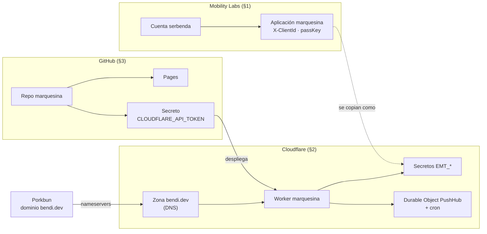
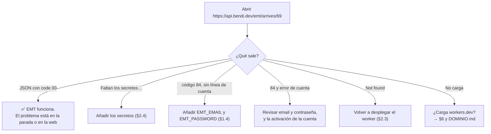
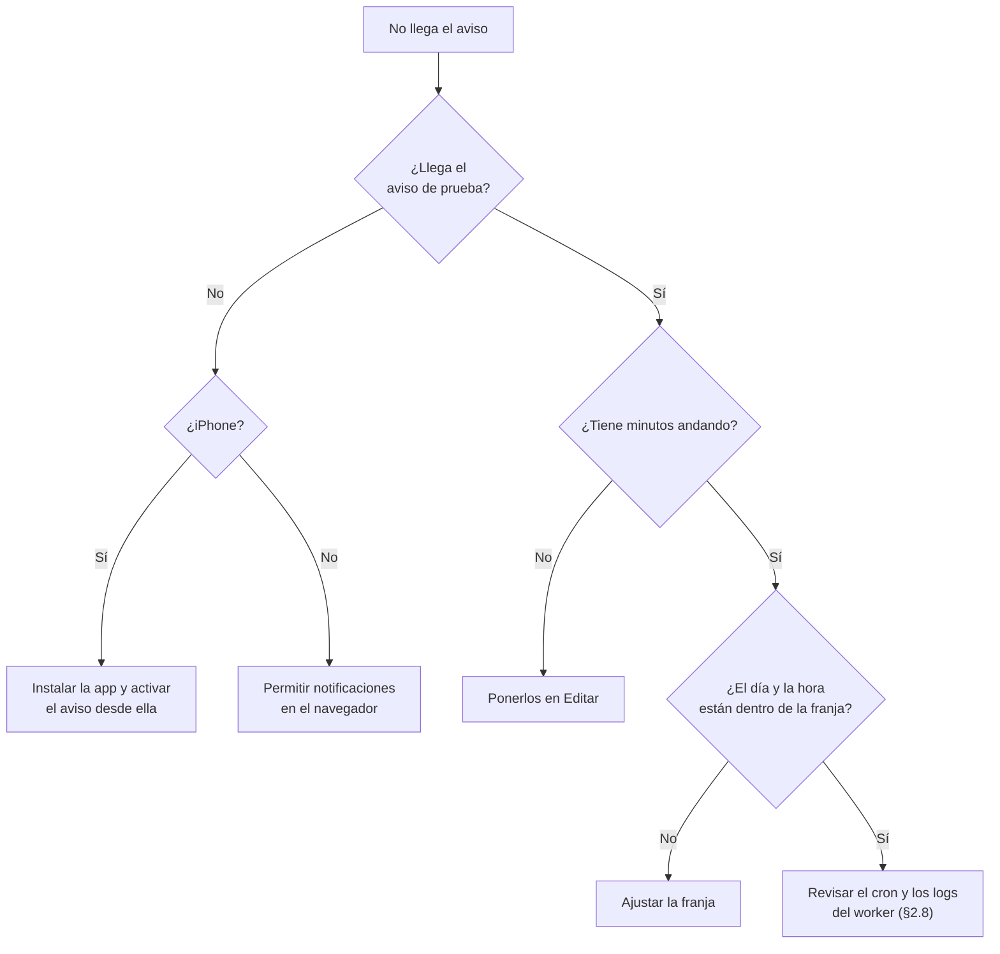

# marquesina: guía de puesta en marcha y mantenimiento

Pasos concretos para montar desde cero, revisar o reparar los servicios externos de marquesina: **Mobility Labs (EMT)**, **Cloudflare (worker)** y **GitHub Pages**. Cómo está diseñado todo se explica en [ARQUITECTURA.md](ARQUITECTURA.md).

> ¿Empiezas de cero? Lee primero la [guía paso a paso con diagramas](GUIA.md). Cómo funciona cada parte por dentro: [REFERENCIA.md](REFERENCIA.md).

> **Regla de oro:** las claves de EMT (X-ClientId y passKey) **nunca** se ponen en `index.html`, en el repo, en un issue ni en un chat. Solo viven en Mobility Labs y como secretos del worker en Cloudflare.

## Datos de referencia

| Qué | Valor |
|---|---|
| Web | https://bendi.dev/marquesina/ |
| Repo | https://github.com/serbenda/marquesina |
| Worker | `marquesina`, en **https://api.bendi.dev** y en https://marquesina.serbenda.workers.dev (alternativa). Ver [DOMINIO.md](DOMINIO.md) |
| DNS de bendi.dev | Cloudflare (nameservers `hassan` y `magali.ns.cloudflare.com`); el dominio sigue registrado en Porkbun |
| Panel de Cloudflare | https://dash.cloudflare.com |
| Portal de EMT | https://mobilitylabs.emtmadrid.es |
| Aplicación en EMT | `marquesina` (cuenta de serbenda) |
| Secretos del worker | `EMT_CLIENT_ID` y `EMT_PASSKEY` (aplicación); `EMT_EMAIL` y `EMT_PASSWORD` (cuenta, respaldo) |
| Icono de la aplicación | [`assets/icono.png`](../assets/icono.png) (512×512) |
| Secreto de GitHub | `CLOUDFLARE_API_TOKEN` (despliegue del worker) |
| Workflows | `pages.yml` (web), `worker.yml` (worker), `healthcheck.yml` (chequeo horario), `tests.yml` (tests en cada PR) |
| Durable Object | `PushHub` (suscripciones y claves VAPID de los avisos) |
| Cron del worker | `* * * * *` (revisa los avisos cada minuto) |

---

## 1. Mobility Labs (EMT Madrid)

### 1.1 Crear la cuenta (una vez)
1. Entra en https://mobilitylabs.emtmadrid.es y regístrate con tu email.
2. Abre el correo de confirmación y activa la cuenta con el enlace. Hasta que no lo actives, el inicio de sesión no funciona.

### 1.2 Registrar la aplicación `marquesina` (una vez)
Dentro del portal, en la zona de tu cuenta o de tus aplicaciones, crea una aplicación nueva con estos datos:

| Campo | Valor |
|---|---|
| Nombre | `marquesina` |
| Categoría | Transporte Público |
| Descarga | Solo **Web App**: `https://bendi.dev/marquesina/` |
| Descripción | Mapa en tiempo real de los autobuses que llegan a tus paradas: dónde están, cuánto les falta y si te da tiempo a salir. Web gratuita y sin anuncios. |
| Firebase Api_Key | Vacío (solo es para apps móviles con notificaciones) |
| Lenguaje del contenido | Español |
| Icono (obligatorio) | `assets/icono.png` de este repo |

Errores habituales del formulario:
- *"Los campos Nombre, Categoría y Descripción son obligatorios"*: el formulario se vacía cuando falla un envío. Rellénalo de nuevo y comprueba que la categoría no se haya quedado en "-- Selecciona Categoría --".
- *"La aplicación debe tener al menos la imagen de icono"*: sube `assets/icono.png`.

### 1.3 Obtener las claves
Al abrir la aplicación ya creada, el portal muestra:
- **X-ClientId**: un identificador largo con guiones.
- **passKey**: un código largo.

Cópialos directamente a Cloudflare (paso 2.4). No los guardes en ningún archivo del repo.

### 1.4 Aplicación no habilitada: código 84
Con una aplicación recién registrada, EMT responde **código 84** al iniciar sesión con su X-ClientId y passKey, aunque estén bien copiados: la aplicación aún no está habilitada en el portal. Mientras tanto, la cuenta (email y contraseña) sí funciona.

Por eso el worker admite dos formas de entrar y prueba en este orden:
1. **Aplicación**: `EMT_CLIENT_ID` + `EMT_PASSKEY`.
2. **Cuenta (respaldo)**: `EMT_EMAIL` + `EMT_PASSWORD`, con el email y la contraseña de Mobility Labs.

Con las dos parejas configuradas, el worker funciona ya con la cuenta y pasará a usar la aplicación en cuanto EMT la habilite, sin tocar nada. Revisa de vez en cuando en el portal si la aplicación aparece como activa o pendiente; si no se habilita, se puede pedir a EMT desde el propio portal.

### 1.5 Regenerar las claves
Hazlo si se filtran o si sospechas que hay un uso indebido:
1. En el portal, en la aplicación `marquesina`, regenera el passKey (o crea una aplicación nueva).
2. Actualiza los secretos en Cloudflare (paso 2.4) y pulsa **Deploy**.
3. Comprueba que funciona (paso 4).

---

## 2. Cloudflare (worker `marquesina`)

### 2.1 Crear la cuenta (una vez)
1. Entra en https://dash.cloudflare.com y regístrate. El plan gratuito es suficiente.
2. Si te pide añadir un dominio, sáltatelo: el worker no necesita dominio propio.

### 2.2 Crear el worker (una vez)
1. Menú de la izquierda → **Build → Compute (Workers)**. En algunas cuentas aparece como **Workers & Pages**.
2. **Create** → **Create Worker** (o *Start with Hello World!*).
3. **Worker name**: `marquesina`.
4. Si pregunta por **Protect with Cloudflare Access**, déjalo **desactivado**. Con Access activado el worker pediría iniciar sesión y la web no podría usarlo.
5. **Deploy**.
6. La primera vez pide elegir un subdominio de `workers.dev`. Se eligió `serbenda`, así que la URL es `https://marquesina.serbenda.workers.dev`.

### 2.3 Subir o actualizar el código
Normalmente no hay que hacer nada: al fusionar en `main` un cambio de `worker.js`, el workflow **Desplegar worker en Cloudflare** lo publica solo (ver §2.7).

El worker ya no es un solo archivo (importa `logic.js` y `push.js`, y declara el Durable Object y el cron en `wrangler.toml`), así que **no se puede pegar a mano** en el editor de Cloudflare. Si el despliegue falla:
1. Repo → **Actions** → *Desplegar worker en Cloudflare* → abre la ejecución en rojo y mira el paso que falló.
2. Corrige la causa (token caducado §2.7, error de sintaxis, etc.).
3. **Run workflow** para relanzarlo.

No edites el código desde el panel de Cloudflare: el siguiente despliegue desde GitHub lo sobrescribiría.

### 2.4 Configurar los secretos de EMT
1. Cloudflare → **Compute (Workers)** → `marquesina` → **Settings** → **Variables and Secrets**.
2. **Add** → tipo **Secret**:
   - Nombre `EMT_CLIENT_ID`, con el valor del **X-ClientId**.
   - Nombre `EMT_PASSKEY`, con el valor del **passKey**.
   - Nombre `EMT_EMAIL`, con el email de la cuenta de Mobility Labs (respaldo, ver §1.4).
   - Nombre `EMT_PASSWORD`, con la contraseña de esa cuenta (respaldo).
3. Pega los valores sin espacios ni saltos de línea al principio o al final.
4. **Deploy** para que el worker los use.

Para cambiar un secreto, edítalo en esa misma pantalla y vuelve a pulsar **Deploy**. Cloudflare no deja ver el valor guardado, solo sobrescribirlo.

### 2.5 Orígenes permitidos (CORS)
`ALLOWED_ORIGINS` en `worker.js` contiene `https://bendi.dev` y `https://serbenda.github.io`. Si la web se publica en otro dominio, añádelo ahí y repite el paso 2.3.

### 2.6 Vigilar el uso
Cloudflare → `marquesina` → **Metrics** (o *Observability*). El plan gratuito permite 100.000 peticiones al día. Las respuestas se guardan 20 s en caché, así que muchas personas mirando la misma parada cuentan poco.

---

### 2.7 Despliegue automático desde GitHub (una vez)
El workflow `.github/workflows/worker.yml` despliega el worker con wrangler. Necesita un token de Cloudflare guardado en GitHub:

1. **Crear el token en Cloudflare:** icono de perfil (arriba a la derecha) → **My Profile** → **API Tokens** → **Create Token** → plantilla **Edit Cloudflare Workers** → **Use template**.
   - En *Account Resources*, elige la cuenta `Serbenda@gmail.com's Account`. En *Zone Resources*, **All zones** (no se usa ninguna zona).
   - **Continue to summary** → **Create Token**. Copia el token: solo se muestra una vez.
2. **Guardarlo en GitHub:** repo `marquesina` → **Settings** → **Secrets and variables** → **Actions** → **New repository secret**.
   - Name: `CLOUDFLARE_API_TOKEN`
   - Secret: el token copiado.
3. **Probarlo:** repo → **Actions** → *Desplegar worker en Cloudflare* → **Run workflow**. Debe terminar en verde con "Worker desplegado y respondiendo".

El token solo permite gestionar Workers. Si se filtra, se revoca en la misma pantalla de API Tokens y se crea otro.

### 2.8 Durable Object y cron de los avisos
Los crea el propio despliegue (`wrangler.toml`), no hay que hacer nada en el panel. Para revisarlos:
- **Cron:** Cloudflare → `marquesina` → **Settings → Trigger events**: debe aparecer `* * * * *`.
- **Durable Object:** Cloudflare → **Storage & databases → Durable Objects** → `marquesina_PushHub`.
- **Logs:** Cloudflare → `marquesina` → **Logs / Observability**, filtrando por *scheduled*, para ver cada ejecución del cron.

El plan gratuito incluye los Durable Objects con almacenamiento SQLite y los cron triggers. **No borres el Durable Object:** guarda las claves VAPID y todas las suscripciones (ver ARQUITECTURA §5.1).

## 3. GitHub Pages (web)

### 3.1 Configuración (una vez)
1. Repo → **Settings → Pages → Build and deployment → Source: GitHub Actions**.
2. Repo → **Settings → Actions → General**: Actions permitidas.
3. El workflow `.github/workflows/pages.yml` publica la web en cada push a `main`.

### 3.2 Publicar un cambio
1. Trabajar en `development` y abrir una PR a `main`.
2. Fusionar la PR. En **Actions** se ejecuta *Publicar en GitHub Pages* (unos 30–60 s).
3. Ver el cambio en `https://bendi.dev/marquesina/?v=N`, o con Ctrl/Cmd + Shift + R, para saltarse la caché de unos 10 minutos.

**Cambios que tocan la web y el worker a la vez:** al fusionar se ejecutan los dos workflows en paralelo. El del worker tarda menos de un minuto; si la web nueva depende de una ruta nueva del worker, puede fallar durante ese rato.

**App instalada (service worker):** la página se pide siempre a la red primero, así que los cambios llegan solos. Si cambias `sw.js` o la lista de archivos que guarda, sube `VERSION` en `sw.js` (por ejemplo `marquesina-v2`) para que los móviles borren la caché anterior.

### 3.3 Avisos del chequeo horario
El workflow **Chequeo de marquesina** (`healthcheck.yml`) comprueba cada hora la web, el Consorcio y EMT.
- **Recibir el email si falla:** GitHub → tu perfil → **Settings** → **Notifications** → **System → Actions**: activa las notificaciones por email (*Only notify for failed workflows*).
- **Ver qué ha fallado:** repo → **Actions** → la ejecución en rojo → el paso que falló muestra la respuesta recibida.
- **Si deja de ejecutarse:** GitHub desactiva los workflows programados tras 60 días sin actividad en el repo. Reactívalo en **Actions** → *Chequeo de marquesina* → **Enable workflow**.

### 3.4 Autoría de los commits
Commits firmados como `Sergio Santiago Bendaña Quesada <serbenda@gmail.com>`. Los merges que hace GitHub al fusionar una PR usan el nombre del perfil de GitHub. Al fusionar se puede elegir el email en el desplegable *Commit email*.

---

## 4. Comprobaciones rápidas

Abre estas URLs en el navegador:

| Qué se comprueba | URL | Resultado esperado |
|---|---|---|
| Worker y Consorcio | `https://api.bendi.dev/crtm/GetStops.php?codStop=8_06756` | JSON con `"MARQUÉS VALDAVIA"` |
| Worker y EMT (secretos) | `https://api.bendi.dev/emt/arrives/69` | JSON con `"code":"00"` y llegadas en `data[0].Arrive` |
| Avisos (clave VAPID) | `https://api.bendi.dev/push/key` | JSON con `publicKey` (87 caracteres) |
| Dirección alternativa | `https://marquesina.serbenda.workers.dev/push/key` | La misma clave |
| Web publicada | `https://bendi.dev/marquesina/?v=N` | Etiqueta **En vivo** y paradas de Alcobendas |
| Aviso real | En la web: *Editar* parada → *Avisarme para salir* → **Enviar aviso de prueba** | Llega la notificación "Marquesina: avisos activados" |

Desde el navegador la ruta de EMT puede mostrar el JSON aunque CORS lo bloquee para otras webs. Si la URL responde bien pero la web no, revisa `ALLOWED_ORIGINS`.

---

## 5. Errores del worker con EMT

| Respuesta de `/emt/arrives/…` | Significado | Qué hacer |
|---|---|---|
| `Faltan los secretos de EMT en el worker…` | No hay ninguna pareja configurada, o se configuraron sin pulsar Deploy | Paso 2.4 |
| `EMT rechazó el inicio de sesión (aplicación: código 84…)` sin línea de cuenta | La aplicación no está habilitada y no hay respaldo | Añadir `EMT_EMAIL` y `EMT_PASSWORD` (§1.4 y 2.4) |
| `… aplicación: código 84; cuenta: código …` | Tampoco entra con la cuenta | Revisar email y contraseña (sin espacios), y que la cuenta esté activada desde el correo |
| Otro código | Credenciales no válidas o cuenta bloqueada | Revisar la cuenta y la aplicación en Mobility Labs |
| `"code":"90"` o similar con `data` vacío | La parada no existe o no tiene servicio ahora | Probar con otra parada (69 o 72, en Cibeles) |
| 404 `Not found` | Ruta mal escrita, o el worker tiene código antiguo sin `/emt/` | Paso 2.3 con el `worker.js` actual |

El worker devuelve el código que da EMT para cada forma de entrar, sin incluir nunca las claves ni la contraseña.

---

## 6. "No se pudo conectar…" en una red concreta

Si la web funciona con datos móviles pero no en una red (casa, oficina), esa red puede bloquear `*.workers.dev`. La web prueba sola `api.bendi.dev` y `workers.dev`, así que basta con que una de las dos funcione. Si fallan las dos, revisar el filtro de esa red (Pi-hole, AdGuard, router, antivirus). Historia completa y diagnóstico en [DOMINIO.md](DOMINIO.md).

## 7. Avisos que no llegan

| Síntoma | Causa probable | Qué hacer |
|---|---|---|
| "Este navegador no permite notificaciones" | Navegador sin Web Push, o iPhone sin la app instalada | En iPhone: Compartir → Añadir a pantalla de inicio, abrir desde el icono y activar el aviso ahí (iOS 16.4+) |
| "Sin permiso de notificaciones…" | Se denegó el permiso | Ajustes del navegador o del sistema → Notificaciones → permitir para bendi.dev (o para la app instalada) |
| El aviso de prueba llega, pero los programados no | Falta indicar los minutos andando, el horario no coincide o el cron no se ejecuta | Revisar los minutos y la franja en *Editar*; revisar el cron (§2.8) |
| Dejan de llegar a un móvil | La suscripción caducó (el navegador la renovó o se borraron los datos) | Volver a guardar el aviso en *Editar*: se crea una suscripción nueva |
| No llegan a nadie | Se perdió la clave VAPID (se borró el Durable Object) o falla el worker | Comprobar `/push/key` (§4) y los logs. Si la clave cambió, cada usuario debe volver a activar sus avisos |
| Llegan repetidos | Dos suscripciones del mismo usuario (por ejemplo, navegador y app instalada) | Normal: son dos dispositivos o apps distintas |

## 8. Revisión periódica (cada pocos meses)

- [ ] Las tres comprobaciones del §4 responden bien.
- [ ] La aplicación `marquesina` sigue activa en Mobility Labs.
- [ ] El uso del worker en Cloudflare está lejos del límite diario.
- [ ] Los workflows (Pages, worker y chequeo) siguen en verde y sin avisos de acciones obsoletas.
- [ ] El chequeo horario sigue activo (no desactivado por inactividad).
- [ ] El token `CLOUDFLARE_API_TOKEN` sigue siendo válido (Cloudflare → API Tokens).
- [ ] El cron del worker sigue activo y el aviso de prueba llega (§4).
- [ ] Los tests pasan (`npm test` o el workflow *Tests*).
- [ ] La API del Consorcio mantiene el mismo formato (ver ARQUITECTURA §3.2).
