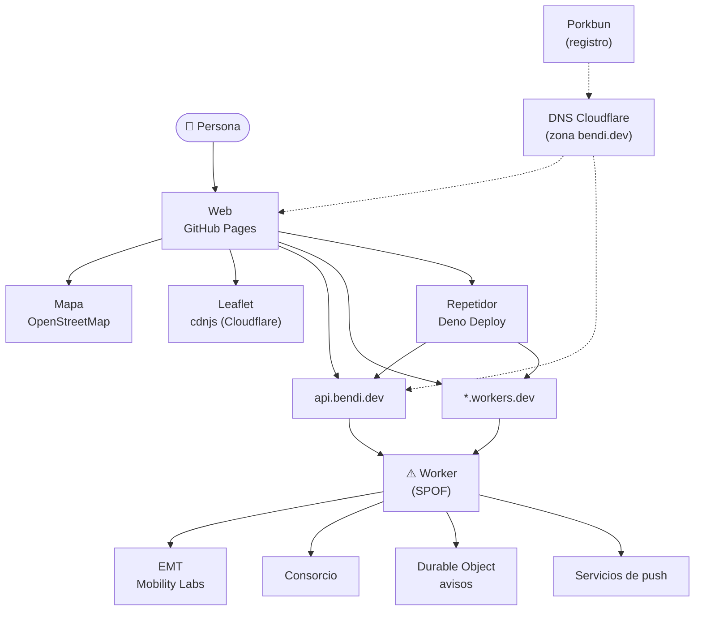
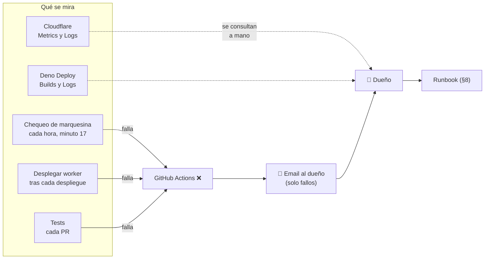
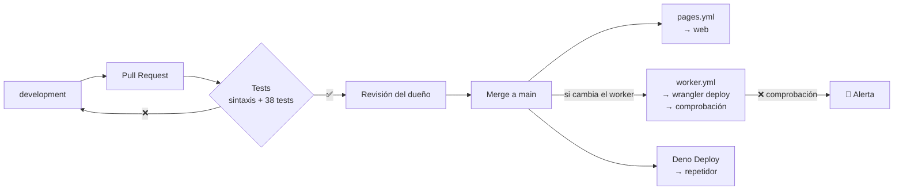
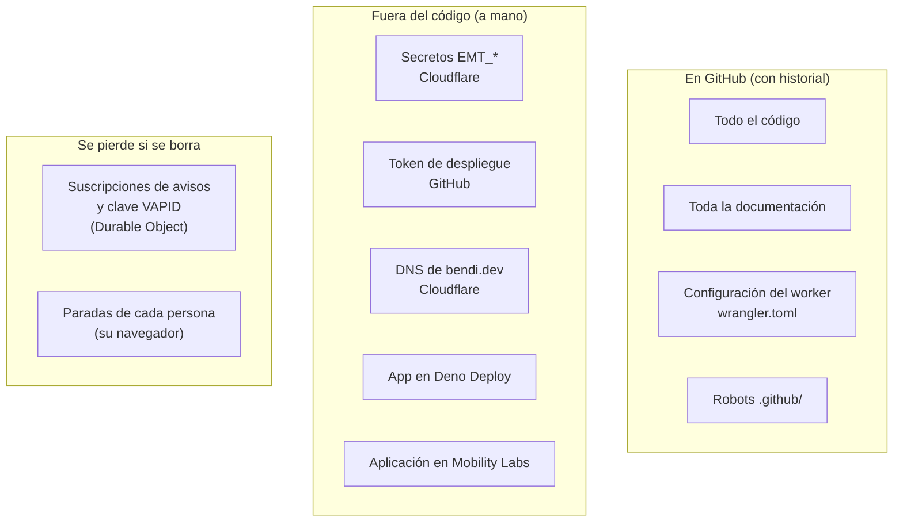

# marquesina: operación del servicio (SRE y DevOps)

Cómo se **mantiene marquesina funcionando**: qué piezas tiene, de qué depende, cómo se vigila, qué hacer cuando algo falla y cómo se recupera todo si se pierde. Escrito como lo haría un equipo de SRE, pero explicando cada concepto para quien empieza.

- Cómo se construyó: [HISTORIA.md](HISTORIA.md)
- Seguridad: [SEGURIDAD.md](SEGURIDAD.md)
- Tareas concretas paso a paso: [MANTENIMIENTO.md](MANTENIMIENTO.md)

---

## Índice

1. [Conceptos en 2 minutos](#1-conceptos-en-2-minutos)
2. [Inventario: todo lo que hay en producción](#2-inventario-todo-lo-que-hay-en-producción)
3. [Mapa de dependencias](#3-mapa-de-dependencias)
4. [Qué pasa si cae cada pieza](#4-qué-pasa-si-cae-cada-pieza)
5. [Objetivos de servicio (SLI y SLO)](#5-objetivos-de-servicio-sli-y-slo)
6. [Vigilancia y alertas](#6-vigilancia-y-alertas)
7. [Cómo se hacen los cambios (CI/CD)](#7-cómo-se-hacen-los-cambios-cicd)
8. [Manuales de incidentes (runbooks)](#8-manuales-de-incidentes-runbooks)
9. [Recuperación ante desastres](#9-recuperación-ante-desastres)
10. [Capacidad, límites y costes](#10-capacidad-límites-y-costes)
11. [Informes de incidentes (postmortems)](#11-informes-de-incidentes-postmortems)
12. [Mejoras de fiabilidad pendientes](#12-mejoras-de-fiabilidad-pendientes)

---

## 1. Conceptos en 2 minutos

| Término | Qué significa | En marquesina |
|---|---|---|
| **SRE** (*Site Reliability Engineering*) | Forma de trabajar que trata la fiabilidad como un problema de ingeniería: medir, automatizar y aprender de los fallos | Este documento |
| **DevOps** | Quien escribe el código también lo publica y lo opera, con mucha automatización | GitHub Actions publica y vigila todo |
| **Producción** | Lo que usa la gente de verdad | La web, el worker y el repetidor |
| **SPOF** (*single point of failure*) | Pieza que, si cae, tira todo | El worker es el único SPOF que queda |
| **SLI** (*indicador*) | Algo que se mide | "¿Responde `/push/key`?" |
| **SLO** (*objetivo*) | Cuánto de bien queremos que vaya ese indicador | "Que responda el 99 % de las horas" |
| **Presupuesto de error** | Lo que puede fallar sin incumplir el objetivo | 1 % de 720 horas al mes ≈ 7 horas |
| **Runbook** | Receta para resolver un incidente concreto sin pensar demasiado | Sección 8 |
| **Postmortem** | Informe después de un incidente: qué pasó, por qué y qué se cambia. Sin buscar culpables | Sección 11 |
| **RTO** | Cuánto se tarda en recuperar el servicio tras un desastre | Sección 9 |
| **RPO** | Cuántos datos se pueden perder en ese desastre | Sección 9 |
| **Degradación elegante** | Seguir dando algo útil aunque falle una parte | Datos antiguos marcados, "+20", otros caminos |
| **CI/CD** | Integración y despliegue continuos: cada cambio se prueba y publica solo | Sección 7 |

---

## 2. Inventario: todo lo que hay en producción

| Componente | Proveedor | Dirección | Código | Cómo se publica | Plan |
|---|---|---|---|---|---|
| Web | GitHub Pages | https://bendi.dev/marquesina/ | `index.html`, `logic.js`, `push.js`, `sw.js`, `manifest.webmanifest`, `assets/` | `pages.yml` al fusionar en `main` | Gratis |
| Worker | Cloudflare Workers | https://api.bendi.dev · https://marquesina.serbenda.workers.dev | `worker.js`, `logic.js`, `push.js`, `wrangler.toml` | `worker.yml` al fusionar cambios del worker en `main` | Free |
| Avisos (estado) | Cloudflare Durable Objects | (interno) `PushHub` / `hub` | `worker.js` | Con el worker | Free (SQLite) |
| Cron de avisos | Cloudflare Cron Triggers | cada minuto | `wrangler.toml` | Con el worker | Free |
| Repetidor | Deno Deploy | https://marquesina.serbenda.deno.net | `relay/` | Deno publica solo cada cambio de `main` | Gratis |
| DNS | Cloudflare | zona `bendi.dev` | — (panel) | A mano | Free |
| Dominio | Porkbun | `bendi.dev` | — | Renovación anual | De pago |
| CI y vigilancia | GitHub Actions | pestaña *Actions* | `.github/workflows/` | Con el repo | Gratis (repo público) |
| Datos EMT | Mobility Labs | openapi.emtmadrid.es | — | — | Gratis |
| Datos Consorcio | CRTM | www.crtm.es/widgets/api | — | — | Gratis, no oficial |
| Mapa | OpenStreetMap | tile.openstreetmap.org | — | — | Gratis, uso justo |
| Notificaciones | Google FCM, Mozilla, Apple, Microsoft | — | — | — | Gratis |

---

## 3. Mapa de dependencias

**Lectura:**
- Hay **tres caminos** hasta el worker, pero **un solo worker**. Si el worker cae, cae todo salvo el mapa.
- El DNS de `bendi.dev` está detrás de la **web** y de `api.bendi.dev`. Si fallara, quedarían `workers.dev` y el repetidor, pero no la web, porque también está en `bendi.dev`.
- **Leaflet** se descarga de cdnjs, que está en Cloudflare. Con la app instalada va en la caché del service worker, así que un bloqueo no afecta a quien ya la ha abierto antes.

---

## 4. Qué pasa si cae cada pieza

Análisis de modos de fallo (*FMEA*, simplificado):

| Si cae… | Lo que nota la persona | Gravedad | Mitigación que ya existe | Cómo se detecta |
|---|---|---|---|---|
| GitHub Pages | La web no carga (salvo la app instalada, que abre la copia guardada) | Alta | Service worker: página "primero red, si no, copia" | Chequeo: *Web publicada* |
| Worker | Ninguna parada carga; no hay avisos | **Crítica** | Ninguna (SPOF) | Chequeo: Consorcio, EMT y avisos |
| Durable Object | No se pueden activar avisos ni llegan | Media | — | Chequeo: *Avisos (clave VAPID)* |
| `api.bendi.dev` (DNS o certificado) | Nada, si funciona otro camino | Baja | `workers.dev` y repetidor | Chequeo de cada camino |
| IP de Cloudflare bloqueadas (fútbol) | Nada, si funciona el repetidor (~4 s más la primera vez) | Baja | Repetidor + elección en paralelo | Solo desde la red afectada |
| Repetidor | Nada, salvo durante un bloqueo | Baja | Los otros dos caminos | Chequeo: *Repetidor de respaldo* |
| EMT | Paradas de EMT con error | Media | Caché de 10 s; respaldo de autenticación | Chequeo: *EMT a través del worker* |
| Consorcio | Paradas del Consorcio con datos antiguos | Media | Reintento + últimos datos buenos 15 min | Chequeo: *Consorcio a través del worker* |
| OpenStreetMap | Mapa sin fondo; la lista funciona | Baja | — | Visual |
| Servicios de push | No llegan avisos | Media | — | Botón *Enviar aviso de prueba* |
| Porkbun (impago) | Al caducar el dominio, la web deja de estar en `bendi.dev` | **Crítica** a largo plazo | Renovación automática | Emails de Porkbun |
| Token de Cloudflare | No se pueden publicar cambios del worker; lo publicado sigue funcionando | Baja | — | *Desplegar worker* en rojo |

---

## 5. Objetivos de servicio (SLI y SLO)

Objetivos **propuestos** para un proyecto personal gratuito. Sirven para decidir cuándo un fallo merece atención.

| Indicador (SLI) | Cómo se mide | Objetivo (SLO) | Presupuesto mensual |
|---|---|---|---|
| Disponibilidad del worker | Chequeo horario: `/push/key`, `/crtm/…`, `/emt/…` en verde | 99 % de las horas | ~7 horas |
| Disponibilidad de la web | Chequeo horario: *Web publicada* | 99,5 % | ~3,5 horas |
| Frescura de los datos | Edad de los datos mostrados | < 30 s el 95 % del tiempo; nunca más de 15 min sin avisar | — |
| Primera carga | Desde que se abre hasta ver minutos | < 3 s normal; < 8 s con bloqueo | — |
| Avisos | Llegan en el minuto en que tocan | 95 % | — |

**Cómo se usa:** si el chequeo falla más de 7 horas en un mes, se para todo lo nuevo y se dedica el tiempo a fiabilidad. Si no, se pueden hacer cambios con tranquilidad.

---

## 6. Vigilancia y alertas

**Lo que comprueba el chequeo horario** (`healthcheck.yml`):

| Paso | Qué abre | Qué espera |
|---|---|---|
| Web publicada | `https://bendi.dev/marquesina/` | `<title>Marquesina</title>` |
| Consorcio a través del worker | `api.bendi.dev/crtm/GetStopsTimes.php?codStop=8_06756…` | `"stopTimes"` |
| EMT a través del worker | `api.bendi.dev/emt/arrives/69` | `"code":"00"` |
| Avisos | `api.bendi.dev/push/key` | `"publicKey"` |
| Dirección alternativa | `marquesina.serbenda.workers.dev/push/key` | `"publicKey"` |
| Repetidor de respaldo | `marquesina.serbenda.deno.net/push/key` | `"publicKey"` |

**Puntos ciegos conocidos:**
- El chequeo se ejecuta **desde EE. UU.** (GitHub). No ve los bloqueos de redes españolas. Para eso solo sirve probar desde la red afectada.
- No mide la **latencia** ni si los **avisos llegan** de verdad.
- GitHub **desactiva** los chequeos programados tras 60 días sin cambios en el repo.

---

## 7. Cómo se hacen los cambios (CI/CD)

| Puerta (*gate*) | Qué impide |
|---|---|
| Rama protegida por norma (`main` solo por PR) | Cambios sin revisar |
| Tests en cada PR | Romper la lógica o la sintaxis |
| Comprobación tras desplegar el worker | Dar por bueno un despliegue que no responde |
| Dependabot (mensual, a `development`) | Acciones de GitHub desactualizadas o con fallos de seguridad |

**Vuelta atrás (*rollback*):**
- **Web o repetidor:** *Revert* de la PR en GitHub → nueva PR → merge. Se publica sola.
- **Worker:** igual; o, en una emergencia, Cloudflare → worker → **Deployments** → volver a la versión anterior.
- **DNS:** volver a poner en Porkbun los nameservers de Porkbun ([DOMINIO.md](DOMINIO.md) §6).

---

## 8. Manuales de incidentes (runbooks)

Cada manual: **síntoma → comprobación → acción → verificación**.

### R1 · La web no carga
1. **Comprobar:** GitHub → *Actions* → ¿*Publicar en GitHub Pages* en rojo?
2. **Acción:** abrir la ejecución y ver el paso que falla; relanzar con *Re-run jobs*. Si es el DNS, ver R7.
3. **Verificar:** `https://bendi.dev/marquesina/` carga.

### R2 · Ninguna parada carga en ningún sitio (worker caído)
1. **Comprobar:** `https://api.bendi.dev/push/key` y `https://marquesina.serbenda.workers.dev/push/key`. Si **ninguno** responde, el worker está caído.
2. **Acción:** Cloudflare → *Workers* → `marquesina` → *Logs* y *Metrics*. ¿Errores? ¿Límite diario? Volver a la versión anterior en *Deployments* o relanzar *Desplegar worker*.
3. **Verificar:** el chequeo horario en verde (lanzarlo a mano con *Run workflow*).

### R3 · Paradas de EMT con error
1. **Comprobar:** `https://api.bendi.dev/emt/arrives/69` → leer `description`.
2. **Acción:** según el código, [MANTENIMIENTO.md §5](MANTENIMIENTO.md). Código 84 → secretos de respaldo. Credenciales → regenerarlas en Mobility Labs y sustituirlas en Cloudflare.
3. **Verificar:** `"code":"00"`.

### R4 · Paradas del Consorcio con datos antiguos o error
1. **Comprobar:** `https://api.bendi.dev/crtm/stop/06756`. Si da 502 o `stale: true` durante mucho rato, el Consorcio está caído o ha cambiado su API.
2. **Acción:** si es caída, esperar (no depende de nosotros). Si ha cambiado el formato, guardar la respuesta nueva en `tests/fixtures/` y ajustar `logic.js`.
3. **Verificar:** `stopTimes` con horas actuales.

### R5 · "No se pudo conectar" solo desde una red (bloqueo)
1. **Comprobar:** ¿hay fútbol? (*hayahora.futbol*). ¿Funciona con otra red?
2. **Acción:** la web debería ir sola por el repetidor. Si no: abrir `https://marquesina.serbenda.deno.net/push/key`. Si responde, recargar la web forzando. Si no responde, R9.
3. **Verificar:** la web pone **En vivo** desde esa red.

### R6 · No llegan los avisos
1. **Comprobar:** *Editar* parada → **Enviar aviso de prueba**.
2. **Acción:** si la prueba no llega → permisos del navegador o app no instalada en iPhone. Si la prueba llega y los programados no → minutos andando, franja horaria o cron ([MANTENIMIENTO.md §7](MANTENIMIENTO.md)).
3. **Verificar:** llega un aviso en la franja.

### R7 · Problemas de DNS o certificado en bendi.dev
1. **Comprobar:** `https://dns.google/resolve?name=bendi.dev&type=NS` → `hassan` y `magali`. Registros A → `185.199.108–111.153`.
2. **Acción:** Cloudflare → `bendi.dev` → *DNS*: los 10 registros en *DNS only*. GitHub → `serbenda.github.io` → *Pages*: *DNS check successful*.
3. **Vuelta atrás:** nameservers de Porkbun ([DOMINIO.md](DOMINIO.md) §6).

### R8 · "Desplegar worker" en rojo
1. **Comprobar:** el paso que falla. *Authentication error* → token. *Could not resolve host* → DNS o zona sin activar. Error de código → el último cambio.
2. **Acción:** token → crear uno nuevo ([GUIA fase 6](GUIA.md)). DNS → R7. Código → *Revert*.
3. **Verificar:** relanzar el workflow.

### R9 · El repetidor no responde
1. **Comprobar:** `https://marquesina.serbenda.deno.net/` → ¿`{"ok":true…}`?
2. **Acción:** console.deno.com → `serbenda` → `marquesina` → *Builds* (¿el último en rojo?) y *Logs*. Comprobar que la configuración es *Dynamic* con `relay/main.js`. Relanzar el último build.
3. **Ojo:** durante un bloqueo no se puede entrar en el panel de Deno (anti-robots en Cloudflare): usar una VPN o esperar.
4. **Verificar:** `/push/key` devuelve la misma clave que `api.bendi.dev`.

### R10 · Límite del plan gratuito
1. **Comprobar:** Cloudflare → worker → *Metrics*: ¿cerca de 100.000 peticiones al día?
2. **Acción:** subir `CACHE_SECONDS` en `worker.js` o el intervalo por defecto (`DEF.every`) en `index.html`; valorar el plan de pago.

---

## 9. Recuperación ante desastres

| Escenario | Qué se pierde | Cómo se recupera | Tiempo (RTO) | Datos perdidos (RPO) |
|---|---|---|---|---|
| Se borra el worker | Código desplegado y Durable Object | *Run workflow* de *Desplegar worker* y volver a poner los 4 secretos | ~15 min | **Todas las suscripciones**: cada persona tiene que volver a activar sus avisos |
| Se borra el repo | Nada si hay copia local; si no, todo el código | Restaurar desde un clon o un fork | ~30 min | Lo no subido |
| Se pierde la cuenta de Cloudflare | Worker, avisos y DNS | [GUIA](GUIA.md) fases 3, 5, 6 y 7 | ~2 h + propagación DNS | Suscripciones |
| Se pierde la app de Deno | Solo el repetidor | [GUIA](GUIA.md) fase 10 | ~10 min | Nada |
| Caduca el dominio | La web y `api.bendi.dev` | Renovar en Porkbun cuanto antes | Horas | Nada |
| Una persona borra los datos del navegador | Sus paradas y avisos en la web | Volver a añadirlas | Minutos | Sus ajustes |

**Copias de seguridad:**
- El **código** tiene historial completo en GitHub. Conviene tener además un clon en otro ordenador.
- Los **secretos** no se pueden leer después de guardarlos. Las claves originales están en Mobility Labs y se pueden regenerar.
- Las **suscripciones de avisos** no tienen copia. Es aceptable: se regeneran solas cuando cada persona vuelve a guardar su aviso.

---

## 10. Capacidad, límites y costes

| Recurso | Límite gratuito | Consumo esperado | Margen |
|---|---|---|---|
| Peticiones al worker | 100.000 al día | 1 persona con 3 paradas, 15 s, 1 h al día ≈ 720 | Amplio (≈100 personas así) |
| Ejecuciones del cron | Incluidas | 1.440 al día (cada minuto) | Amplio |
| Durable Object | Plan gratuito con SQLite | Hasta 1.000 suscripciones (límite propio) | Amplio |
| Deno Deploy | Organización sin verificar (límites bajos; ×100 al verificar) | Solo durante bloqueos | Suficiente; verificar si crece |
| GitHub Actions | Gratis en repos públicos | 24 chequeos al día + PR | Amplio |
| Teselas de OpenStreetMap | Política de uso justo | Bajo | Si crece mucho, usar otro proveedor de teselas |

**Coste total:** solo la renovación anual de `bendi.dev`.

---

## 11. Informes de incidentes (postmortems)

Formato sin culpables (*blameless*): qué pasó, por qué y qué se cambió para que no vuelva a pasar.

### INC-1 · Paradas de El Pardo no aparecían (1 nov, mañana)
- **Impacto:** en El Pardo, *Cerca de mí* y *Buscar paradas* no encontraban nada.
- **Causa raíz:** la búsqueda solo usaba el Consorcio, que no tiene todas las paradas de EMT.
- **Arreglo:** búsqueda en EMT (`/emt/near`) además del Consorcio, uniendo resultados ([PR #12](https://github.com/serbenda/marquesina/pull/12)).
- **Prevención:** test de `parseEmtNear` y `mergeStops`.

### INC-2 · Carga lenta, ~12,5 s (1 nov, tarde)
- **Impacto:** *"tarda en cargar, no funciona"*.
- **Causa raíz:** la respuesta esperaba a la posición GPS de todos los buses, que el Consorcio da lento.
- **Arreglo:** posiciones como mucho 2,5 s; cada parada se pinta al llegar; límite de 10 s por petición ([PR #14](https://github.com/serbenda/marquesina/pull/14)).
- **Prevención:** SLO de primera carga (§5).

### INC-3 · Errores 502 intermitentes del Consorcio (1 nov, tarde)
- **Impacto:** paradas con error a ratos.
- **Causa raíz:** el Consorcio falla cuando recibe muchas peticiones a la vez.
- **Arreglo:** reintento, máximo 3 a la vez, últimos datos buenos 15 min ([PR #15](https://github.com/serbenda/marquesina/pull/15)).
- **Prevención:** tests de reintento y de datos antiguos en `worker.test.js`.

### INC-4 · "No se pudo conectar" desde casa (1 nov, ~18:00)
- **Impacto:** la web no funcionaba desde la conexión de casa.
- **Causa atribuida entonces:** filtro de `*.workers.dev`.
- **Arreglo:** dominio propio `api.bendi.dev` ([PR #16](https://github.com/serbenda/marquesina/pull/16)).
- **Revisión posterior:** la causa principal era probablemente el bloqueo de LaLiga (INC-5). El dominio propio sigue siendo útil frente a filtros por nombre.
- **Lección:** confirmar la causa raíz comprobando también la **IP**, no solo el nombre.

### INC-5 · Bloqueo de LaLiga (1 nov, 19:31 – 20:08)
- **Impacto:** sin servicio desde redes de Movistar, MasOrange, Vodafone y DIGI durante los partidos.
- **Detección:** aviso del usuario (*"sigue sin ir"*). El chequeo horario no lo vio porque se ejecuta desde EE. UU.
- **Causa raíz:** bloqueo judicial de IP de Cloudflare compartidas (`188.114.96.5`, `188.114.97.5`).
- **Arreglo:** repetidor en Deno Deploy y elección del camino en paralelo ([PR #24](https://github.com/serbenda/marquesina/pull/24)). Probado con el bloqueo activo.
- **Tiempo hasta arreglar:** ~40 min desde el diagnóstico.
- **Prevención:** chequeo del repetidor; runbook R5; ver mejoras en §12.

---

## 12. Mejoras de fiabilidad pendientes

| Mejora | Qué resuelve | Esfuerzo |
|---|---|---|
| Chequeo desde España (por ejemplo, un runner propio o un servicio de monitorización con nodos en España) | Detectar bloqueos de operadoras españolas | Medio |
| Medir la latencia en el chequeo | Detectar lentitud, no solo caídas | Bajo |
| Copia del worker completa fuera de Cloudflare | Quitar el último SPOF | Alto |
| Exportar periódicamente las suscripciones | Poder recuperar los avisos | Medio |
| Revisar la PR de Dependabot que queda (#19) | Mantener las acciones al día | Bajo |
| Verificar la organización de Deno Deploy | Límites ×100 si crece el uso | Bajo |
