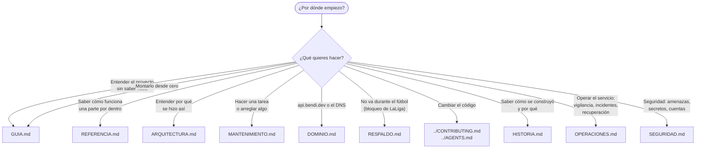

# Documentación de marquesina

| Documento | Para quién | Qué tiene |
|---|---|---|
| [GUIA.md](GUIA.md) | Quien empieza de cero | Qué es cada pieza (con un símil), diccionario, 14 diagramas, montaje en 9 fases, día a día, árbol de problemas |
| [REFERENCIA.md](REFERENCIA.md) | Quien va a tocar el código | Cómo funciona por dentro: arranque, ciclo de actualización, cada ruta del worker, cachés, avisos, cifrado, robots, límites, mensajes de error |
| [ARQUITECTURA.md](ARQUITECTURA.md) | Quien quiere entender las decisiones | Piezas, fuentes de datos, por qué un proxy, seguridad, ideas pendientes |
| [MANTENIMIENTO.md](MANTENIMIENTO.md) | Quien mantiene el servicio | Mobility Labs, Cloudflare, GitHub Pages, comprobaciones, errores y revisión periódica |
| [DOMINIO.md](DOMINIO.md) | Quien toca el DNS | Por qué `api.bendi.dev`, registros, nameservers, pasos y vuelta atrás |
| [HISTORIA.md](HISTORIA.md) | Todos | Cómo se construyó, paso a paso, con fechas, decisiones (ADR), lo configurado fuera del código y lecciones aprendidas |
| [OPERACIONES.md](OPERACIONES.md) | SRE / DevOps | Inventario, dependencias, qué pasa si cae cada pieza, SLO, vigilancia, CI/CD, runbooks, recuperación ante desastres, capacidad y postmortems |
| [SEGURIDAD.md](SEGURIDAD.md) | Arquitectura de seguridad | Activos, fronteras de confianza, modelo de amenazas STRIDE, controles, ciclo de vida de secretos, cuentas, cadena de suministro y riesgos |
| [RESPALDO.md](RESPALDO.md) | Quien mantiene el servicio | Repetidor en Deno Deploy para los bloqueos de LaLiga: por qué, cómo se monta y cómo se comprueba |

En la raíz del repositorio:

| Archivo | Qué tiene |
|---|---|
| [README.md](../README.md) | Qué es, cómo se usa y resumen de todo |
| [CONTRIBUTING.md](../CONTRIBUTING.md) | Cómo hacer cambios: ramas, commits, tests, lista de comprobación |
| [AGENTS.md](../AGENTS.md) | Lo imprescindible para un asistente de IA (o una persona nueva) antes de tocar nada |
| [SECURITY.md](../SECURITY.md) | Datos que se manejan, secretos y cómo avisar de un fallo |
| [CHANGELOG.md](../CHANGELOG.md) | Historial de cambios |

Los diagramas están hechos con [Mermaid](https://mermaid.js.org): GitHub los dibuja solos.
