# marquesina: referencia técnica en diagramas

Este documento explica **cómo funciona por dentro cada parte de marquesina**, casi todo con diagramas. Está pensado para quien vaya a tocar el código o tenga que averiguar por qué algo falla.

- ¿Empiezas de cero? Lee antes la [guía paso a paso](GUIA.md).
- Las decisiones de diseño están en [ARQUITECTURA.md](ARQUITECTURA.md), las tareas de mantenimiento en [MANTENIMIENTO.md](MANTENIMIENTO.md) y el dominio propio en [DOMINIO.md](DOMINIO.md).

> Los diagramas están hechos con Mermaid y GitHub los dibuja solos. Si ves código en lugar de un dibujo, abre el archivo en github.com.

---

## Índice

1. [Qué documento leer](#1-qué-documento-leer)
2. [Vista general de componentes](#2-vista-general-de-componentes)
3. [Archivos y dependencias](#3-archivos-y-dependencias)
4. [La web por dentro (`index.html`)](#4-la-web-por-dentro-indexhtml)
5. [La lógica (`logic.js`)](#5-la-lógica-logicjs)
6. [El worker (`worker.js`)](#6-el-worker-workerjs)
7. [Los avisos (Web Push)](#7-los-avisos-web-push)
8. [El service worker (`sw.js`)](#8-el-service-worker-swjs)
9. [Publicación y vigilancia (GitHub Actions)](#9-publicación-y-vigilancia-github-actions)
10. [Seguridad](#10-seguridad)
11. [Todos los números y límites](#11-todos-los-números-y-límites)
12. [Catálogo de mensajes de error](#12-catálogo-de-mensajes-de-error)
13. [Historial de problemas resueltos](#13-historial-de-problemas-resueltos)

---

## 1. Qué documento leer

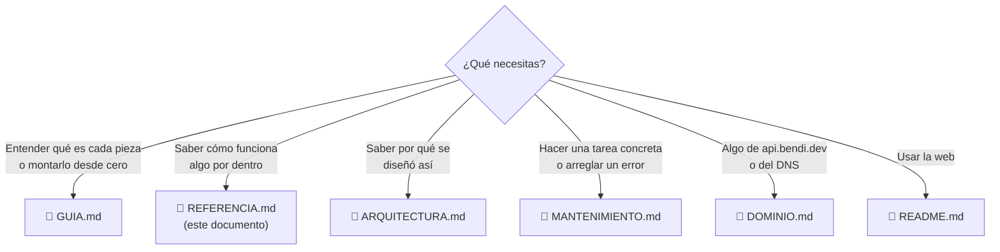

---

## 2. Vista general de componentes

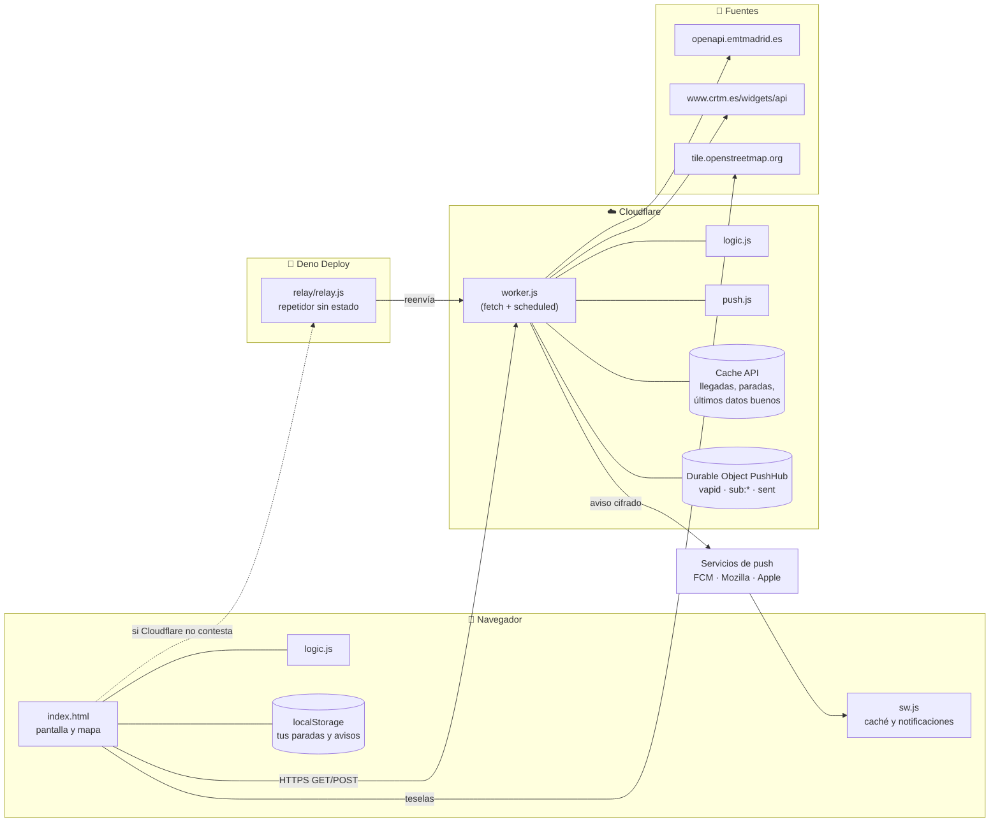

**Idea clave:** `logic.js` es el mismo archivo en los dos lados. La web lo usa para pintar y el worker para decidir cuándo enviar un aviso, así que los dos calculan "sal en X min" exactamente igual.

---

## 3. Archivos y dependencias

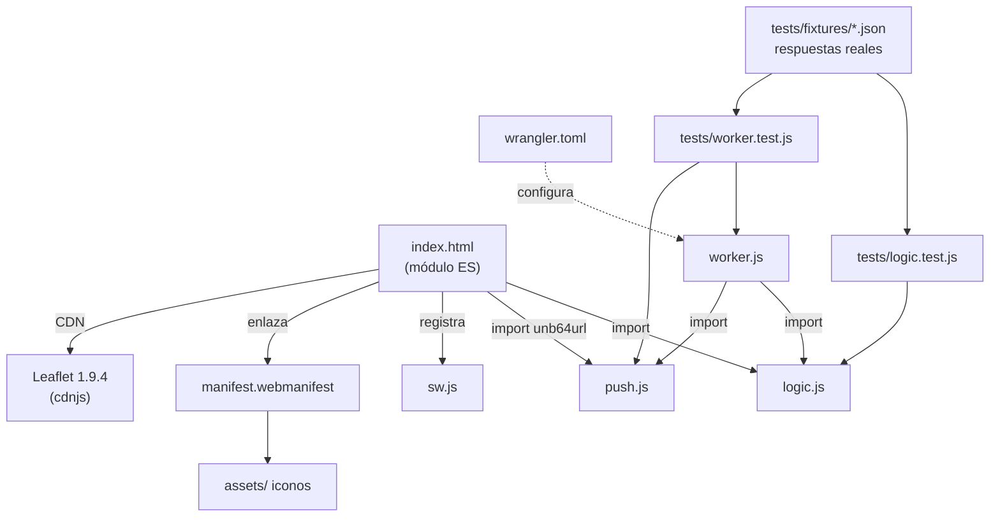

| Archivo | Líneas aprox. | Qué contiene | Se ejecuta en |
|---|---|---|---|
| `index.html` | 820 | Estilos, pantalla, mapa, ciclo de actualización, diálogos, avisos | Navegador |
| `logic.js` | 200 | Funciones puras: leer APIs, agrupar, calcular salida, formatos | Navegador **y** worker |
| `push.js` | 100 | Claves VAPID, firma ES256, cifrado aes128gcm, envío | Worker (y `unb64url` en la web) |
| `sw.js` | 80 | Caché de la app y recepción de notificaciones | Navegador (segundo plano) |
| `worker.js` | 420 | Rutas, proxy, cachés, Durable Object, cron | Cloudflare |
| `wrangler.toml` | 30 | Nombre, dominio, Durable Object, cron | Despliegue |
| `relay/relay.js` | 100 | Repetidor: rutas permitidas, reenvío, alternativa, CORS | Deno Deploy (y Node en los tests) |
| `relay/main.js` | 5 | `Deno.serve(handle)` | Deno Deploy |

---

## 4. La web por dentro (`index.html`)

### 4.1 Arranque

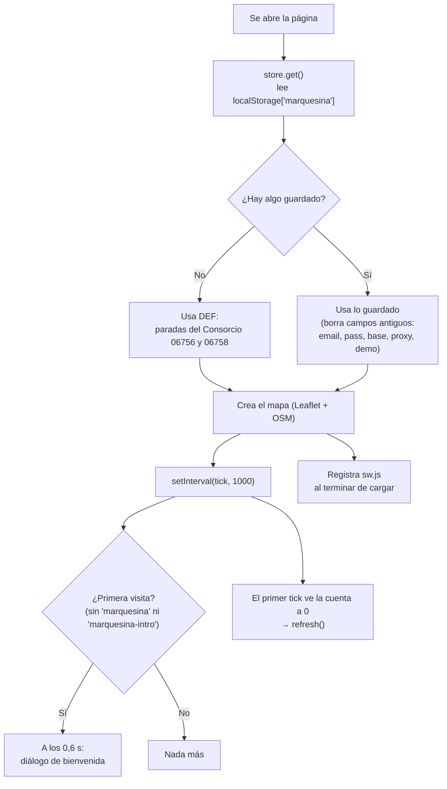

### 4.2 Ciclo de actualización

Cada segundo, `tick()` baja la cuenta atrás del anillo. Al llegar a 0 llama a `refresh()`, **pero solo si la pestaña está visible**: con la app en segundo plano no se gasta ni batería ni peticiones.

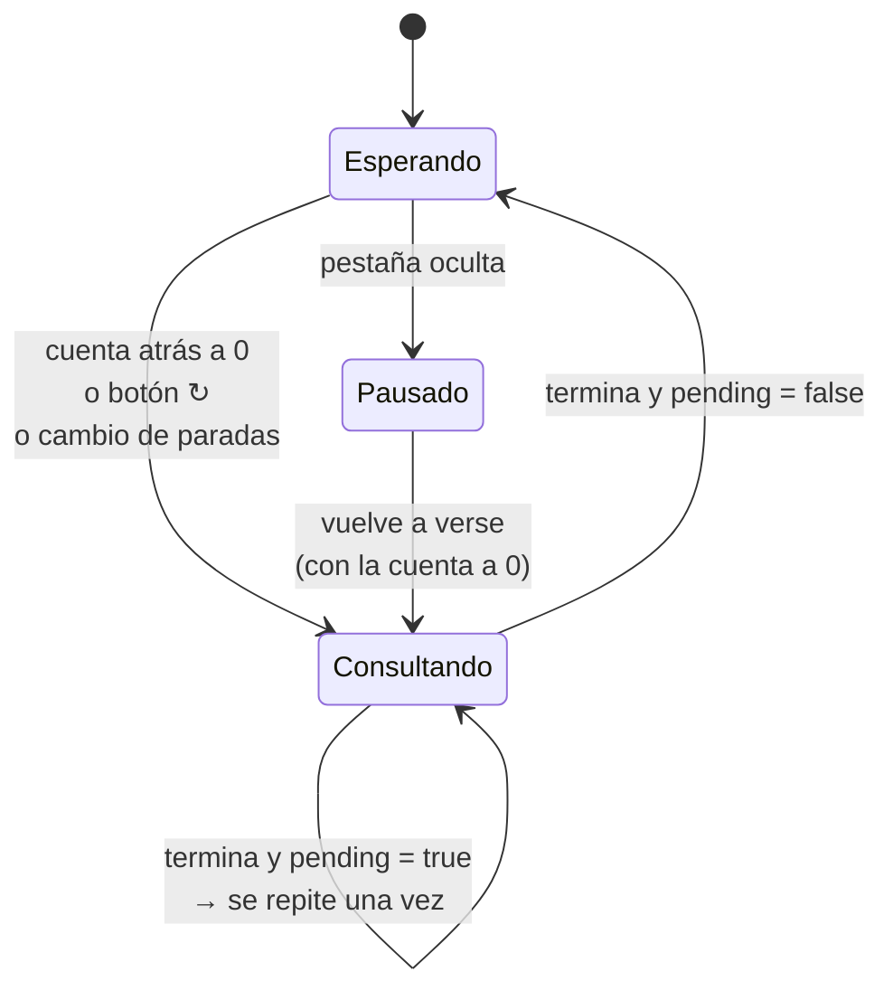

- Solo hay **una consulta a la vez** (`refreshing`). Si se pide otra mientras tanto, se apunta (`pending`) y se hace al terminar, así no se pierde y no se solapan.
- El intervalo (`cfg.every`) puede ser **10, 15, 30 o 60 s**. Por defecto, 15.

### 4.3 Renderizado progresivo

Cada parada se pinta **en cuanto llega su respuesta**, sin esperar a las demás. Mientras tanto se ven sus datos anteriores.

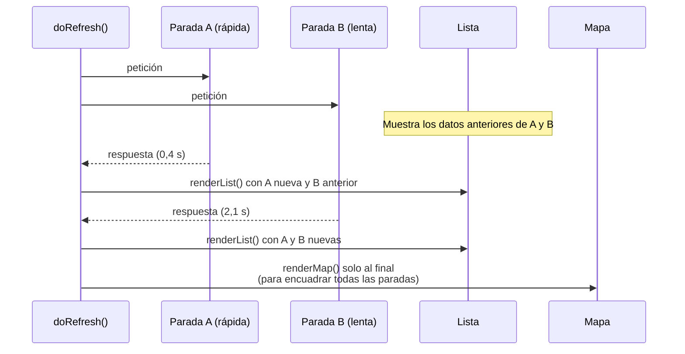

### 4.4 La etiqueta de estado (arriba a la derecha)

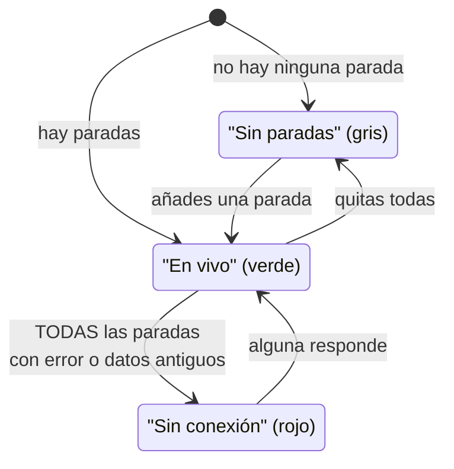

Si solo fallan algunas paradas, la etiqueta sigue en **En vivo** y el aviso aparece en la tarjeta de esa parada.

### 4.5 Las tres direcciones del worker (`pickProxy` y `getJson`)

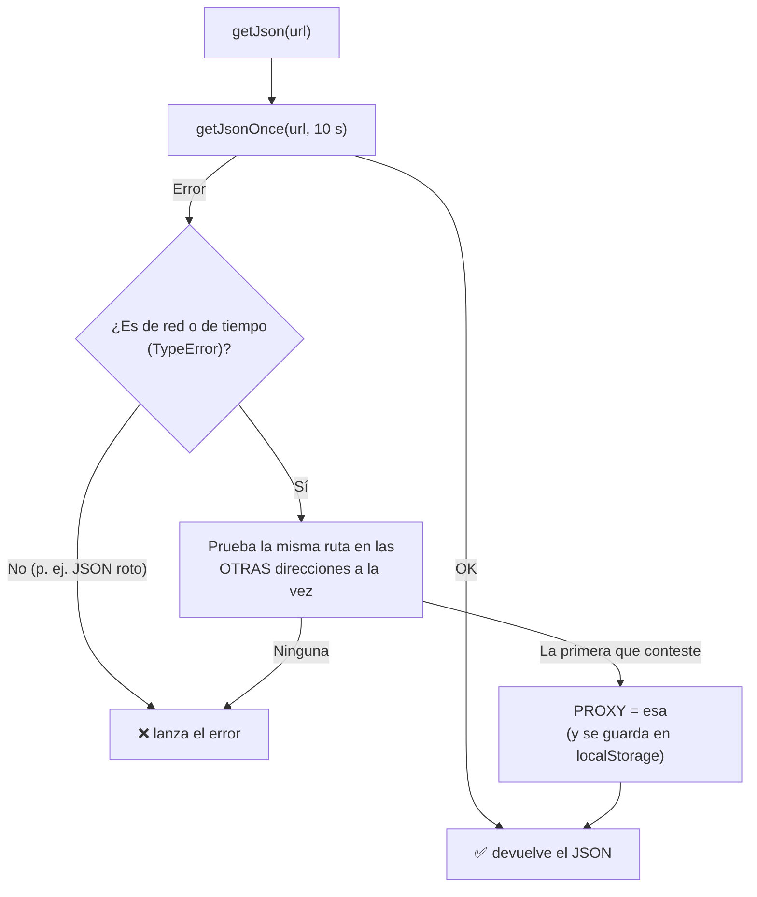

`PROXIES` tiene tres caminos al mismo worker:

| # | Dirección | Dónde | Para qué |
|---|---|---|---|
| 1 | `https://api.bendi.dev` | Cloudflare (dominio propio) | La principal |
| 2 | `https://marquesina.serbenda.workers.dev` | Cloudflare | Si un filtro bloquea el dominio propio |
| 3 | `https://marquesina.serbenda.deno.net` | Deno Deploy (repetidor) | Si las operadoras bloquean IP de Cloudflare (LaLiga). Ver [RESPALDO.md](RESPALDO.md) |

Al abrir la web, `pickProxy()` pide `/push/key` a **los tres caminos a la vez**. Si el primero en contestar es `api.bendi.dev`, se usa ese. Si es otro, se espera 0,5 s más por `api.bendi.dev` y, si no llega, se usa el que contestó. Así, al terminar un bloqueo, la web vuelve sola al camino directo. El camino elegido se guarda en `localStorage["marquesina-proxy"]` (se usa si ninguno contesta al abrir). La primera consulta de paradas espera a esa elección.

⚠️ Las rutas del Consorcio se piden **sin `.php`** (`/crtm/GetNearestStopsByLocation?…`): Deno Deploy rechaza las que acaban en `.php` (ver §6.9).

### 4.6 Qué pasa cuando una parada falla

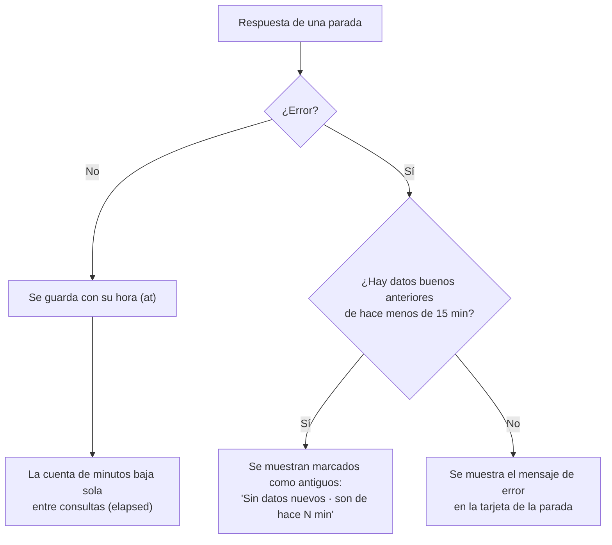

El worker tiene su propia red de seguridad para el Consorcio (ver [§6.6](#66-parada-del-consorcio-completa-crtmstopcódigo)): si el Consorcio falla, devuelve los últimos datos buenos con `stale: true` y la web los marca como antiguos con su hora real.

### 4.7 Datos guardados en el navegador

Todo lo personal se queda en el navegador (`localStorage`). El servidor solo guarda lo imprescindible para los avisos (ver [§7.1](#71-qué-se-guarda-en-el-durable-object)).

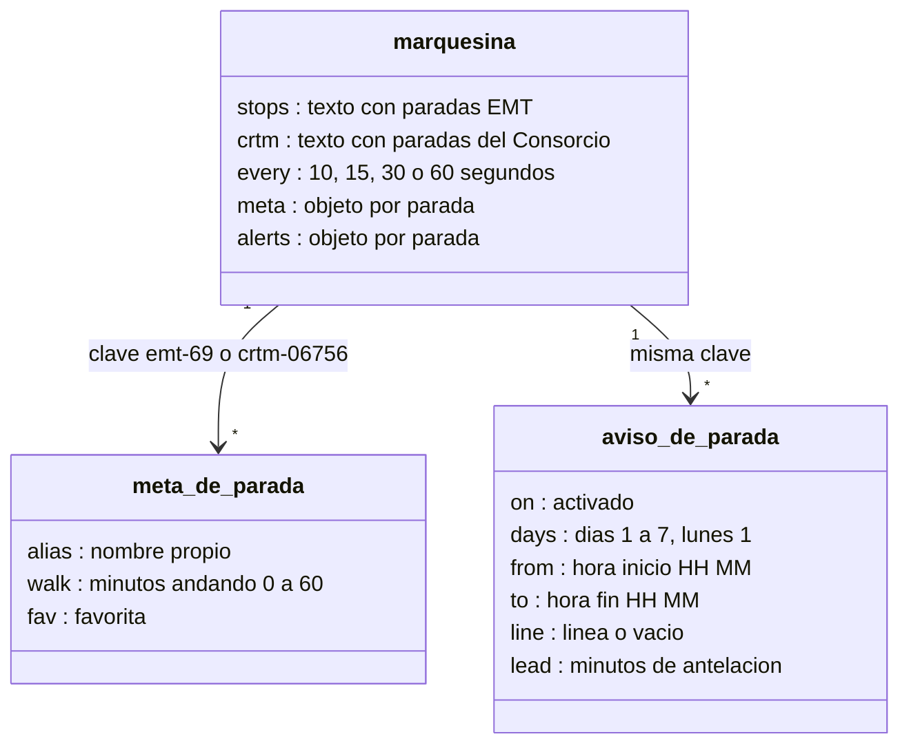

| Clave de `localStorage` | Para qué |
|---|---|
| `marquesina` | Todos los ajustes (el objeto de arriba) |
| `marquesina-intro` | `"1"` cuando ya se vio la bienvenida |
| `marquesina-ios-tip` | `"1"` cuando ya se enseñó en iPhone cómo instalar la app |
| `marquesina-proxy` | La última dirección del worker que funcionó |

Ejemplo real de `localStorage["marquesina"]`:

```json
{
  "stops": "69",
  "crtm": "06756, 4_278",
  "every": 15,
  "meta":   { "crtm:06756": { "alias": "Cole", "walk": 6, "fav": true } },
  "alerts": { "crtm:06756": { "on": true, "days": [1,2,3,4,5], "from": "08:00", "to": "08:45", "line": "153", "lead": 3 } }
}
```

En el diagrama las claves se escriben `emt-69`; en el código son `emt:69` y `crtm:06756`.

**Formato de los códigos de parada:**

| Red | Cómo se escribe | Código interno del Consorcio |
|---|---|---|
| EMT | `69` (en `stops`) | — |
| Interurbano | `06756` o `6756` (en `crtm`) | `8_06756` |
| Urbano de otro municipio | `9_…` | `9_…` |
| Metro | `4_278` | `4_278` |
| Metro Ligero | `10_…` | `10_…` |
| Cercanías | `5_18` | `5_18` |

### 4.8 Buscar paradas, Zona y Cerca de mí

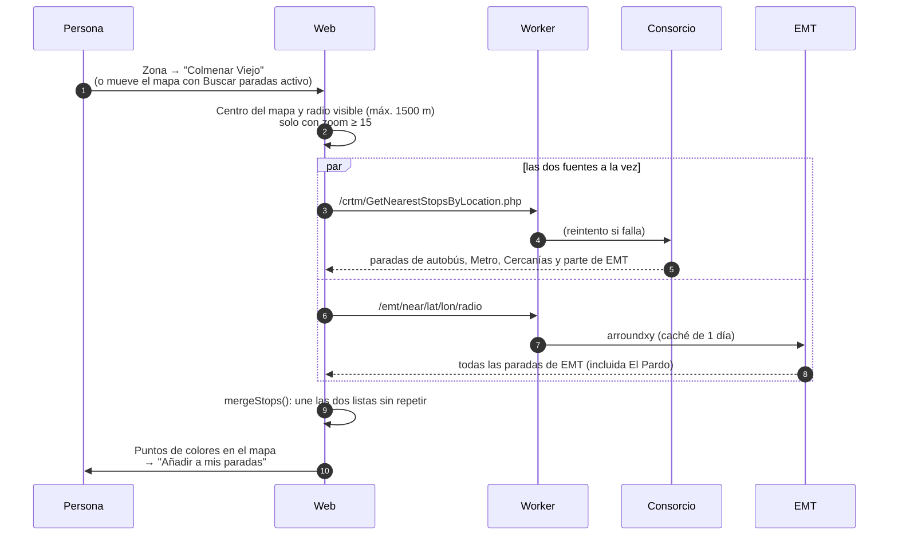

**Cerca de mí** pide la ubicación. Si aún no tienes paradas tuyas, carga las **3 más cercanas** (en 600 m). Si ya tienes, solo enseña las de alrededor para que elijas.

### 4.9 Bienvenida (primera visita)

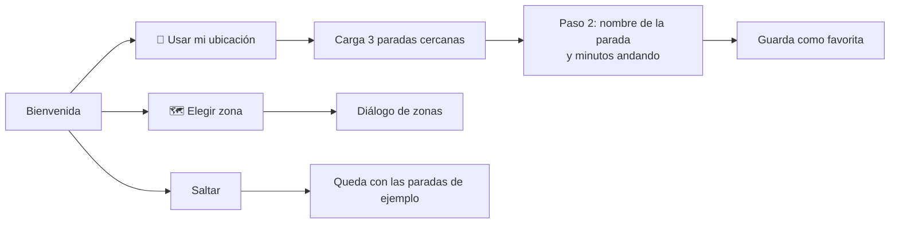

---

## 5. La lógica (`logic.js`)

Funciones **puras**: no tocan la red, la pantalla ni el mapa. Reciben datos y devuelven datos, por eso son fáciles de probar.

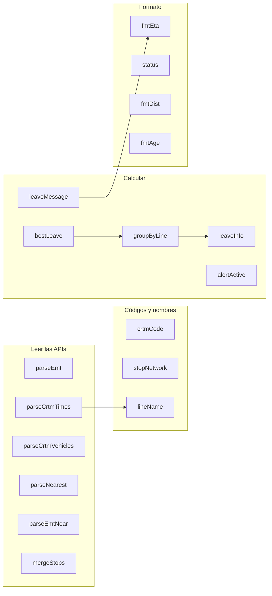

### 5.1 Cómo se calcula "Sal en X min"

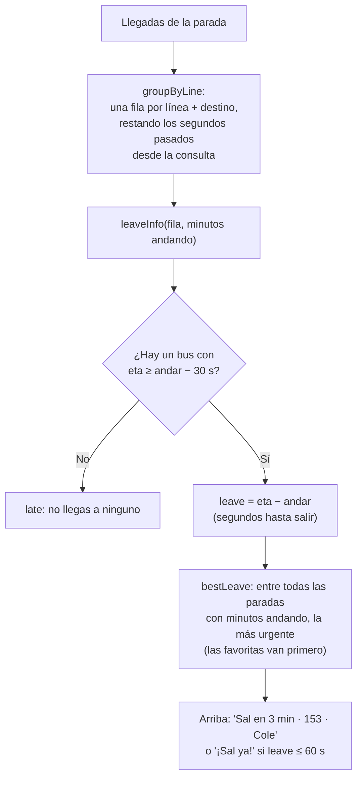

**Ejemplo:** tardas 6 min andando (360 s). Los próximos 153 pasan en 4 min (240 s) y en 14 min (840 s).

| Bus | eta | ¿eta ≥ 360 − 30 = 330? | Resultado |
|---|---|---|---|
| 1.º | 240 s | No | No llegas |
| 2.º | 840 s | Sí | **leave = 840 − 360 = 480 s → "Sal en 8 min"** (y avisa de que pierdes el primero) |

### 5.2 Formatos

| Función | Entrada | Salida |
|---|---|---|
| `fmtEta(s)` | `30` · `400` · `999999` | `<1 min` · `6 min` · `+20 min` |
| `status(s)` | `< 90` · `< 300` · resto | Llegando · Cerca · En camino |
| `fmtDist(m)` | `350` · `1500` | `350 m` · `1,5 km` |
| `fmtAge(ms)` | `30000` · `180000` | `hace menos de 1 min` · `hace 3 min` |
| `crtmCode(c)` | `6756` · `4_278` | `8_06756` · `4_278` |
| `lineName(cod)` | `8__157_C__` · `8_N_101___` | `157C` · `N101` |

⚠️ EMT manda `999999` segundos cuando el bus está a más de 20 min. Se respeta tal cual y se muestra **+20**; nunca se convierte en minutos (antes salía "16666′").

### 5.3 ¿Está activo un aviso? (`alertActive`)

Se calcula siempre en **hora de Madrid** (`Europe/Madrid`), aunque el worker funcione en UTC. Así el cambio de hora de octubre y marzo no afecta.

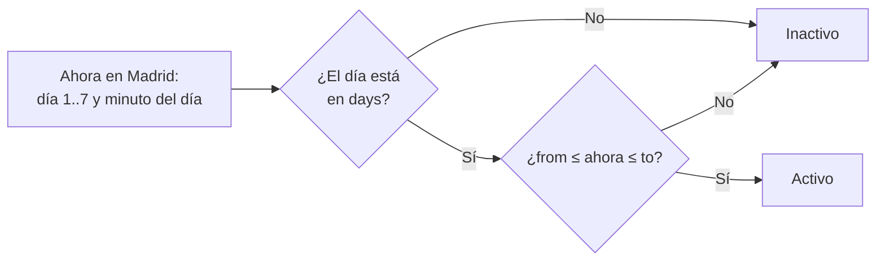

---

## 6. El worker (`worker.js`)

### 6.1 Enrutado de cada petición

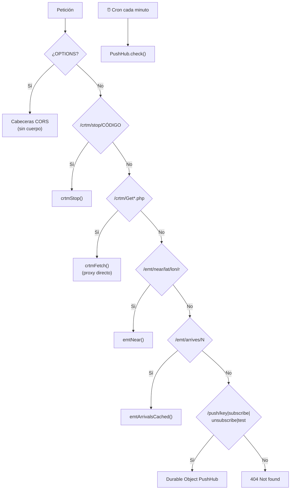

### 6.2 Rutas

| Ruta | Método | Qué devuelve | Caché | Si falla |
|---|---|---|---|---|
| `/crtm/stop/06756` | GET | `{stop:{name,pos}, stopTimes, vehicles, stale?}` | 10 s | Últimos datos buenos (`stale:true`) o **502** |
| `/crtm/GetStops.php?…` (y cualquier `Get*.php`) | GET | La respuesta del Consorcio tal cual | 10 s | **502** `El Consorcio no responde ahora mismo` |
| `/emt/near/40.47/-3.68/500` | GET | Respuesta de EMT `arroundxy` | 1 día | **502** `{code:"ERR"}` |
| `/emt/arrives/69` | GET | Respuesta de EMT `arrives` | 10 s | **502** `{code:"ERR", description}` |
| `/push/key` | GET | `{publicKey}` | — | — |
| `/push/subscribe` | POST | `{ok, alerts}` | — | **400** suscripción no válida · **503** máximo alcanzado |
| `/push/unsubscribe` | POST | `{ok}` | — | **400** |
| `/push/test` | POST | `{ok, status}` | — | **400** |
| Otra cosa | — | `Not found` | — | **404** |

Los códigos: coordenadas con `-?\d{1,2}(.\d+)`, radio de 1 a 4 cifras (se limita a 50–1500 m), parada de EMT de 1 a 6 cifras y parada del Consorcio `N_NNNNN` o solo cifras.

### 6.3 Inicio de sesión en EMT

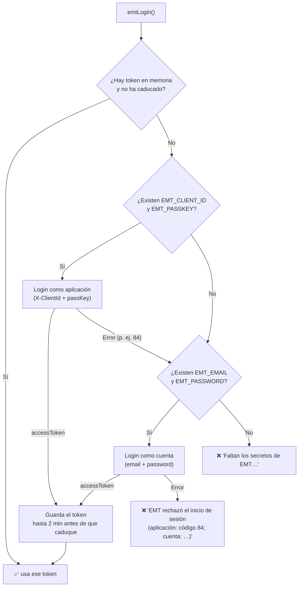

El token vive **en memoria de la instancia** del worker. Cloudflare puede arrancar instancias nuevas cuando quiera; entonces simplemente se vuelve a iniciar sesión.

### 6.4 Llegadas de EMT (`/emt/arrives/N`)

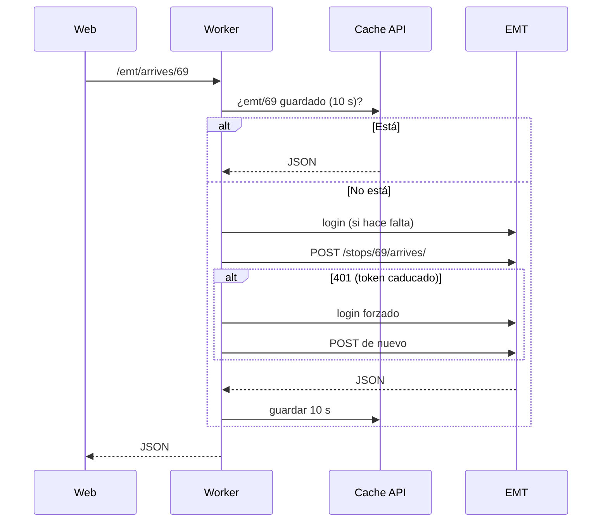

La misma caché la usan la web y los avisos: si 50 personas miran la misma parada, EMT recibe como mucho una petición cada 10 s.

### 6.5 Paradas de EMT cercanas (`/emt/near`)

- Redondea el punto a 3 decimales (unos 100 m) y el radio a 50–1500 m.
- Guarda la respuesta **1 día**: las paradas casi no cambian.
- El código `01` de EMT ("no hay paradas") también es una respuesta válida y se guarda.

### 6.6 Parada del Consorcio completa (`/crtm/stop/CÓDIGO`)

Es la ruta más compleja. Junta en **una sola respuesta** lo que serían 3 tipos de petición al Consorcio:

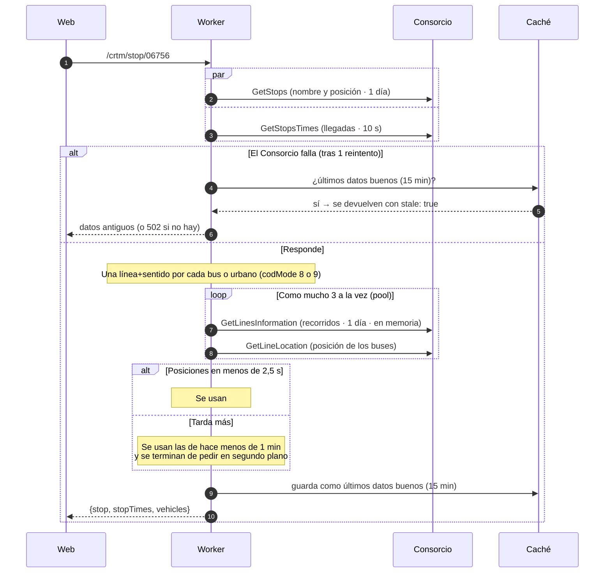

**Por qué así:**
- **Una sola petición desde la web:** antes eran 1 + 2 por línea y la carga tardaba hasta 12,5 s.
- **`pool(3)`:** si se piden todas las posiciones a la vez, el Consorcio responde con 502.
- **2,5 s como máximo para las posiciones:** los minutos importan más que el punto en el mapa.
- **Reintento a los 400 ms (`crtmFetch`):** los errores del Consorcio suelen ser momentáneos. También se reintenta si devuelve una página HTML en lugar de JSON.

### 6.7 Las capas de caché

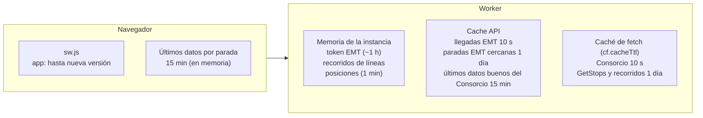

| Qué | Dónde | Cuánto | Clave |
|---|---|---|---|
| Página, `logic.js`, `push.js`, iconos, Leaflet | `sw.js` (Cache Storage) | Hasta cambiar `VERSION` | URL |
| Llegadas de EMT | Cache API | 10 s | `cache.marquesina/emt/<parada>` |
| Paradas de EMT cercanas | Cache API | 1 día | `cache.marquesina/emt-near/<lat>/<lon>/<r>` |
| Últimos datos buenos del Consorcio | Cache API | 15 min | `cache.marquesina/crtm-last/<código>` |
| Respuestas del Consorcio | `fetch` con `cf.cacheTtl` | 10 s (GetStops y recorridos: 1 día) | URL |
| Búsquedas de paradas, paradas y líneas del Consorcio (`/crtm/GetNearestStopsByLocation`, `GetStops`, `GetLinesInformation`) | Cache API | 1 día | `cache.marquesina/crtm/<nombre>?<consulta>` |
| Token de EMT | Memoria | Hasta 2 min antes de caducar | — |
| Recorridos de cada línea | Memoria | Mientras viva la instancia | `codLine` |
| Posiciones de los buses | Memoria | 1 min | código de parada |

⚠️ **Nunca se guardan** en el navegador las respuestas del worker ni las teselas del mapa: tienen que ser en vivo.

### 6.8 CORS

- Orígenes permitidos: `https://bendi.dev` y `https://serbenda.github.io`. Cualquier otro recibe `Access-Control-Allow-Origin: https://bendi.dev` y el navegador bloquea la respuesta.
- Métodos: `GET, POST, OPTIONS`. Cabecera permitida: `Content-Type`.
- El navegador guarda la respuesta a `OPTIONS` **1 día** (`Access-Control-Max-Age: 86400`).

### 6.9 El repetidor de respaldo (`relay/`)

Vive en Deno Deploy, fuera de Cloudflare, para cuando las operadoras bloquean IP de Cloudflare (ver [RESPALDO.md](RESPALDO.md) y [ARQUITECTURA §5.2](ARQUITECTURA.md)).

```mermaid
flowchart TB
  IN["Petición de la web"] --> O{"¿OPTIONS?"}
  O -- "Sí" --> C["Cabeceras CORS"]
  O -- "No" --> H{"¿Ruta '/'?"}
  H -- "Sí" --> OK["{ok:true, servicio}"]
  H -- "No" --> RT{"¿Empieza por<br/>/crtm/, /emt/ o /push/?"}
  RT -- "No" --> NF["404"]
  RT -- "Sí" --> M{"¿GET o POST?"}
  M -- "No" --> X405["405"]
  M -- "Sí" --> SZ{"¿Cuerpo ≤ 16 KB?"}
  SZ -- "No" --> X413["413"]
  SZ -- "Sí" --> U1["Reenvía a api.bendi.dev"]
  U1 -- "contesta (cualquier código)" --> COPY["Copia estado, cuerpo,<br/>Content-Type y Cache-Control<br/>+ CORS"]
  U1 -- "error de red o tiempo" --> U2["Reenvía a<br/>marquesina.serbenda.workers.dev"]
  U2 -- "contesta" --> COPY
  U2 -- "error" --> E502["502 {code:'ERR'}"]
```

| Detalle | Valor | Por qué |
|---|---|---|
| Plazo total | 24 s, compartido entre las dos direcciones | La búsqueda de paradas del Consorcio puede tardar 10 s o más; la web le da 25 s |
| Rutas | `/crtm/`, `/emt/`, `/push/` y `/` | No ser un proxy abierto |
| Métodos | GET, POST, OPTIONS | Los que usa la web |
| Cuerpo máximo | 16 KB | Una suscripción con 10 avisos ocupa ~2 KB |
| Secretos | Ninguno | Las claves de EMT siguen solo en Cloudflare |
| Estado | Ninguno | El worker es la única fuente de verdad (avisos incluidos) |
| Errores del worker (4xx/5xx) | Se copian tal cual | Traen un mensaje útil para la web |
| Tests | `tests/relay.test.js` (8) | Red simulada: reenvío, alternativa, 502, POST, límites, CORS |

⚠️ **Deno Deploy rechaza con un 404 vacío (sin cabeceras CORS) cualquier ruta que acabe en `.php`**, antes de que llegue a `relay.js`. Por eso la web pide `/crtm/GetNearestStopsByLocation?…` sin `.php`, y el worker acepta las dos formas y siempre añade `.php` al llamar al Consorcio. El chequeo horario hace esta búsqueda de verdad a través del repetidor.

`relay.js` no usa nada propio de Deno (solo `fetch`, `Request`, `Response` y `Headers`), por eso se prueba con Node. `main.js` es lo único específico: `Deno.serve((req) => handle(req))`.

---

## 7. Los avisos (Web Push)

### 7.1 Qué se guarda en el Durable Object

Hay **un único** Durable Object, llamado `hub`, con este contenido:

```mermaid
erDiagram
  VAPID {
    string publicKey "65 bytes en base64url"
    json privateJwk "clave privada ES256"
  }
  SUB {
    string id "sub: + 24 hex del SHA-256 del endpoint"
    json subscription "endpoint + keys p256dh y auth"
    number updated "fecha"
  }
  ALERT {
    string id "emt:69 o crtm:06756"
    string net "emt o crtm"
    string stop "código"
    string alias "hasta 24 letras"
    string line "vacío = cualquiera"
    number walk "1..60 min"
    number lead "0..15 min"
    list days "1..7"
    string from "HH:MM"
    string to "HH:MM"
  }
  SENT {
    string clave "sub|aviso|línea|bus"
    number cuando "se olvida a las 2 h"
  }
  SUB ||--|{ ALERT : "hasta 10"
  SUB ||--o{ SENT : "evita repetir"
```

- **No se guarda** el nombre, el correo ni la ubicación. Solo la dirección de entrega que da el navegador y los avisos.
- La clave VAPID se crea sola la primera vez que alguien pide `/push/key`. **Si se borrara el Durable Object, todas las suscripciones dejarían de valer** y cada persona tendría que volver a activar sus avisos.

### 7.2 Validación de lo que manda la web (`cleanAlerts`)

| Campo | Regla |
|---|---|
| Lista | Como mucho **10 avisos** por suscripción |
| `id` | Hasta 40 caracteres; obligatorio |
| `net` | `emt` o, si no, `crtm` |
| `stop` | Solo cifras y `_`, hasta 10; obligatorio |
| `alias` | Hasta 24 caracteres |
| `line` | Hasta 8 caracteres |
| `walk` | 0–60; si es 0, **se descarta el aviso** |
| `lead` | 0–15 |
| `days` | Números del 1 al 7; si no queda ninguno, se descarta |
| `from` / `to` | `HH:MM`; si no, 07:00 y 09:00 |
| Total | Como mucho **1000 suscripciones** en el worker |

### 7.3 Lo que hace el cron cada minuto

```mermaid
flowchart TB
  A["⏰ scheduled() → PushHub.check()"] --> B["Lee todas las sub:*"]
  B --> C["Filtra los avisos activos ahora<br/>(alertActive, hora de Madrid)"]
  C --> D{"¿Hay alguno?"}
  D -- "No" --> Z["Fin (no gasta nada más)"]
  D -- "Sí" --> E["Pide cada parada UNA vez<br/>aunque la usen varios avisos<br/>(EMT con la caché de 10 s)"]
  E --> F["bestLeave() con la línea elegida"]
  F --> G{"¿leave ≤ lead × 60?"}
  G -- "No" --> NEXT["Siguiente aviso"]
  G -- "Sí" --> H{"¿Ya se avisó de ese bus?<br/>(línea + hora prevista ±2 min)"}
  H -- "Sí" --> NEXT
  H -- "No" --> I["sendPush() cifrado y firmado<br/>TTL 120 s · Urgency high"]
  I --> J{"Respuesta"}
  J -- "2xx" --> K["Apunta en sent"]
  J -- "404 / 410" --> L["Suscripción caducada:<br/>se borra"]
  J -- "Otra" --> NEXT
  K --> NEXT
  L --> NEXT
  NEXT --> M["Borra de sent lo de hace más de 2 h"]
```

### 7.4 Cifrado y firma (`push.js`)

Sin librerías: todo con `crypto.subtle`, que existe igual en Cloudflare y en Node.

```mermaid
flowchart LR
  subgraph Firma["Firma VAPID (RFC 8292)"]
    J1["JWT {aud: origen del endpoint,<br/>exp: +12 h, sub: bendi.dev/marquesina}"] --> J2["Firma ES256<br/>con la clave privada"] --> J3["Authorization: vapid t=…, k=…"]
  end
  subgraph Cifrado["Cifrado (RFC 8291, aes128gcm)"]
    C1["Clave temporal ECDH P-256"] --> C2["Secreto compartido<br/>con p256dh del navegador"]
    C2 --> C3["HKDF con auth<br/>→ clave y nonce"]
    C3 --> C4["AES-128-GCM<br/>del JSON del mensaje"]
  end
  J3 --> P["POST al endpoint<br/>TTL · Urgency: high<br/>Content-Encoding: aes128gcm"]
  C4 --> P
```

Solo se aceptan endpoints de servicios de push conocidos (`isPushEndpoint`), para que nadie use el worker para enviar peticiones a otros sitios.

### 7.5 Cuando llega al móvil

```mermaid
sequenceDiagram
  participant S as Servicio de push
  participant SW as sw.js
  participant N as Sistema operativo
  participant A as App
  S->>SW: evento push (descifrado por el navegador)
  SW->>N: showNotification(título, texto, icono, vibración)
  Note over N: "¡Sal ya! 153 · Cole"
  N->>SW: la persona toca la notificación
  SW->>A: si la app está abierta, la trae al frente<br/>y si no, la abre
```

---

## 8. El service worker (`sw.js`)

```mermaid
flowchart TB
  A["Petición del navegador"] --> B{"¿Es GET?"}
  B -- "No" --> NET["Red normal"]
  B -- "Sí" --> C{"¿Worker (api.bendi.dev,<br/>*.workers.dev) o teselas OSM?"}
  C -- "Sí" --> NET
  C -- "No" --> D{"¿Es la página<br/>(navegación)?"}
  D -- "Sí" --> E["Primero red;<br/>si falla, la copia guardada"]
  D -- "No" --> F{"¿Mismo origen, cdnjs<br/>o Google Fonts?"}
  F -- "Sí" --> G["Primero caché;<br/>si no está, red y se guarda"]
  F -- "No" --> NET
```

**Ciclo de vida:**

```mermaid
stateDiagram-v2
  [*] --> install: primera visita<br/>o sw.js cambiado
  install --> activate: guarda la app (SHELL)<br/>y skipWaiting
  activate --> activo: borra cachés con otra VERSION<br/>y toma el control
  activo --> install: se publica un sw.js distinto
```

⚠️ Si cambias archivos que guarda (`logic.js`, `push.js`, iconos…), **sube `VERSION`** en `sw.js` (por ejemplo, de `marquesina-v2` a `marquesina-v3`). Si no, algunos móviles seguirán usando la versión anterior de esos archivos. La página (`index.html`) no lo necesita, porque va "primero red".

---

## 9. Publicación y vigilancia (GitHub Actions)

### 9.1 Qué robot se lanza y cuándo

```mermaid
flowchart LR
  PUSHD["push a development"] --> T["🧪 Tests"]
  PR["Pull Request"] --> T
  PUSHM["push a main<br/>(al fusionar)"] --> T
  PUSHM --> P["🌐 Publicar en GitHub Pages"]
  PUSHM -- "solo si cambian worker.js, logic.js,<br/>push.js, wrangler.toml o worker.yml" --> W["⚙️ Desplegar worker"]
  CRON["⏰ minuto 17 de cada hora"] --> H["🩺 Chequeo de marquesina"]
  MAN["▶️ Run workflow (a mano)"] --> P
  MAN --> W
  MAN --> H
```

| Robot | Archivo | Pasos |
|---|---|---|
| **Tests** | `tests.yml` | Sintaxis de `worker.js`, `sw.js` y `logic.js` → `node --test tests/*.test.js` |
| **Publicar en GitHub Pages** | `pages.yml` | Empaqueta el repo → lo publica en Pages |
| **Desplegar worker en Cloudflare** | `worker.yml` | Valida el código → `wrangler deploy` → espera hasta 5 min a `api.bendi.dev/push/key` → comprueba Consorcio, EMT, avisos y `workers.dev` |
| **Chequeo de marquesina** | `healthcheck.yml` | Web publicada → Consorcio → EMT → clave de avisos → dirección alternativa |

### 9.2 Qué hace `wrangler deploy`

```mermaid
flowchart TB
  A["wrangler deploy<br/>(con CLOUDFLARE_API_TOKEN)"] --> B["Empaqueta worker.js<br/>+ logic.js + push.js"]
  B --> C["Sube el código al worker 'marquesina'"]
  C --> D["Durable Object PushHub<br/>(migración v1, SQLite; solo la 1.ª vez)"]
  C --> E["Cron '* * * * *'"]
  C --> F["marquesina.serbenda.workers.dev"]
  C --> G["api.bendi.dev (custom domain):<br/>crea DNS y certificado<br/>— necesita bendi.dev Active en Cloudflare"]
  C -. "keep_vars" .-> H["NO toca los secretos<br/>EMT_* (se quedan como estaban)"]
```

### 9.3 Los tests

```mermaid
flowchart LR
  F1["emt-arrives-69.json"] --> L["logic.test.js<br/>parseo, agrupación, salida,<br/>avisos, formatos"]
  F2["crtm-stoptimes-06756.json"] --> L
  F3["crtm-linelocation-153.json"] --> L
  F1 --> W["worker.test.js<br/>rutas, caché, reintentos,<br/>datos antiguos, push"]
  F2 --> W
  F3 --> W
```

Los *fixtures* son **respuestas reales** guardadas de EMT y del Consorcio. Así los tests no dependen de que las APIs estén funcionando. Para ejecutarlos: `npm test` (Node 22, sin instalar nada).

---

## 10. Seguridad

```mermaid
flowchart TB
  subgraph Publico["🌍 Público (cualquiera puede verlo)"]
    CODE["Código del repo<br/>Web publicada<br/>Clave pública VAPID"]
  end
  subgraph Navegador["🔐 Solo en tu navegador"]
    LOC["Paradas, nombres,<br/>minutos andando, avisos"]
  end
  subgraph CF["🔒 Solo en Cloudflare"]
    SEC["EMT_CLIENT_ID · EMT_PASSKEY<br/>EMT_EMAIL · EMT_PASSWORD"]
    PRIV["Clave privada VAPID<br/>Suscripciones"]
  end
  subgraph GH["🔒 Solo en GitHub"]
    TOK["CLOUDFLARE_API_TOKEN"]
  end
  LOC -- "solo los avisos activados<br/>(sin nombre ni ubicación)" --> PRIV
  TOK -- "permite desplegar" --> CF
```

| Riesgo | Cómo se evita |
|---|---|
| Robo de las claves de EMT | Solo están como secretos del worker; la web no las ve nunca |
| Otra web usando el worker | CORS limitado a `bendi.dev` y `serbenda.github.io` |
| Usar el worker como proxy abierto | Solo rutas concretas; en `/crtm/` solo archivos `Get*.php` |
| Usar los avisos para atacar otros sitios | Solo endpoints de servicios de push conocidos |
| Llenar el almacenamiento | Máximo 1000 suscripciones y 10 avisos por suscripción; validación de cada campo |
| Inyectar HTML en la página | Todo texto que viene de fuera pasa por `esc()` |
| Token de Cloudflare filtrado | Solo con permisos de Workers; se puede revocar en *My Profile → API Tokens* |

---

## 11. Todos los números y límites

| Constante | Valor | Dónde | Qué controla |
|---|---|---|---|
| `DEF.every` | 15 s (10, 15, 30 o 60) | `index.html` | Cada cuánto se actualiza la web |
| `getJson` (tiempo) | 10 s | `index.html` | Cuánto se espera a una respuesta |
| Datos antiguos en la web | 15 min | `index.html` | Cuánto se enseñan los últimos datos si falla |
| Radio de búsqueda | hasta 1500 m, zoom ≥ 15 | `index.html` | Buscar paradas |
| Cerca de mí | 3 paradas en 600 m | `index.html` | Primera carga por ubicación |
| `CACHE_SECONDS` | 10 s | `worker.js` | Caché de llegadas |
| `VEHICLES_WAIT_MS` | 2500 ms | `worker.js` | Espera máxima por las posiciones |
| `pool` | 3 a la vez | `worker.js` | Peticiones de posición al Consorcio |
| Reintento Consorcio | 1, a los 400 ms | `worker.js` | `crtmFetch` |
| Últimos datos buenos | 900 s | `worker.js` | Respaldo si el Consorcio falla |
| Paradas EMT cercanas | 86400 s | `worker.js` | Caché de `/emt/near` |
| `MAX_ALERTS` | 10 | `worker.js` | Avisos por suscripción |
| `MAX_SUBSCRIPTIONS` | 1000 | `worker.js` | Suscripciones en total |
| Margen de salida | 30 s | `logic.js` | `leaveInfo` |
| "¡Sal ya!" | leave ≤ 60 s | `logic.js` | Texto del aviso |
| Llegadas por línea | 2, hasta 90 min | `logic.js` | `parseCrtmTimes` |
| TTL del aviso | 120 s (prueba: 60 s) | `worker.js` | Cuánto lo guarda el servicio de push si el móvil está apagado |
| Envíos recordados | 2 h | `worker.js` | Para no repetir el mismo bus |
| JWT VAPID | 12 h | `push.js` | Validez de la firma |
| Cron | cada minuto | `wrangler.toml` | Revisión de avisos |
| Chequeo | minuto 17 de cada hora | `healthcheck.yml` | Vigilancia |
| Plan gratuito de Workers | 100.000 peticiones al día | Cloudflare | Límite de uso |
| `pickProxy` | 4 s por camino (los tres a la vez) + 0,5 s de preferencia por `api.bendi.dev` | `index.html` | Elección del camino al abrir |
| Plazo del repetidor | 24 s | `relay/relay.js` | Tiempo total para llegar al worker |
| Espera de la búsqueda de paradas | 25 s | `index.html` (`crtmNearest`) | La búsqueda del Consorcio es lenta (4–10 s) |
| Espera de los minutos de una parada del Consorcio | 15 s | `index.html` (`crtmArrivals`) | El Consorcio va a rachas (1–9 s) |
| Nombre y posición de la parada, recorridos de las líneas | 1 día (Cache API) | `worker.js` (`crtmGetDaily`) | Casi no cambian |
| Búsquedas, paradas y líneas del Consorcio guardadas | 1 día | `worker.js` | Las paradas casi no cambian |
| Cuerpo máximo del repetidor | 16 KB | `relay/relay.js` | Tamaño de los POST de avisos |

---

## 12. Catálogo de mensajes de error

| Mensaje que ves | Dónde nace | Causa | Qué hacer |
|---|---|---|---|
| *No se pudo conectar con el Consorcio (parada X).* | `index.html` | Ninguna dirección del worker respondió en 10 s | Probar con datos móviles; ver [DOMINIO.md](DOMINIO.md) |
| *No se pudo conectar con EMT (parada X).* | `index.html` | Igual, para EMT | Igual |
| *No se pudo consultar el Consorcio* (502) | `worker.js` | El Consorcio falló dos veces y no había datos guardados | Esperar; es temporal |
| *El Consorcio no responde ahora mismo* (502) | `worker.js` | Igual, en las rutas `Get*.php` | Esperar |
| *Sin datos nuevos · son de hace N min* | `index.html` | Se muestran los últimos datos buenos | Nada |
| *EMT no está disponible ahora mismo (parada X).* | `logic.js` | El worker respondió `code: ERR` | Abrir `/emt/arrives/X` y leer `description` |
| *EMT rechazó el inicio de sesión (aplicación: código 84; …)* | `worker.js` | Aplicación no habilitada y sin cuenta de respaldo | Añadir `EMT_EMAIL` y `EMT_PASSWORD` ([MANTENIMIENTO §1.4](MANTENIMIENTO.md)) |
| *Faltan los secretos de EMT en el worker…* | `worker.js` | No hay ningún secreto `EMT_*` | [GUIA fase 5](GUIA.md) |
| *La parada X no devolvió datos (…)* | `logic.js` | El número de parada no existe o no tiene servicio | Revisar el número |
| *Sin datos de paradas* | `index.html` | Fallaron el Consorcio y EMT al buscar | Reintentar |
| *Acerca el mapa (o toca una zona)…* | `index.html` | Zoom menor de 15 al buscar | Acercar el mapa |
| *Sin permiso de notificaciones…* | `index.html` | Permiso denegado | Ajustes del navegador → Notificaciones |
| *En iPhone, instala primero la app…* | `index.html` | Safari sin instalar no admite push | Compartir → Añadir a pantalla de inicio |
| *Indica los minutos andando de la parada…* | `index.html` | Aviso sin minutos andando | Rellenar el campo |
| *No se pudieron guardar los avisos…* | `index.html` | `/push/subscribe` falló | Reintentar; ver los logs del worker |
| *Se ha alcanzado el máximo de suscripciones* (503) | `worker.js` | 1000 suscripciones | Subir `MAX_SUBSCRIPTIONS` |
| *El repetidor no pudo llegar al worker (…)* (502) | `relay/relay.js` | El worker no contesta ni en `api.bendi.dev` ni en `workers.dev` | Es un fallo del worker: [MANTENIMIENTO.md](MANTENIMIENTO.md) |
| *Failed to fetch* solo en la búsqueda de paradas, a través del repetidor | Deno Deploy | Ruta acabada en `.php` | Pedirla sin `.php` |
| *Petición demasiado grande* (413) | `relay/relay.js` | Cuerpo de más de 16 KB | Revisar qué manda la web |

---

## 13. Historial de problemas resueltos

```mermaid
flowchart LR
  P1["En El Pardo<br/>no salía ninguna parada"] --> S1["El Consorcio no tiene todas<br/>las paradas de EMT<br/>→ /emt/near + mergeStops"]
  P2["La carga tardaba ~12 s"] --> S2["Una sola petición por parada<br/>+ posiciones en 2,5 s como mucho<br/>+ pintado progresivo"]
  P3["502 del Consorcio a ratos"] --> S3["Reintento + pool(3)<br/>+ últimos datos buenos 15 min"]
  P4["'luego 16666′'"] --> S4["999999 de EMT = '+20'"]
  P5["Consultas solapadas"] --> S5["Una consulta a la vez<br/>con cola (pending)"]
  P6["Ajustes borraba nombres<br/>y avisos"] --> S6["Se conservan meta y alerts<br/>al guardar"]
  P7["Sin conexión en casa:<br/>la red bloquea *.workers.dev"] --> S7["api.bendi.dev<br/>+ alternativa automática"]
  P8["Sigue sin ir en casa<br/>en día de partido"] --> S8["Bloqueo de LaLiga por IP<br/>→ repetidor en Deno Deploy<br/>+ 3 caminos a la vez"]
```

| Problema | Causa | Solución | Dónde |
|---|---|---|---|
| Paradas de El Pardo no aparecían | El Consorcio no incluye todas las paradas de EMT | Buscar también en EMT (`/emt/near`) y unir | `worker.js`, `logic.js` |
| Carga lenta | Muchas peticiones encadenadas al Consorcio, esperando las posiciones | `/crtm/stop`, `VEHICLES_WAIT_MS`, pintado progresivo | `worker.js`, `index.html` |
| Errores 502 intermitentes | El Consorcio falla con muchas peticiones a la vez | `crtmFetch` con reintento, `pool(3)`, últimos datos buenos | `worker.js` |
| "16666′" | EMT usa 999999 para "más de 20 min" | `fmtEta` y `groupByLine` lo respetan | `logic.js` |
| Consultas solapadas | Varios `refresh()` a la vez | `refreshing` + `pending` | `index.html` |
| Ajustes borraba nombres y avisos | Se rehacía `cfg` sin `meta` ni `alerts` | `{...cfg, …}` | `index.html` |
| "No se pudo conectar" en una red concreta | Filtro que bloquea `*.workers.dev` | Dominio propio `api.bendi.dev` | `wrangler.toml`, `index.html` |
| Sigue sin conectar durante el fútbol | Bloqueo de LaLiga a IP de Cloudflare (mismas IP para los dos nombres) | Repetidor en Deno Deploy y elección del camino en paralelo | `relay/`, `index.html`, `sw.js` |
