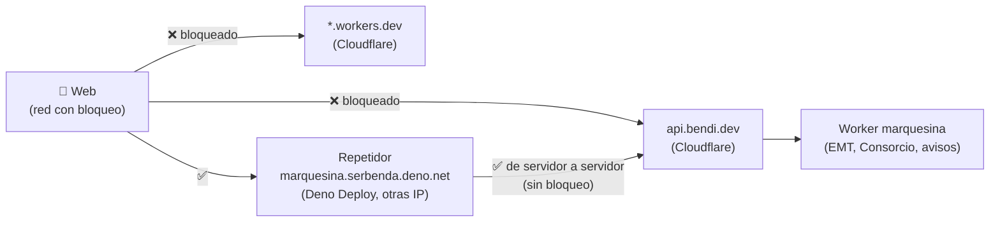
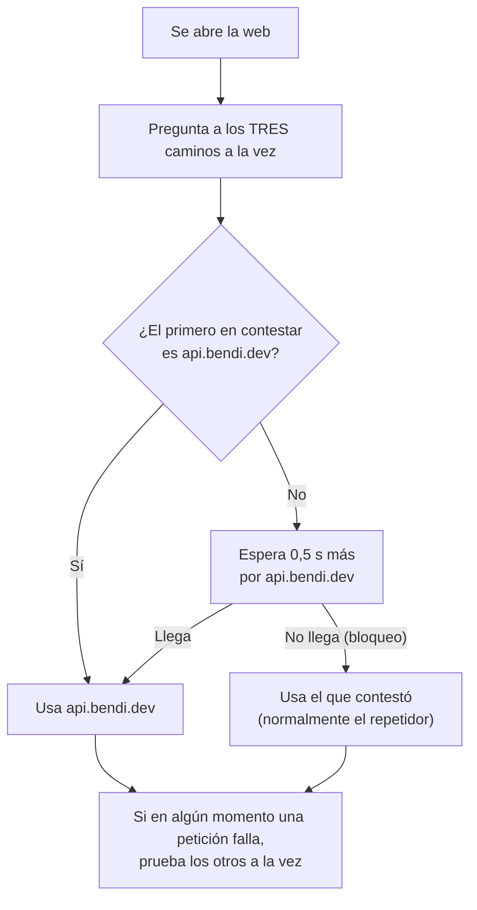

# marquesina: repetidor de respaldo fuera de Cloudflare

Qué es el repetidor de Deno Deploy, por qué hace falta, cómo se monta paso a paso y qué hacer si falla. Para el resto del proyecto, ver la [guía paso a paso](GUIA.md) y la [referencia técnica](REFERENCIA.md).

## 1. El problema: el bloqueo de LaLiga

Desde 2025, durante los partidos de fútbol, **Movistar, MasOrange, Vodafone y DIGI bloquean por orden judicial direcciones IP de Cloudflare** donde se emite fútbol pirata. Esas direcciones las comparten miles de webs que no tienen nada que ver, entre ellas el worker de marquesina.

El 1 de noviembre de 2026, un domingo por la tarde, se comprobó desde una conexión de casa:

| Prueba | Resultado |
|---|---|
| DNS de `api.bendi.dev` | ✅ Correcto: `188.114.96.5` y `188.114.97.5` (Cloudflare) |
| DNS de `marquesina.serbenda.workers.dev` | ✅ Las **mismas** IP |
| Abrir cualquiera de las dos | ❌ Se queda colgada (no da error: no contesta) |
| Desde GitHub Actions (EE. UU.) | ✅ Todo responde |

**Conclusión:** no es un fallo de marquesina ni del DNS. Es un bloqueo por IP en la red del operador. Un dominio propio no lo evita, porque el bloqueo va por la dirección numérica, no por el nombre.

> Para saber si hay bloqueo en un momento dado: el monitor **hayahora.futbol** lo indica en tiempo real.

## 2. La solución: un repetidor en otro proveedor



- El **repetidor** (`relay/relay.js`) recibe la petición de la web y la reenvía **tal cual** al worker. No sabe nada de autobuses, no guarda nada y **no necesita secretos**: las claves de EMT siguen solo en Cloudflare.
- El bloqueo solo afecta a los **clientes** de esas operadoras. La conexión entre Deno Deploy y Cloudflare no pasa por ellas, así que funciona.
- Los **avisos** siguen funcionando: el repetidor también reenvía `/push/…`, y las notificaciones las envía el worker a Google, Apple o Mozilla, que no están bloqueados.

### Cómo elige la web



Las tres direcciones, en orden: `api.bendi.dev` → `marquesina.serbenda.workers.dev` → `marquesina.serbenda.deno.net`.

> ⚠️ No es infalible: algún día podrían bloquear también IP de Deno Deploy. Por eso hay tres caminos y el chequeo horario vigila los tres.

## 3. Montarlo paso a paso (una sola vez, ~10 min)

> ✅ **Estado:** montado el 1 de noviembre de 2026 (organización `serbenda`, app `marquesina`). Probado ese mismo día desde una red con el bloqueo activo: la web eligió sola el repetidor y mostró las paradas **En vivo**. El chequeo horario lo vigila.

⚠️ **El inicio de sesión de Deno Deploy usa una verificación anti-robots alojada en Cloudflare**, así que durante un bloqueo tampoco carga. Hay que hacerlo cuando no haya partido, con una VPN o desde otra red.

### Paso 1 · Crear la cuenta

1. 🖱️ Entra en **https://console.deno.com**.
2. 🖱️ **Sign in with GitHub** → acepta con la cuenta `serbenda`.
3. Si pide crear una **organización**: ⌨️ nombre `serbenda`. ⚠️ El nombre no se puede cambiar después y forma parte de la dirección.

### Paso 2 · Crear la app

1. 🖱️ **+ New App**.
2. Elige el repositorio **serbenda/marquesina**. Si no aparece: **Configure GitHub App permissions** → dale acceso solo a `marquesina`.
3. En **App Config** pulsa **Edit build config** y deja:

| Campo | Valor |
|---|---|
| Framework preset | **No Preset** |
| Install command | *(vacío; Deno propone `deno install`: bórralo)* |
| Build command | *(vacío)* |
| Runtime configuration | **Dynamic** |
| Dynamic Entrypoint | `relay/main.js` |
| Static directory | *(desaparece con Dynamic; si propone `.`, es que sigue en Static)* |
| Deployment targets | **Managed** · **Free Regions** |

4. ⌨️ Nombre de la app: `marquesina`.
5. **No** hace falta ninguna variable de entorno ni secreto. El aviso *Your organization is not verified* se puede ignorar: los límites gratuitos sobran.
6. 🖱️ **Create App** y espera a que el registro termine en verde.

✅ **Bien si:** `https://marquesina.serbenda.deno.net/push/key` muestra `{"publicKey":"…"}` (la misma clave que `https://api.bendi.dev/push/key`).

ℹ️ Si Deno Deploy da otra dirección, hay que cambiarla en tres sitios: `PROXIES` en `index.html`, el paso *Repetidor de respaldo* de `.github/workflows/healthcheck.yml` y este documento.

### Paso 3 · Actualizaciones

Deno Deploy vuelve a publicar el repetidor solo cada vez que cambia la rama `main`. No hay que hacer nada más. Cada publicación aparece en **console.deno.com → serbenda → marquesina → Builds**, y los registros en **Logs**.

## 4. Comprobaciones

```text
https://marquesina.serbenda.deno.net/                   → {"ok":true,"servicio":"repetidor de marquesina"}
https://marquesina.serbenda.deno.net/push/key           → {"publicKey":"…"} (igual que api.bendi.dev)
https://marquesina.serbenda.deno.net/crtm/stop/06756    → JSON con "stopTimes"
https://marquesina.serbenda.deno.net/emt/arrives/69     → JSON con "code":"00"
```

El chequeo horario de GitHub (*Chequeo de marquesina*, paso **Repetidor de respaldo**) lo comprueba solo.

## 5. Problemas

| Síntoma | Causa probable | Qué hacer |
|---|---|---|
| `{"code":"ERR","error":"El repetidor no pudo llegar al worker…"}` | El worker de Cloudflare no responde | Es un fallo del worker, no del repetidor: [MANTENIMIENTO.md](MANTENIMIENTO.md) |
| *Zona*, *Buscar paradas* o *Cerca de mí* traen casi nada durante un bloqueo | La ruta acaba en `.php` y Deno Deploy la rechaza con un 404 vacío (sin CORS: el navegador ve *Failed to fetch*) | La web pide `/crtm/Get…` **sin** `.php` y el worker lo añade. No volver a usar rutas `.php` a través del repetidor |
| 404 en todas las rutas | Entrypoint mal configurado | Deno Deploy → app → Settings → Build config → `relay/main.js` |
| La dirección no existe | La app o la organización tienen otro nombre | Ver la dirección real en Deno Deploy y cambiarla en los tres sitios del paso 2 |
| Funciona en el navegador pero la web no lo usa | Caché del navegador | Recargar forzando; si persiste, comprobar que `sw.js` tiene `.deno.net` en la lista de direcciones que no guarda |
| Falla también durante un partido | Han bloqueado también IP de Deno | Esperar al final del partido; valorar un cuarto proveedor |

## 6. Datos y privacidad

El repetidor no guarda nada. Deno Deploy registra, como cualquier servidor, las peticiones (ruta y hora) durante un tiempo limitado. Por él pasan las mismas peticiones que irían al worker: códigos de parada, coordenadas al buscar paradas cercanas y, al activar avisos, la suscripción del navegador.

## 7. Archivos

| Archivo | Qué hace |
|---|---|
| `relay/relay.js` | La lógica: rutas permitidas, reenvío, alternativa entre direcciones del worker, CORS |
| `relay/main.js` | Arranca `relay.js` en Deno (`Deno.serve`) |
| `tests/relay.test.js` | 8 tests con la red simulada |
| `index.html` | `PROXIES`, `pickProxy()` y `getJson()` |
| `sw.js` | No guarda respuestas de `*.deno.net` |
| `.github/workflows/healthcheck.yml` | Paso *Repetidor de respaldo* |
