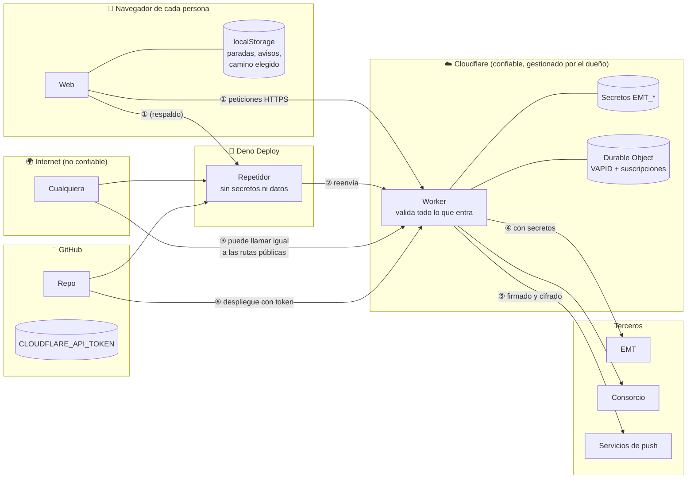
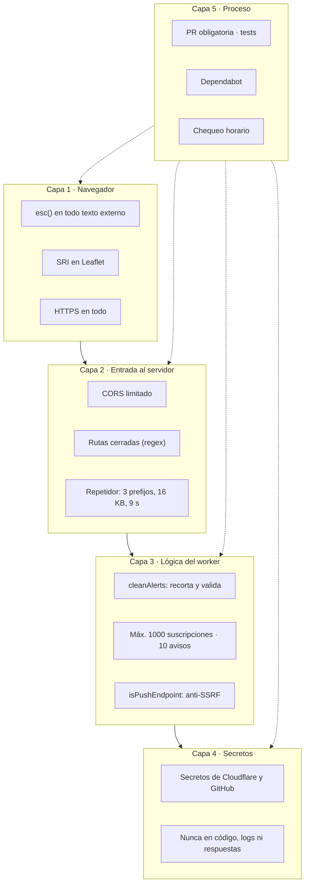
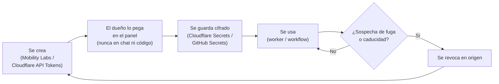

# marquesina: arquitectura de seguridad

Qué hay que proteger en marquesina, de quién, cómo está protegido y qué riesgos quedan. Escrito como lo haría un arquitecto de seguridad, explicando cada concepto para quien empieza.

- Resumen corto y cómo avisar de un fallo: [SECURITY.md](../SECURITY.md)
- Operación del servicio: [OPERACIONES.md](OPERACIONES.md)

---

## Índice

1. [Conceptos en 2 minutos](#1-conceptos-en-2-minutos)
2. [Qué hay que proteger (activos)](#2-qué-hay-que-proteger-activos)
3. [Fronteras de confianza y flujos de datos](#3-fronteras-de-confianza-y-flujos-de-datos)
4. [Modelo de amenazas (STRIDE)](#4-modelo-de-amenazas-stride)
5. [Controles, uno por uno](#5-controles-uno-por-uno)
6. [Ciclo de vida de los secretos](#6-ciclo-de-vida-de-los-secretos)
7. [Cuentas y accesos](#7-cuentas-y-accesos)
8. [Cadena de suministro](#8-cadena-de-suministro)
9. [Privacidad](#9-privacidad)
10. [Riesgos que quedan y recomendaciones](#10-riesgos-que-quedan-y-recomendaciones)
11. [Revisión de seguridad periódica](#11-revisión-de-seguridad-periódica)

---

## 1. Conceptos en 2 minutos

| Término | Qué significa |
|---|---|
| **Activo** | Algo valioso que hay que proteger: una clave, un dato, el propio servicio |
| **Amenaza** | Algo malo que podría pasarle a un activo |
| **Superficie de ataque** | Todo lo que un atacante puede tocar desde fuera (direcciones, formularios, rutas) |
| **Frontera de confianza** | La línea donde los datos pasan de un sitio que controlas a otro que no (por ejemplo, del navegador de cualquiera a tu servidor) |
| **Mínimo privilegio** | Dar a cada pieza solo los permisos que necesita, nada más |
| **Defensa en profundidad** | Varias capas de protección, para que si falla una queden las demás |
| **STRIDE** | Lista de 6 tipos de amenaza: **S**uplantación, **T**ampering (manipulación), **R**epudio, **I**nformación revelada, **D**enegación de servicio, **E**levación de privilegios |
| **CORS** | Regla del navegador: una web solo puede leer respuestas de otra si esa otra lo permite |
| **XSS** | Colar código en una página a través de un texto que la página muestra sin limpiarlo |
| **SRI** | Huella de un archivo externo: si el archivo cambia, el navegador no lo ejecuta |
| **SSRF** | Engañar a un servidor para que haga peticiones a sitios que no debería |

---

## 2. Qué hay que proteger (activos)

| Activo | Dónde está | Valor para un atacante | Impacto si se compromete |
|---|---|---|---|
| Claves de EMT (`EMT_CLIENT_ID`, `EMT_PASSKEY`) | Secretos del worker | Usar la API de EMT en nombre de marquesina | EMT podría bloquear la aplicación → sin datos de EMT |
| Cuenta de EMT (`EMT_EMAIL`, `EMT_PASSWORD`) | Secretos del worker | Igual, y entrar en la cuenta de Mobility Labs | Ídem, más acceso a la cuenta |
| Token de despliegue (`CLOUDFLARE_API_TOKEN`) | Secreto de GitHub | **Publicar código propio en el worker** de cualquier zona de la cuenta | Crítico: podría servir código malicioso desde `api.bendi.dev` |
| Clave privada VAPID | Durable Object | Enviar notificaciones a los suscriptores | Notificaciones falsas |
| Suscripciones de avisos | Durable Object | Direcciones de entrega de notificaciones | Bajo (no identifican a nadie por sí solas) |
| DNS de `bendi.dev` | Cloudflare + Porkbun | Redirigir la web o `api.bendi.dev` a otro sitio | Crítico: suplantar la web |
| Código fuente | GitHub | Meter código malicioso en `main` | Crítico: se publica solo |
| Disponibilidad del servicio | Cloudflare, GitHub, Deno | Tirarlo o agotar los límites gratuitos | Medio |
| Paradas y avisos de cada persona | Su navegador | Poco | Bajo |

---

## 3. Fronteras de confianza y flujos de datos

**Fronteras (líneas que cruzan los datos):**

| # | Frontera | Riesgo principal | Control |
|---|---|---|---|
| ① | Navegador → worker / repetidor | Datos manipulados, abuso | Rutas cerradas, validación (`cleanAlerts`), límites, CORS |
| ② | Repetidor → worker | Que el repetidor sirva para otra cosa | Solo 3 prefijos de ruta, 2 destinos fijos, 16 KB |
| ③ | Cualquiera → worker | Uso de las rutas sin pasar por la web | Rutas de solo lectura de datos públicos; límites de suscripciones |
| ④ | Worker → EMT | Exponer credenciales | Secretos fuera del código; errores sin claves |
| ⑤ | Worker → push | SSRF, notificaciones falsas | Solo endpoints de push conocidos; firma VAPID |
| ⑥ | GitHub → Cloudflare | Despliegue malicioso | Solo desde `main` vía PR; token como secreto |

---

## 4. Modelo de amenazas (STRIDE)

| Componente | Amenaza | Tipo | Probabilidad | Impacto | Control actual | Riesgo |
|---|---|---|---|---|---|---|
| Worker | Robar las claves de EMT | I | Baja | Alto | Secretos de Cloudflare; nunca se devuelven en respuestas ni errores | 🟢 Bajo |
| Worker | Usarlo como proxy abierto hacia cualquier web | T/E | Media | Medio | Rutas fijas; en `/crtm/` solo `Get*.php`; destinos fijos | 🟢 Bajo |
| Worker | Que otra web lo use desde el navegador | S | Media | Bajo | CORS solo para `bendi.dev` y `serbenda.github.io` | 🟢 Bajo |
| Worker | Agotar el límite gratuito con peticiones masivas | D | Media | Medio | Caché de 10 s; Cloudflare filtra ataques grandes | 🟡 Medio (no hay límite por IP) |
| Worker / avisos | Llenar el almacenamiento con suscripciones falsas | D | Baja | Medio | Máximo 1000 suscripciones y 10 avisos; validación de cada campo | 🟢 Bajo |
| Worker / avisos | Usar `/push/test` para enviar peticiones a cualquier URL | T (SSRF) | Baja | Medio | `isPushEndpoint`: solo Google, Mozilla, Apple y Microsoft por HTTPS | 🟢 Bajo |
| Worker / avisos | Borrar la suscripción de otra persona | T | Muy baja | Bajo | Hace falta conocer su endpoint exacto (secreto de su navegador) | 🟢 Bajo |
| Repetidor | Usarlo como proxy abierto | T/E | Media | Medio | Solo `/crtm/`, `/emt/`, `/push/` hacia 2 destinos fijos; 16 KB; 9 s | 🟢 Bajo |
| Web | XSS con nombres de parada o líneas | T/E | Baja | Medio | Todo texto externo pasa por `esc()` | 🟢 Bajo |
| Web | Leaflet manipulado en el CDN | T | Muy baja | Alto | **SRI** en el CSS y el JS de Leaflet | 🟢 Bajo |
| Web | Fuentes de Google manipuladas | T | Muy baja | Bajo | Solo CSS y fuentes, no código | 🟢 Bajo |
| Despliegue | Robo del token de Cloudflare | E | Baja | **Crítico** | Secreto de GitHub, solo usado en `worker.yml` | 🟡 Medio (token con *All zones*) |
| Repo | Cambio malicioso en `main` | T | Baja | **Crítico** | Norma de PR; solo el dueño fusiona | 🟡 Medio (sin protección de rama configurada) |
| DNS | Secuestro de `bendi.dev` | S | Baja | **Crítico** | Cuentas de Cloudflare y Porkbun del dueño | 🟡 Medio (revisar 2FA, §7) |
| Avisos | Notificación falsa | S | Muy baja | Bajo | Solo el worker tiene la clave privada VAPID | 🟢 Bajo |
| Todo | No saber quién cambió algo | R | Baja | Bajo | Historial de Git, PR y registros de Actions | 🟢 Bajo |

---

## 5. Controles, uno por uno

| Control | Dónde | Qué evita |
|---|---|---|
| `corsHeaders()` | `worker.js`, `relay/relay.js` | Que otras webs lean las respuestas |
| Expresiones regulares de ruta | `worker.js` (`/crtm/stop/…`, `Get[A-Za-z]+\.php`, `/emt/arrives/\d{1,6}`, …) | Proxy abierto, inyección en rutas |
| `ROUTE`, `MAX_BODY`, `TIMEOUT_MS` | `relay/relay.js` | Proxy abierto, cuerpos enormes, peticiones colgadas |
| `cleanAlerts()` | `worker.js` | Datos basura o maliciosos en el almacenamiento |
| `MAX_SUBSCRIPTIONS`, `MAX_ALERTS` | `worker.js` | Llenar el Durable Object |
| `isPushEndpoint()` | `push.js` | SSRF a través de los avisos |
| `subId()` (SHA-256 del endpoint) | `worker.js` | Guardar el endpoint como clave legible |
| `esc()` | `logic.js` | XSS |
| `integrity=` (SRI) | `index.html` | Leaflet manipulado |
| `keep_vars = true` | `wrangler.toml` | Que un despliegue borre los secretos |
| Mensajes de error sin credenciales | `emtLogin()` | Filtrar claves en errores |

---

## 6. Ciclo de vida de los secretos

| Secreto | Se crea en | Se guarda en | Lo usa | Cómo rotarlo |
|---|---|---|---|---|
| `EMT_CLIENT_ID`, `EMT_PASSKEY` | Mobility Labs → aplicación `marquesina` | Cloudflare → worker → *Variables and Secrets* | `emtLogin()` | Regenerar en Mobility Labs → sustituir en Cloudflare ([MANTENIMIENTO §1.5](MANTENIMIENTO.md)) |
| `EMT_EMAIL`, `EMT_PASSWORD` | Mobility Labs → cuenta | Igual | `emtLogin()` (respaldo) | Cambiar la contraseña → sustituir |
| `CLOUDFLARE_API_TOKEN` | Cloudflare → *My Profile* → *API Tokens* | GitHub → *Settings* → *Secrets and variables* → *Actions* | `worker.yml` | Crear uno nuevo → sustituir en GitHub → borrar el viejo |
| Clave VAPID | El propio worker, la primera vez | Durable Object (`vapid`) | `sendPush()` | No rotar salvo fuga: invalidaría todas las suscripciones |

**Reglas:** nunca en el código, en un issue, en una PR, en un chat ni en una captura. Los paneles no dejan volver a leer un secreto, solo sustituirlo.

---

## 7. Cuentas y accesos

| Cuenta | Qué controla | Riesgo si se pierde | Recomendación |
|---|---|---|---|
| GitHub `serbenda` | Código, despliegues, secreto de Cloudflare | Crítico | Comprobar que el 2FA está activado; revisar sesiones y apps autorizadas |
| Cloudflare | Worker, avisos, DNS de `bendi.dev` | Crítico | Comprobar que el 2FA está activado |
| Porkbun | Propiedad del dominio | Crítico | **Activar 2FA** (Porkbun lo sugiere en el panel); renovación automática |
| Mobility Labs | Acceso a datos de EMT | Medio | Contraseña única |
| Deno Deploy | Repetidor | Bajo (no tiene secretos) | Entra con GitHub: hereda su 2FA |

**Mínimo privilegio aplicado:**
- La app de GitHub de Deno Deploy tiene acceso **solo** al repo `marquesina`.
- El token de Cloudflare usa la plantilla *Edit Cloudflare Workers*. Tiene *All zones* porque lo necesita para crear `api.bendi.dev`; se podría limitar a la zona `bendi.dev`.

---

## 8. Cadena de suministro

| Dependencia | Tipo | Riesgo | Control |
|---|---|---|---|
| Paquetes npm | — | **Ninguno**: el proyecto no tiene dependencias | `package.json` sin `dependencies` |
| Leaflet 1.9.4 (cdnjs) | Script en el navegador | Manipulación en el CDN | SRI; versión fijada |
| Google Fonts | Hojas de estilo y fuentes | Bajo | — |
| Acciones de GitHub (`checkout`, `wrangler-action`…) | Ejecutan en CI con acceso a secretos | Medio | Versiones fijadas por número mayor; Dependabot avisa |
| wrangler | Lo instala `wrangler-action` en CI | Medio | Versión gestionada por la acción |
| Runtime de Cloudflare y Deno | Plataforma | Bajo | Proveedores grandes |

---

## 9. Privacidad

| Dato | Se recoge | Dónde | Cuánto tiempo |
|---|---|---|---|
| Paradas, nombres, minutos andando | Sí | Solo en el navegador | Hasta que la persona lo borre |
| Ubicación | Solo al pulsar **Cerca de mí** | Se envía para buscar paradas; no se guarda asociada a nadie | La lista de paradas de la zona se cachea 1 día (redondeada a ~100 m) |
| Avisos activados | Sí | Durable Object | Hasta que se desactiven o caduque la suscripción |
| Dirección de entrega de notificaciones | Sí | Durable Object (clave = hash) | Igual |
| IP, navegador | Registros técnicos de Cloudflare, GitHub y Deno | Sus sistemas | Según cada proveedor |
| Cuentas, cookies, analítica | **No** | — | — |

---

## 10. Riesgos que quedan y recomendaciones

| # | Riesgo | Recomendación | Esfuerzo | Prioridad |
|---|---|---|---|---|
| 1 | Cualquiera puede cambiar `main` si consigue la cuenta de GitHub, y no hay protección técnica de rama | Activar *branch protection* en `main`: PR obligatoria y *Tests* en verde | Bajo | Alta |
| 2 | Porkbun sin 2FA (lo sugiere su propio panel) | Activar 2FA | Bajo | Alta |
| 3 | Token de Cloudflare con *All zones* | Limitarlo a la zona `bendi.dev` | Bajo | Media |
| 4 | Sin límite de peticiones por IP | *Rate limiting* de Cloudflare o un contador en el worker | Medio | Media |
| 5 | Sin cabeceras de seguridad (CSP) en la web | Añadir una política CSP con `<meta http-equiv>` (GitHub Pages no permite cabeceras propias) | Medio | Baja |
| 6 | PR de Dependabot pendientes (#19–#23) | Revisarlas una a una (cambios de versión mayor) | Bajo | Media |
| 7 | La clave VAPID no tiene copia | Asumido: perderla solo obliga a reactivar avisos | — | — |

---

## 11. Revisión de seguridad periódica

Cada pocos meses:

- [ ] 2FA activo en GitHub, Cloudflare y Porkbun.
- [ ] Cloudflare → *API Tokens*: solo los tokens que se usan; ninguno caducado ni sobrante.
- [ ] GitHub → *Settings* → *Applications*: solo las apps necesarias (Deno Deploy con acceso solo a `marquesina`).
- [ ] Ningún secreto en el repo: buscar `passKey`, `password` y `token` en el código.
- [ ] PR de Dependabot revisadas.
- [ ] Huellas SRI de Leaflet al día si se cambia de versión.
- [ ] Revisar en Cloudflare *Metrics* si hay picos raros de tráfico.
- [ ] Mobility Labs: la aplicación sigue activa y sin uso extraño.
