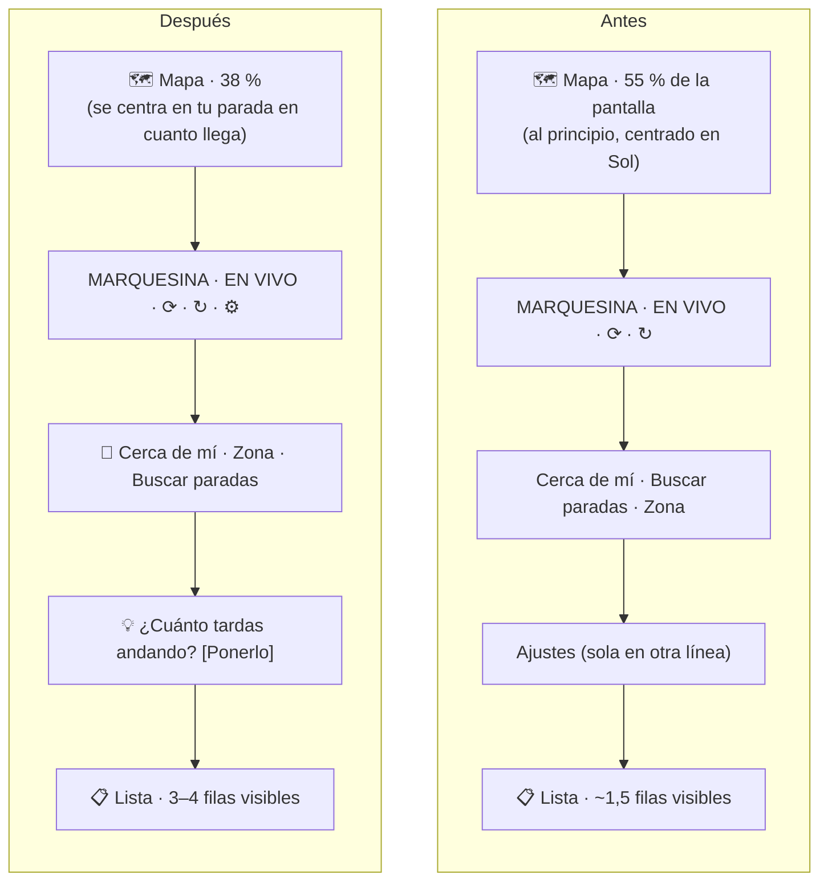

# marquesina: revisión de experiencia de uso (UX)

Revisión hecha el 2 de noviembre de 2026 sobre la web publicada, en un móvil de 375 × 812 px (el tamaño de un iPhone mini o un Android pequeño), en tema claro y oscuro. Para cada hallazgo se indica el principio de usabilidad que incumple, lo que se ha cambiado y lo que queda.

> **Principios usados** (heurísticas de Nielsen, resumidas): ① que se vea qué está pasando · ② hablar el idioma de quien la usa · ③ control y libertad · ④ coherencia · ⑤ evitar errores · ⑥ reconocer antes que recordar · ⑦ eficiencia · ⑧ diseño sobrio · ⑨ ayudar a salir de los errores · ⑩ ayuda. Más la accesibilidad (WCAG 2.2) y las guías de tamaño de botones de Apple (44 pt) y Google (48 dp).

---

## 1. Lo que se ve al abrir, antes y después

---

## 2. Hallazgos

| # | Hallazgo | Principio | Gravedad | Estado |
|---|---|---|---|---|
| 1 | **La web no arrancaba** tras una publicación para quien ya la había usado: se quedaba en *Cargando…* para siempre, sin explicación | ①⑨ | 🔴 Crítica | ✅ Arreglado (INC-8): archivos siempre nuevos y aviso con **Recargar** a los 15 s |
| 2 | **Tocar *Editar* a veces no hacía nada.** La lista se redibujaba entera cada segundo y el botón desaparecía bajo el dedo | ③⑤ | 🔴 Alta | ✅ Solo se redibuja si algo cambia |
| 3 | **El mapa ocupaba el 55 %** y la lista, lo que de verdad se mira, solo enseñaba fila y media | ⑦⑧ | 🟠 Alta | ✅ Mapa 38 % / lista 62 % en el móvil |
| 4 | **Al abrir, el mapa enseñaba la Puerta del Sol** durante unos segundos, aunque tus paradas estuvieran en Alcobendas | ①④ | 🟠 Media | ✅ Se centra en la primera parada que llega |
| 5 | **Barra de botones en dos líneas** (*Ajustes* sola abajo): ruido y menos espacio para la lista | ⑧ | 🟠 Media | ✅ Una fila (se desliza si no cabe); *Ajustes* pasa a icono ⚙ |
| 6 | **Botones pequeños:** 31 px de alto, y *Editar* 24 px; por debajo de los 44 px recomendados | Accesibilidad | 🟠 Media | ✅ 40 px (36 px *Editar*) |
| 7 | **Destinos en MAYÚSCULAS y cortados** (*SAN SEBASTIÁN DE LOS R…*): se leen peor y se pierde información | ②⑧ | 🟠 Media | ✅ *San Sebastián de los Reyes (Tempranales)*, en dos líneas (`prettyName`) |
| 8 | **Lo más útil, "Sal en X min", no se descubre:** solo aparece si pones los minutos andando, y nada lo sugiere | ⑥⑩ | 🟠 Media | ✅ Pista: *¿Cuánto tardas andando a…? [Ponerlo]* hasta que haya alguna parada con minutos |
| 9 | ***luego 77′*:** el símbolo ′ no todo el mundo lo lee como minutos | ② | 🟡 Baja | ✅ *luego 14 y 26 min* |
| 10 | **Textos de 11–12 px** (subtítulos, etiquetas) | Accesibilidad | 🟡 Baja | ✅ Mínimo 12–13 px |
| 11 | **La etiqueta *En vivo* y los avisos no se anunciaban** a los lectores de pantalla | Accesibilidad | 🟡 Baja | ✅ `role="status"` y `aria-live` |
| 12 | **El anillo con un número** (segundos hasta actualizar) no se entiende sin explicación | ① | 🟡 Baja | ⏳ Pendiente (ver §4) |
| 13 | **La primera búsqueda en una zona tarda** hasta 10 s | ① | 🟡 Baja | ✅ Desde #29: *Buscando paradas…* con ruedita |
| 14 | **Seguridad:** el nombre de la parada iba sin escapar en la ventanita del mapa | — | 🟡 Baja | ✅ Escapado con `esc()` |

---

## 3. Lo que funciona bien (y no hay que tocar)

- **La información clave se ve de un vistazo:** número de línea con su color, destino y minutos en grande.
- **Los estados son honestos:** *Según horario* frente a *En directo (GPS)*, *Sin datos nuevos · son de hace N min*, *+20*.
- **Funciona sin registrarse** y recuerda tus paradas.
- **Tema claro y oscuro** automáticos, con buen contraste.
- **La bienvenida** lleva a algo útil en un toque (*Usar mi ubicación*).

---

## 4. Siguientes mejoras propuestas

Por orden de impacto para quien la usa:

| Prioridad | Mejora | Por qué | Esfuerzo |
|---|---|---|---|
| 1 | **Lista arrastrable sobre el mapa** (*bottom sheet*), como en Google Maps o Citymapper | Quien quiere el mapa lo despliega; quien solo quiere minutos, no lo ve | Medio |
| 2 | **Una sola acción "+ Añadir parada"** que abra *Cerca de mí / Elegir municipio / Buscar en el mapa* | Tres botones con nombres parecidos confunden; una pregunta es más clara | Bajo |
| 3 | **"Actualizado hace 5 s"** en lugar del anillo con número, y un toque para actualizar | Se entiende sin explicación | Bajo |
| 4 | **Reordenar paradas** arrastrándolas, y **ocultar** las que no usas a ciertas horas | Por la mañana importa la del cole; por la tarde, otra | Medio |
| 5 | **Vista "en marcha"** solo con el aviso grande de *Sal en X min*, para la pantalla de bloqueo o un widget | Es lo que se mira con prisa | Alto |
| 6 | **Vibración o sonido** opcional cuando falta 1 min para salir, con la app abierta | Complementa los avisos | Bajo |
| 7 | **Modo de alto contraste** y textos un punto más grandes, opcionales en Ajustes | Personas mayores, al sol | Bajo |

---

## 5. Cómo se ha probado

- Capturas reales en la web publicada (móvil de 375 px, tema oscuro) y capturas locales del código nuevo, en tema claro y oscuro, con datos reales guardados.
- La *Prueba en navegador* (`e2e.yml`) comprueba en cada PR que la web arranca sin errores de JavaScript, busca paradas, funciona con Cloudflare bloqueado y abre enlaces compartidos.
- Pendiente: probarlo con 3–5 personas reales (por ejemplo, en la puerta del cole) y anotar dónde dudan.
